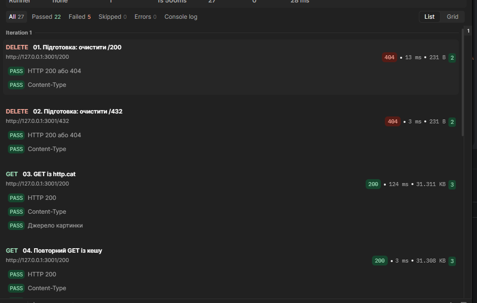
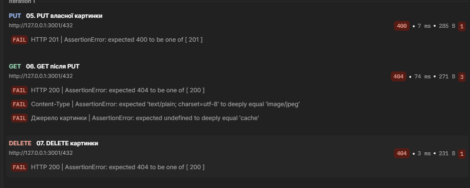
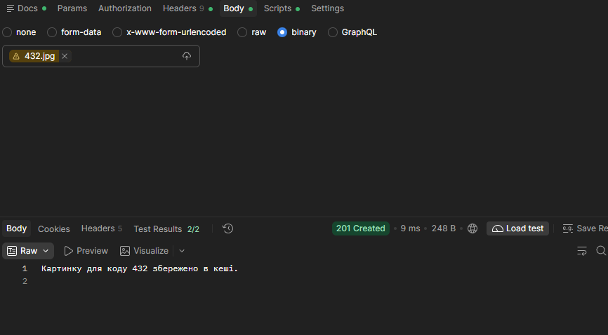
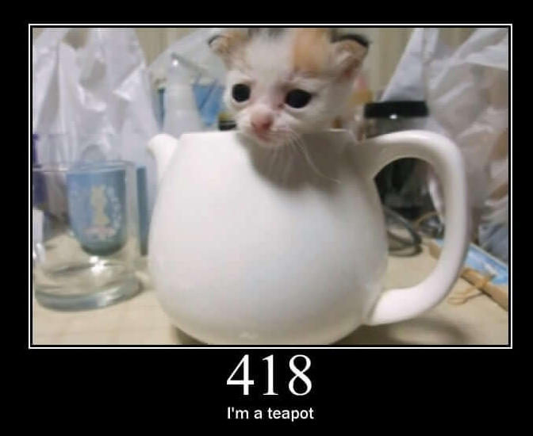

# Звіт до лабораторної роботи № 5

**Створення найпростішого кешуючого проксі-сервера на Node.js на базі модуля http**

Заклад освіти: **[вказати]**

Факультет / кафедра: **[вказати]**

Дисципліна: **Вебпрограмування на стороні сервера**

Виконав: **Олег Меленюк**

Група: **[вказати]**

Перевірив: **[ПІБ викладача]**

Рік: **2026**

> Номер роботи в наданій методичці — 5. Суфікс Git-імені `lab6` використано за окремою вимогою методички.

## Стан матеріалів

Реалізація GET, PUT і DELETE, перевірки помилок та експорт колекції готові. Успішне проходження Postman після вибору binary-файла підтверджене користувачем у розмові. Наявні знімки початкового невдалого запуску, успішного ручного PUT та картинки /418.

**Перед здачею потрібно доповнити:** реквізити титульної сторінки, версію Postman, GitHub URL, знімки підсумків двох успішних запусків Runner та їхні вимірювання часу. Ці відсутні дані не замінено вигаданими результатами.

## 1. Мета та завдання

Реалізувати HTTP-сервер-посередник, який отримує JPEG-зображення з http.cat, зберігає їх на диску й обслуговує повторні запити з кешу. Реалізувати завантаження власного зображення та видалення кешованого файла. Асинхронні операції виконувати через проміси та async/await.

Обов'язкові аргументи: `-h, --host`, `-p, --port`, `-c, --cache`. Головний файл — `main.js`; прямі сторонні залежності — лише `commander` та `superagent`. HTTP-сервер використовує `http`, файлові операції — `fs/promises`.

## 2. Середовище

| Component | Version |
|---|---|
| Node.js | v24.22.1 |
| npm | 11.19.1 |
| commander | 15.1.0 |
| superagent | 10.4.2 |
| Windows | Microsoft Windows NT 10.0.26300.0 |
| PowerShell | 5.1.26100.9711 |

Версія Postman: **[вказати з інтерфейсу Postman]**. Не слід підміняти її версією Node.js, колекції або розширення іншого редактора.

## 3. Репозиторій і структура

GitHub-репозиторій: **[додати URL]**. Під час підготовки звіту `git remote -v` не містив записів; публікацію не підтверджено.

Локальне ім'я Git до першого коміту встановлено командою:

```powershell
git config --local user.name "Олег Меленюк lab6"
```

Вивід `git log --oneline` перед комітом зі звітом (уже містить щонайменше 8 змістовних комітів):

```text
c88c662 test: add Postman collection and verify request sequence
977a7da fix: preserve cache integrity and verify error handling
ff17dd0 feat: implement DELETE and add custom photo assets
3f1c16b feat: implement PUT image upload
93db738 feat: implement GET with disk cache
5ea2760 feat: add HTTP server and request validation
3a9fdd7 feat: configure CLI and cache directory
bb536b0 chore: prepare npm project
```

Структура основних файлів:

```text
main.js                         сервер
package.json                    налаштування npm і залежності
package-lock.json               зафіксоване дерево залежностей
.gitignore                      виключення з Git
cati.jpg                        оригінальне власне фото
output/custom/432.jpg            власне фото з рамкою для PUT
output/custom/README.md          опис підготовки фото
scripts/verify-errors.ps1        перевірки помилок та цілісності
scripts/README.md               пояснення цих перевірок
postman/lab5.postman_collection.json  експорт колекції
postman/check-sequence.ps1       перевірка порядку запитів через curl
postman/README.md                інструкція Postman
report/REPORT.md                 зібраний звіт із повними додатками
report/REPORT.template.md        редагований текст звіту
report/evidence/                 надані знімки екрана
scripts/build-report.ps1         відтворюване складання звіту
test.txt                        локальний журнал команд і результатів
cache/                          робочі картинки, виключено з Git
test-output/                    тестові кеші й артефакти, виключено з Git
```

Тека `node_modules/` та кеш не потрапляють до Git. `package-lock.json` дозволяє відтворити встановлення через `npm.cmd ci`. Для довільного шляху `--cache` всередині репозиторію треба також додати відповідне виключення; у цій роботі використовуються `cache/` і `test-output/`.

**Узгодження з вимогами:** за попереднім проханням користувача `test.txt`, `test.md` і `PLAN.md` виключені з Git. Методичка окремо вимагає `test.txt` у корені репозиторію. Повний журнал включено в додаток цього звіту, але це не замінює вимогу наявності файла в Git; перед фінальною здачею потрібно узгодити його повернення. Додаткові картинки кролів залишаються локальними та не потрібні для роботи сервера.

## 4. Обґрунтування реалізації

### 4.1. CLI та запуск

`commander.requiredOption()` перевіряє наявність трьох аргументів. `-h` означає host, тому довідка винесена на `--help`. Порт приймається лише як десяткове ціле число 1–65535; відхиляються дроби, текст і значення поза діапазоном. Порожні host та cache також відхиляються. Значення за замовчуванням не задано, оскільки опції обов'язкові.

Перед `listen(port, options.host)` виконується `await mkdir(..., { recursive: true })`. Це створює вкладені теки та допускає повторний запуск. Використання `type: module` дозволяє top-level await. На сервері немає `.then()`, `.catch()`, `.on()`, колбека listen або синхронних файлових API.

### 4.2. Шлях і відповіді

Спочатку перевіряється HTTP-метод, потім початковий `request.url`. Дозволений шлях має форму `/100`–`/599`. Запити з `../`, закодованими символами, додатковими сегментами або query-параметрами відхиляються. Альтернатива — нормалізувати URL; для одного числового ідентифікатора обрано строгий формат, щоб явно контролювати ім'я файла.

Файл кешу має ім'я `<код>.jpg`. Зображення `/404` є звичайним ресурсом: якщо його отримано, статус відповіді проксі — 200. Число в URL не є статусом поточної відповіді.

| Ситуація | Статус |
|---|---:|
| Успішний GET або DELETE | 200 |
| Створення або заміна через PUT | 201 |
| Неправильний шлях, порожній PUT | 400 |
| Помилка джерела або відсутній файл при DELETE | 404 |
| Недозволений метод | 405 та Allow: GET, PUT, DELETE |
| PUT понад 20 MiB | 413 |
| Інша помилка диска чи обробки запиту | 500 |

`sendText()` формує текстові відповіді з `text/plain; charset=utf-8`. Помилки обробки перехоплюються в async-обробнику createServer. Технічна причина записується в консоль, клієнт отримує зрозумілий текст. Якщо відповідь уже почалася або клієнт від'єднався, надіслати новий статус неможливо — з'єднання завершується.

### 4.3. GET і джерело

Спочатку виконується `readFile()` без кодування: результат — Buffer. Лише ENOENT означає промах кешу. При інших файлових помилках сервер повертає 500, а не маскує проблему зверненням до джерела.

При промаху виконується `await superagent.get(...).responseType('blob')`. У Node.js це дає Buffer. Встановлено таймаути 5 секунд до початку відповіді й 15 секунд на весь запит. Перед записом перевіряються image/jpeg та непорожнє двійкове тіло; повне декодування JPEG не виконується. Картинка зберігається перед відповіддю клієнтові.

Успішний GET має `Content-Type: image/jpeg` і `X-Image-Source: http.cat` або `cache`. Помилка superagent, включно з таймаутом чи відсутністю картинки, дає 404 без запису кешу за вимогою методички. Помилка запису кешу дає 500. Альтернатива 502 для збою зовнішнього сервера тут не застосована через умови завдання.

### 4.4. PUT і незмінність байтів

Тіло HTTP-запиту надходить потоком. `for await...of` очікує його частини, а `Buffer.concat()` об'єднує їх без перетворення на текст. Рядкове накопичення могло б пошкодити JPEG.

Порожнє тіло відхиляється до запису. Межа — 20 MiB на один PUT. Після перевищення межі частини більше не зберігаються в пам'яті; потік дочитується, після чого повертається 413. Передчасний вихід з асинхронного ітератора може зруйнувати сокет, тому обрано дочитування. При розриві з'єднання до кінця тіла запис не починається.

Створення й заміна повертають 201 відповідно до методички. Клієнт має надсилати JPEG, бо GET оголошує image/jpeg. Сервер зберігає непорожні байти без перекодування; він не доводить, що довільне тіло є коректним зображенням.

### 4.5. Запис і конкурентні запити

Прямий writeFile у кешований файл виявився недостатнім: у тесті до виправлення 6 із 10 паралельних GET отримали порожній або неповний файл.

Тепер `saveImage()` створює унікальну тимчасову теку всередині кешу через mkdtemp, записує файл повністю й замінює цільовий файл через rename. Тимчасові файли й теки прибираються у finally. Дані не обрізаються на початку запису.

На Windows конкурентна заміна одного файла іноді давала EPERM. Тому Map `activeRequests` зберігає проміс поточного запиту для кожного коду. Наступний запит цього коду очікує завершення попереднього. Різні коди можуть оброблятися паралельно. Допоміжні async-функції викликаються напряму, не передаються як колбеки.

Альтернативи: глобальна черга надмірно блокувала б різні картинки; лише тимчасовий файл не усунув усіх конфліктів Windows. Поточна черга діє лише в одному процесі; кілька незалежних серверів зі спільним кешем не координуються.

### 4.6. DELETE

`await unlink()` видаляє лише файл заданого коду. Попередня перевірка існування не потрібна, бо стан міг би змінитися між перевіркою й видаленням. ENOENT дає 404, успіх — 200, інші помилки — 500.

DELETE не звертається до джерела. Подальший GET може знову завантажити картинку. Повторний DELETE має інший статус, але однаковий кінцевий стан — файла немає; це пояснює ідемпотентність методу.

## 5. Перевірки через PowerShell і curl

Команди використовують `curl.exe`, щоб уникнути псевдоніма Invoke-WebRequest у Windows PowerShell. Тестові сервери працювали в окремих кешах; користувацький робочий кеш не очищався.

| Етап | Фактично перевірено | Результат |
|---|---|---|
| 1 | Залежності, синтаксис і запуск заглушки | Успішно |
| 2 | 20 запусків CLI | Очікувані коди завершення |
| 3 | 25 HTTP-запитів: URL, 405, тимчасові заглушки | Успішно на тому етапі |
| 4 | 10 HTTP-запитів GET; SHA-256 прямого джерела, кешу та відповіді | Збіг байтів |
| 5 | 14 запитів PUT, заміна, chunked, порожнє тіло, помилка диска | Успішно |
| 6 | 15 запитів DELETE та суміжних сценаріїв | Успішно |
| 7 | 50 HTTP-запитів і 148 перевірок після виправлень | 0 невідповідностей |
| 8 | 2 проходи по 11 запитів колекції через curl | 0 невідповідностей |
| 9 | Повторні 22 запити після отримання експорту Postman | 0 невідповідностей |

Заглушки 501 з етапу 3 належать історії розробки; у фінальному коді GET, PUT і DELETE реалізовані.

На етапі 7 перевірено неправильні шляхи, відсутність і недоступність джерела, 503, HTML або порожній JPEG замість картинки, таймаут, помилки читання/заміни/видалення, перервані та завеликі PUT, паралельні запити й незмінність байтів. Для відтворюваних збоїв URL джерела замінювався **лише в окремій тестовій копії main.js** на локальний тестовий сервер. Ці перевірки не є доказом збою реального http.cat; робочий код продовжує використовувати http.cat.

```powershell
npm.cmd run check
powershell.exe -NoProfile -ExecutionPolicy Bypass -File .\scripts\verify-errors.ps1
powershell.exe -NoProfile -ExecutionPolicy Bypass -File .\postman\check-sequence.ps1 -Port 32162
```

ExecutionPolicy Bypass діє лише для запущеного процесу PowerShell. Повні команди, відповіді, невдалі спроби й причини виправлень наведені в додатку В; успіх не приписано перерваним запускам.

## 6. Postman і браузер

Колекція містить 11 послідовних запитів: два підготовчі DELETE, перший GET, повторний GET, PUT власного фото, GET після PUT, DELETE, повторний DELETE, GET відсутньої картинки, POST та фінальний DELETE. Вісім обов'язкових сценаріїв покрито. Адресу й порт винесено в `baseUrl`.

Кожен запит перевіряє статус і Content-Type. GET додатково перевіряє X-Image-Source; помилковий GET очікує відсутність цього заголовка. POST перевіряє Allow. Post-response скрипти використовують pm.test у середовищі Postman; це окремий тестовий код, не колбек-інтерфейс Node.js-сервера.

Підготовчі DELETE та завершальне очищення роблять два запуски відтворюваними. Перший GET /200 знову має йти до джерела в кожному запуску. Жорсткої перевірки часу немає: мережеві затримки не є сталою величиною.

### Фактично надані результати

Початковий Runner-запуск мав 22 успішні й 5 невдалих перевірок. На знімку видно GET із джерела 124 мс та GET із кешу 3 мс.



Причина п'яти невдач — PUT без переданого binary-файла: 400 замість 201; після цього GET та DELETE не могли знайти картинку.



Після вибору файла ручний PUT повернув 201 і 2/2 успішні тести. На знімку його час — 9 мс.



Користувач повідомив про успішне виконання колекції та наявність повторного запуску. **Підсумкові скриншоти двох успішних Runner-запусків ще треба додати сюди.** Очікувана кількість тестів — 27, але зображень остаточних лічильників у наданих матеріалах немає.

| Успішний Runner-запуск | GET із джерела, мс | GET із кешу, мс | Знімок підсумків |
|---|---|---|---|
| 1 | [внести] | [внести] | [додати] |
| 2 | [внести] | [внести] | [додати] |

Окремі автоматичні вимірювання curl наведено нижче. Вони не підміняють вимірювання Postman:

| Серія curl | Запуск | Джерело, мс | Кеш, мс |
|---|---:|---:|---:|
| Підготовлена колекція | 1 | 153,455 | 2,384 |
| Підготовлена колекція | 2 | 70,215 | 2,007 |
| Експортована колекція | 1 | 148,180 | 3,202 |
| Експортована колекція | 2 | 104,746 | 3,487 |

Наданий користувачем знімок картинки /418 підтверджує її візуальне відображення:



Для PUT використовується `output/custom/432.jpg`: власне фото з підписом і рамкою. Рамку додано за допомогою imagegen; оригінал cati.jpg збережено. Сам сервер картинки не генерує й не редагує. Кролі для /200 і /404 також були завантажені через PUT у робочий кеш; вони не змінюють джерело http.cat і не використовувалися замість початкового GET у чистому тестовому кеші.

## 7. Висновки та обмеження

Реалізовано проксі з дисковим кешем та трьома HTTP-методами. У наведених вимірюваннях читання кешу займало приблизно 2–3,5 мс, звернення до джерела — приблизно 70–153 мс. Це спостереження для конкретних запусків, а не гарантія швидкості для будь-якого середовища.

Перевірка SHA-256 підтвердила незмінність двійкових даних при GET і PUT. Виявлення неповних відповідей при конкурентному записі обґрунтувало тимчасові файли та послідовне обслуговування одного коду. Після виправлення фінальні перевірки пройшли без невідповідностей.

Кеш може застаріти, якщо картинку змінять на http.cat: автоматичного строку придатності немає. PUT може замінити картинку довільними байтами, а повної перевірки JPEG немає. Великі або повільні одночасні завантаження все ще потребують контролю ресурсів; ліміт 20 MiB не є глобальним лімітом пам'яті. Черга працює в одному процесі. Аварійне завершення може залишити тимчасову теку; стійкість до вимкнення живлення не перевірялася.

Можливі подальші вдосконалення: строк придатності кешу, перевірка формату JPEG, обмеження кількості одночасних завантажень і тривалості повільного PUT, очищення залишених тимчасових тек. Ці можливості не заявляються реалізованими.

**Власні додаткові спостереження студента:** [доповнити після двох успішних Runner-запусків і усної підготовки].

## 8. Короткі тези для захисту

1. Сервер має роль reverse proxy до фіксованого джерела: клієнт звертається до нашої адреси, а ми визначаємо джерело.
2. Cache hit — файл знайдено на диску; cache miss — потрібне завантаження. Кеш економить зовнішні запити, але може застаріти.
3. GET читає, PUT створює/замінює ресурс за відомим URL, DELETE видаляє. PUT і DELETE ідемпотентні за кінцевим станом; статуси повторних запитів можуть різнитися.
4. Content-Type описує формат тіла. JPEG передається як Buffer, текстове повідомлення — як UTF-8. Неправильний заголовок може завадити відображенню.
5. Проміс може бути pending, fulfilled або rejected. await очікує результат; відхилення обробляється try/catch.
6. Тіло запиту є потоком: частини приходять поступово. Асинхронний ітератор дозволяє читати їх без .on('data').
7. superagent із await повертає відповідь або кидає помилку. Помилка зовнішнього запиту за методичкою перетворюється на 404.
8. Послідовний доступ одного коду запобігає конфліктам GET/PUT/DELETE. Це не блокування для всіх процесів ОС.
9. Postman-колекція зберігає запити, змінні та тести; Runner виконує їх у визначеному порядку.
10. 405 супроводжується Allow. 500 означає внутрішню помилку, а 413 — перевищення допустимого розміру тіла.

## Джерела

- Надана методичка `test.md` — вимоги до лабораторної роботи.
- [Node.js fs/promises](https://nodejs.org/api/fs.html) — файлові операції з промісами.
- [SuperAgent](https://forwardemail.github.io/superagent/) — запити та обробка відповіді.
- [Postman: тести](https://learning.postman.com/docs/tests-and-scripts/write-scripts/test-scripts/) — Post-response і Runner.
- [Postman: робоча тека](https://learning.postman.com/docs/getting-started/installation/settings/working-directory) — відносні шляхи binary-файлів.

## Додаток А. package.json і .gitignore

### package.json

```json
{
  "name": "lab5",
  "version": "1.0.0",
  "description": "Кешуючий проксі-сервер для зображень http.cat",
  "type": "module",
  "main": "main.js",
  "scripts": {
    "start": "node main.js",
    "check": "node --check main.js"
  },
  "private": true,
  "dependencies": {
    "commander": "^15.1.0",
    "superagent": "^10.4.2"
  }
}
```

### .gitignore

```gitignore
node_modules/
cache/
.idea/
test-output/
*.log
PLAN.md
test.txt
test.md
```

## Додаток Б. Повний main.js

```javascript
import { Command } from 'commander';
import superagent from 'superagent';
import http from 'node:http';
import { mkdir, mkdtemp, readFile, writeFile, rename, unlink, rmdir } from 'node:fs/promises';

const MAX_IMAGE_BYTES = 20 * 1024 * 1024;

const program = new Command();

program
  .name('main.js')
  .description('Кешуючий проксі-сервер для зображень http.cat')
  // -h зарезервовано для host згідно з методичкою.
  .helpOption('--help', 'показати довідку')
  .requiredOption('-h, --host <address>', 'адреса сервера')
  .requiredOption('-p, --port <number>', 'порт сервера (1–65535)')
  .requiredOption('-c, --cache <path>', 'шлях до теки кешу');

program.parse();

const options = program.opts();
const port = Number(options.port);

if (!/^\d+$/.test(options.port) || !Number.isInteger(port) || port < 1 || port > 65535) {
  program.error('Порт має бути цілим числом від 1 до 65535.');
}

if (options.host.trim().length === 0) {
  program.error('Адреса сервера не може бути порожньою.');
}

if (options.cache.trim().length === 0) {
  program.error('Шлях до теки кешу не може бути порожнім.');
}

function sendText(response, statusCode, message, headers = {}) {
  response.writeHead(statusCode, {
    'Content-Type': 'text/plain; charset=utf-8',
    ...headers,
  });
  response.end(message + '\n');
}

async function saveImage(cacheFile, image) {
  // Унікальна тека всередині кешу: тимчасовий файл на тій самій файловій системі.
  const temporaryDirectory = await mkdtemp(`${options.cache}/.write-`);
  const temporaryFile = `${temporaryDirectory}/image.jpg`;

  try {
    await writeFile(temporaryFile, image);
    // GET бачить попередній або новий повний файл, а не частково записані байти.
    await rename(temporaryFile, cacheFile);
  } finally {
    try {
      await unlink(temporaryFile);
    } catch (error) {
      // Після успішного rename тимчасового файла вже немає.
      if (error.code !== 'ENOENT') {
        throw error;
      }
    }
    await rmdir(temporaryDirectory);
  }
}

const activeRequests = new Map();

async function handleImageRequest(request, response, code, cacheFile) {
  if (request.method === 'GET') {
    let image;
    let source = 'cache';

    try {
      // Без кодування readFile повертає Buffer із незміненими байтами.
      image = await readFile(cacheFile);
    } catch (error) {
      // Лише відсутність файлу означає промах кешу.
      if (error.code !== 'ENOENT') {
        throw error;
      }

      try {
        const upstream = await superagent
          .get(`https://http.cat/${code}`)
          .responseType('blob')
          .timeout({ response: 5000, deadline: 15000 });

        // У Node.js responseType('blob') повертає двійковий Buffer.
        if (upstream.type !== 'image/jpeg' || !Buffer.isBuffer(upstream.body) || upstream.body.length === 0) {
          throw new Error('Джерело не повернуло JPEG-зображення.');
        }

        image = upstream.body;
      } catch (error) {
        console.error(`Помилка http.cat для коду ${code}: ${error.message}`);
        sendText(response, 404, 'Картинку не знайдено або джерело http.cat недоступне.');
        return;
      }

      // Спочатку зберігаємо картинку, потім відповідаємо клієнтові.
      // Помилки диска обробляє зовнішній catch як 500, а не як 404 джерела.
      await saveImage(cacheFile, image);
      source = 'http.cat';
    }

    response.writeHead(200, {
      'Content-Type': 'image/jpeg',
      'X-Image-Source': source,
    });
    response.end(image);
    return;
  }

  if (request.method === 'PUT') {
    const chunks = [];
    let receivedBytes = 0;

    // request є потоком: очікуємо всі частини тіла без колбеків .on().
    for await (const chunk of request) {
      receivedBytes += chunk.length;
      if (receivedBytes <= MAX_IMAGE_BYTES) {
        chunks.push(chunk);
      } else {
        // Дочитуємо потік без накопичення, щоб коректно надіслати 413.
        chunks.length = 0;
      }
    }

    if (receivedBytes > MAX_IMAGE_BYTES) {
      sendText(response, 413, 'Картинка завелика. Максимальний розмір — 20 MiB.');
      return;
    }

    const image = Buffer.concat(chunks);
    if (image.length === 0) {
      sendText(response, 400, 'Тіло PUT-запиту не може бути порожнім. Надішліть картинку.');
      return;
    }

    await saveImage(cacheFile, image);
    sendText(response, 201, `Картинку для коду ${code} збережено в кеші.`);
    return;
  }

  if (request.method === 'DELETE') {
    try {
      // Видаляємо лише файл цього коду; попередня перевірка існування не потрібна.
      await unlink(cacheFile);
    } catch (error) {
      if (error.code === 'ENOENT') {
        sendText(response, 404, 'Картинку не знайдено в кеші.');
        return;
      }
      throw error;
    }

    sendText(response, 200, `Картинку для коду ${code} видалено з кешу.`);
    return;
  }
}

try {
  // Створюємо також батьківські теки; наявна тека не є помилкою.
  await mkdir(options.cache, { recursive: true });
  console.log(`Тека кешу готова: ${options.cache}`);

  const server = http.createServer(async (request, response) => {
    try {
      if (!['GET', 'PUT', 'DELETE'].includes(request.method)) {
        sendText(response, 405, 'Метод не дозволено. Використовуйте GET, PUT або DELETE.', {
          Allow: 'GET, PUT, DELETE',
        });
        return;
      }

      // Перевіряємо початковий URL без нормалізації: лише /100 ... /599.
      if (!/^\/[1-5]\d{2}$/.test(request.url)) {
        sendText(response, 400, 'Некоректний шлях. Очікується /<код> від /100 до /599.');
        return;
      }

      const code = request.url.slice(1);
      const cacheFile = `${options.cache}/${code}.jpg`;

      // Один код обробляємо послідовно, щоб уникнути гонок GET/PUT/DELETE.
      while (activeRequests.has(code)) {
        try {
          await activeRequests.get(code);
        } catch {
          // Помилку попереднього запиту обробляє його власний обробник.
        }
      }

      const operation = handleImageRequest(request, response, code, cacheFile);
      activeRequests.set(code, operation);
      try {
        await operation;
      } finally {
        activeRequests.delete(code);
      }
    } catch (error) {
      console.error(`Помилка обробки запиту: ${error.message}`);
      if (!response.headersSent && !response.destroyed) {
        sendText(response, 500, 'Внутрішня помилка сервера.');
      } else {
        // Якщо відповідь уже почалася, надіслати інший статус неможливо.
        response.destroy();
      }
    }
  });

  server.listen(port, options.host);
  console.log(`Запуск HTTP-сервера: host=${options.host}, port=${port}`);
} catch (error) {
  console.error(`Помилка підготовки сервера: ${error.message}`);
  process.exitCode = 1;
}
```

## Додаток В. Повний локальний test.txt

Журнал є історичним: він містить проміжні заглушки, невдалі спроби та перевірки попередніх версій. Це не перелік лише успішних тестів фінального коду. Вміст включено повністю на момент складання звіту.

```text
Етап 1 — підготовка проєкту
Оболонка: Windows PowerShell 5.1.26100.9711
ОС: Microsoft Windows NT 10.0.26300.0
Команди нижче виконано в корені проєкту. Результати фактичні.

node --version
# v24.22.1

npm.cmd --version
# 11.19.1

npm.cmd install commander superagent
# added 43 packages, and audited 44 packages in 2s
# found 0 vulnerabilities (результат npm під час встановлення)

npm.cmd ls --depth=0
# lab5@1.0.0
# commander@15.1.0
# superagent@10.4.2

npm.cmd run check
# Виконано node --check main.js; синтаксичних помилок не виведено.

npm.cmd start
# Проєкт підготовлено. HTTP-сервер ще не реалізовано.

git config --local user.name "Олег Меленюк lab6"
git config --local --get user.name
# Олег Меленюк lab6

git rm --cached -- .idea/.gitignore index.js
# Прибрано з індексу початкові записи IDE та заміненого index.js.
# Локальний файл .idea/.gitignore збережено.

git check-ignore node_modules/ cache/ .idea/ test-output/
# node_modules/
# cache/
# .idea/
# test-output/

git diff --check
# Помилок пробілів немає; Git попередив про майбутню заміну LF на CRLF у package.json.

HTTP-методи, curl.exe, Postman і браузер на цьому етапі НЕ перевірялися.
Перед окремими комітами GET, PUT, DELETE та обробки недозволених методів
сюди буде додано виконані команди curl.exe і фактичні результати.

Етап 2 — CLI та створення кешу
Перевірки виконано у Windows PowerShell. HTTP-сервер ще не реалізований.
npm.cmd run check
# node --check main.js: синтаксичних помилок немає.
git diff --check
# Помилок пробілів немає; попередження Git про LF -> CRLF.

node main.js '--help'
# Usage: main.js [options]
#
# Кешуючий проксі-сервер для зображень http.cat
#
# Options:
#   -h, --host <address>  адреса сервера
#   -p, --port <number>   порт сервера (1–65535)
#   -c, --cache <path>    шлях до теки кешу
#   --help                показати довідку
# Exit code: 0; expected: 0

node main.js
# error: required option '-h, --host <address>' not specified
# Exit code: 1; expected: 1

node main.js '-p' '3000' '-c' './test-output/stage2-b3a16feaee3c4040adf365ff2ce3f037/cache with spaces/nested'
# error: required option '-h, --host <address>' not specified
# Exit code: 1; expected: 1

node main.js '-h' '127.0.0.1' '-c' './test-output/stage2-b3a16feaee3c4040adf365ff2ce3f037/cache with spaces/nested'
# error: required option '-p, --port <number>' not specified
# Exit code: 1; expected: 1

node main.js '-h' '127.0.0.1' '-p' '3000'
# error: required option '-c, --cache <path>' not specified
# Exit code: 1; expected: 1

node main.js '-h' '127.0.0.1' '-p' 'abc' '-c' './test-output/stage2-b3a16feaee3c4040adf365ff2ce3f037/cache with spaces/nested'
# Порт має бути цілим числом від 1 до 65535.
# Exit code: 1; expected: 1

node main.js '-h' '127.0.0.1' '-p' '3000abc' '-c' './test-output/stage2-b3a16feaee3c4040adf365ff2ce3f037/cache with spaces/nested'
# Порт має бути цілим числом від 1 до 65535.
# Exit code: 1; expected: 1

node main.js '-h' '127.0.0.1' '-p' '1.5' '-c' './test-output/stage2-b3a16feaee3c4040adf365ff2ce3f037/cache with spaces/nested'
# Порт має бути цілим числом від 1 до 65535.
# Exit code: 1; expected: 1

node main.js '-h' '127.0.0.1' '-p' '0' '-c' './test-output/stage2-b3a16feaee3c4040adf365ff2ce3f037/cache with spaces/nested'
# Порт має бути цілим числом від 1 до 65535.
# Exit code: 1; expected: 1

node main.js '-h' '127.0.0.1' '-p' '-1' '-c' './test-output/stage2-b3a16feaee3c4040adf365ff2ce3f037/cache with spaces/nested'
# Порт має бути цілим числом від 1 до 65535.
# Exit code: 1; expected: 1

node main.js '-h' '127.0.0.1' '-p' '65536' '-c' './test-output/stage2-b3a16feaee3c4040adf365ff2ce3f037/cache with spaces/nested'
# Порт має бути цілим числом від 1 до 65535.
# Exit code: 1; expected: 1

node main.js '-h' '127.0.0.1' '-p' '1e3' '-c' './test-output/stage2-b3a16feaee3c4040adf365ff2ce3f037/cache with spaces/nested'
# Порт має бути цілим числом від 1 до 65535.
# Exit code: 1; expected: 1

node main.js '-h' '127.0.0.1' '-p' '0x50' '-c' './test-output/stage2-b3a16feaee3c4040adf365ff2ce3f037/cache with spaces/nested'
# Порт має бути цілим числом від 1 до 65535.
# Exit code: 1; expected: 1

node main.js '-h' ' ' '-p' '3000' '-c' './test-output/stage2-b3a16feaee3c4040adf365ff2ce3f037/cache with spaces/nested'
# Адреса сервера не може бути порожньою.
# Exit code: 1; expected: 1

node main.js '-h' '127.0.0.1' '-p' '3000' '-c' ' '
# Шлях до теки кешу не може бути порожнім.
# Exit code: 1; expected: 1

Test-Path -LiteralPath './test-output/stage2-b3a16feaee3c4040adf365ff2ce3f037/cache with spaces/nested'
# Before valid launch: False
node main.js '--host' '127.0.0.1' '--port' '3000' '--cache' './test-output/stage2-b3a16feaee3c4040adf365ff2ce3f037/cache with spaces/nested'
# Тека кешу готова: ./test-output/stage2-b3a16feaee3c4040adf365ff2ce3f037/cache with spaces/nested
# Параметри сервера: host=127.0.0.1, port=3000
# HTTP-сервер ще не реалізовано.
# Exit code: 0; expected: 0

Test-Path -LiteralPath './test-output/stage2-b3a16feaee3c4040adf365ff2ce3f037/cache with spaces/nested' -PathType Container
# After valid launch: True
node main.js '-h' '127.0.0.1' '-p' '3000' '-c' './test-output/stage2-b3a16feaee3c4040adf365ff2ce3f037/cache with spaces/nested'
# Тека кешу готова: ./test-output/stage2-b3a16feaee3c4040adf365ff2ce3f037/cache with spaces/nested
# Параметри сервера: host=127.0.0.1, port=3000
# HTTP-сервер ще не реалізовано.
# Exit code: 0; expected: 0

node main.js '-h' '127.0.0.1' '-p' '1' '-c' './test-output/stage2-b3a16feaee3c4040adf365ff2ce3f037/cache with spaces/nested'
# Тека кешу готова: ./test-output/stage2-b3a16feaee3c4040adf365ff2ce3f037/cache with spaces/nested
# Параметри сервера: host=127.0.0.1, port=1
# HTTP-сервер ще не реалізовано.
# Exit code: 0; expected: 0

node main.js '-h' '127.0.0.1' '-p' '65535' '-c' './test-output/stage2-b3a16feaee3c4040adf365ff2ce3f037/cache with spaces/nested'
# Тека кешу готова: ./test-output/stage2-b3a16feaee3c4040adf365ff2ce3f037/cache with spaces/nested
# Параметри сервера: host=127.0.0.1, port=65535
# HTTP-сервер ще не реалізовано.
# Exit code: 0; expected: 0

node main.js '-h' '127.0.0.1' '-p' '3000' '-c' './package.json'
# Не вдалося створити теку кешу "./package.json": EEXIST: file already exists, mkdir 'C:\Users\omele\OneDrive - lnu.edu.ua\web  програмування на стороні сервера\lab5\package.json'
# Exit code: 1; expected: 1

# Перевірка теки: до коректного запуску = False; після = True.
# Кількість невідповідностей очікуваним результатам: 0
# HTTP-методи не перевірялися: це етап підготовки CLI.


Етап 3 — HTTP-сервер, URL і 405
npm.cmd run check
# Синтаксичних помилок немає.
git diff --check
# Помилок пробілів немає; Git попередив про LF -> CRLF.
New-Item -ItemType Directory -Path './test-output/stage3-d24cbd48d00e4f04abff1b8c3577888a' | Out-Null
$stageServer = Start-Process -FilePath (Get-Command node).Source -ArgumentList @('main.js', '-h', '127.0.0.1', '-p', '32153', '-c', './test-output/stage3-d24cbd48d00e4f04abff1b8c3577888a/cache') -WindowStyle Hidden -PassThru -RedirectStandardOutput './test-output/stage3-d24cbd48d00e4f04abff1b8c3577888a/server.log' -RedirectStandardError './test-output/stage3-d24cbd48d00e4f04abff1b8c3577888a/server-errors.log'
Start-Sleep -Milliseconds 800
Test-Path -LiteralPath './test-output/stage3-d24cbd48d00e4f04abff1b8c3577888a/cache' -PathType Container
# True
curl.exe '--silent' '--show-error' '--include' '--max-time' '5' '--path-as-is' '--noproxy' '*' '--request' 'GET' 'http://127.0.0.1:32153/200'
# HTTP/1.1 501 Not Implemented
# Content-Type: text/plain; charset=utf-8
# Date: Sun, 08 Nov 2026 11:31:40 GMT
# Connection: keep-alive
# Keep-Alive: timeout=5
# Transfer-Encoding: chunked
#
# Метод GET ще не реалізовано.
# curl exit code: 0; expected HTTP: 501; passed: True

curl.exe '--silent' '--show-error' '--include' '--max-time' '5' '--path-as-is' '--noproxy' '*' '--request' 'PUT' 'http://127.0.0.1:32153/200'
# HTTP/1.1 501 Not Implemented
# Content-Type: text/plain; charset=utf-8
# Date: Sun, 08 Nov 2026 11:31:40 GMT
# Connection: keep-alive
# Keep-Alive: timeout=5
# Transfer-Encoding: chunked
#
# Метод PUT ще не реалізовано.
# curl exit code: 0; expected HTTP: 501; passed: True

curl.exe '--silent' '--show-error' '--include' '--max-time' '5' '--path-as-is' '--noproxy' '*' '--request' 'DELETE' 'http://127.0.0.1:32153/200'
# HTTP/1.1 501 Not Implemented
# Content-Type: text/plain; charset=utf-8
# Date: Sun, 08 Nov 2026 11:31:40 GMT
# Connection: keep-alive
# Keep-Alive: timeout=5
# Transfer-Encoding: chunked
#
# Метод DELETE ще не реалізовано.
# curl exit code: 0; expected HTTP: 501; passed: True

curl.exe '--silent' '--show-error' '--include' '--max-time' '5' '--path-as-is' '--noproxy' '*' '--request' 'POST' 'http://127.0.0.1:32153/200'
# HTTP/1.1 405 Method Not Allowed
# Content-Type: text/plain; charset=utf-8
# Allow: GET, PUT, DELETE
# Date: Sun, 08 Nov 2026 11:31:40 GMT
# Connection: keep-alive
# Keep-Alive: timeout=5
# Transfer-Encoding: chunked
#
# Метод не дозволено. Використовуйте GET, PUT або DELETE.
# curl exit code: 0; expected HTTP: 405; passed: True

curl.exe '--silent' '--show-error' '--include' '--max-time' '5' '--path-as-is' '--noproxy' '*' '--request' 'PATCH' 'http://127.0.0.1:32153/200'
# HTTP/1.1 405 Method Not Allowed
# Content-Type: text/plain; charset=utf-8
# Allow: GET, PUT, DELETE
# Date: Sun, 08 Nov 2026 11:31:40 GMT
# Connection: keep-alive
# Keep-Alive: timeout=5
# Transfer-Encoding: chunked
#
# Метод не дозволено. Використовуйте GET, PUT або DELETE.
# curl exit code: 0; expected HTTP: 405; passed: True

curl.exe '--silent' '--show-error' '--include' '--max-time' '5' '--path-as-is' '--noproxy' '*' '--request' 'OPTIONS' 'http://127.0.0.1:32153/200'
# HTTP/1.1 405 Method Not Allowed
# Content-Type: text/plain; charset=utf-8
# Allow: GET, PUT, DELETE
# Date: Sun, 08 Nov 2026 11:31:40 GMT
# Connection: keep-alive
# Keep-Alive: timeout=5
# Transfer-Encoding: chunked
#
# Метод не дозволено. Використовуйте GET, PUT або DELETE.
# curl exit code: 0; expected HTTP: 405; passed: True

curl.exe '--silent' '--show-error' '--include' '--max-time' '5' '--path-as-is' '--noproxy' '*' '--head' 'http://127.0.0.1:32153/200'
# HTTP/1.1 405 Method Not Allowed
# Content-Type: text/plain; charset=utf-8
# Allow: GET, PUT, DELETE
# Date: Sun, 08 Nov 2026 11:31:40 GMT
# Connection: keep-alive
# Keep-Alive: timeout=5
#
# curl exit code: 0; expected HTTP: 405; passed: True

curl.exe '--silent' '--show-error' '--include' '--max-time' '5' '--path-as-is' '--noproxy' '*' '--request' 'POST' 'http://127.0.0.1:32153/bad'
# HTTP/1.1 405 Method Not Allowed
# Content-Type: text/plain; charset=utf-8
# Allow: GET, PUT, DELETE
# Date: Sun, 08 Nov 2026 11:31:40 GMT
# Connection: keep-alive
# Keep-Alive: timeout=5
# Transfer-Encoding: chunked
#
# Метод не дозволено. Використовуйте GET, PUT або DELETE.
# curl exit code: 0; expected HTTP: 405; passed: True

curl.exe '--silent' '--show-error' '--include' '--max-time' '5' '--path-as-is' '--noproxy' '*' '--request' 'GET' 'http://127.0.0.1:32153/'
# HTTP/1.1 400 Bad Request
# Content-Type: text/plain; charset=utf-8
# Date: Sun, 08 Nov 2026 11:31:40 GMT
# Connection: keep-alive
# Keep-Alive: timeout=5
# Transfer-Encoding: chunked
#
# Некоректний шлях. Очікується /<код> від /100 до /599.
# curl exit code: 0; expected HTTP: 400; passed: True

curl.exe '--silent' '--show-error' '--include' '--max-time' '5' '--path-as-is' '--noproxy' '*' '--request' 'GET' 'http://127.0.0.1:32153/abc'
# HTTP/1.1 400 Bad Request
# Content-Type: text/plain; charset=utf-8
# Date: Sun, 08 Nov 2026 11:31:40 GMT
# Connection: keep-alive
# Keep-Alive: timeout=5
# Transfer-Encoding: chunked
#
# Некоректний шлях. Очікується /<код> від /100 до /599.
# curl exit code: 0; expected HTTP: 400; passed: True

curl.exe '--silent' '--show-error' '--include' '--max-time' '5' '--path-as-is' '--noproxy' '*' '--request' 'GET' 'http://127.0.0.1:32153/99'
# HTTP/1.1 400 Bad Request
# Content-Type: text/plain; charset=utf-8
# Date: Sun, 08 Nov 2026 11:31:40 GMT
# Connection: keep-alive
# Keep-Alive: timeout=5
# Transfer-Encoding: chunked
#
# Некоректний шлях. Очікується /<код> від /100 до /599.
# curl exit code: 0; expected HTTP: 400; passed: True

curl.exe '--silent' '--show-error' '--include' '--max-time' '5' '--path-as-is' '--noproxy' '*' '--request' 'GET' 'http://127.0.0.1:32153/600'
# HTTP/1.1 400 Bad Request
# Content-Type: text/plain; charset=utf-8
# Date: Sun, 08 Nov 2026 11:31:40 GMT
# Connection: keep-alive
# Keep-Alive: timeout=5
# Transfer-Encoding: chunked
#
# Некоректний шлях. Очікується /<код> від /100 до /599.
# curl exit code: 0; expected HTTP: 400; passed: True

curl.exe '--silent' '--show-error' '--include' '--max-time' '5' '--path-as-is' '--noproxy' '*' '--request' 'GET' 'http://127.0.0.1:32153/999'
# HTTP/1.1 400 Bad Request
# Content-Type: text/plain; charset=utf-8
# Date: Sun, 08 Nov 2026 11:31:40 GMT
# Connection: keep-alive
# Keep-Alive: timeout=5
# Transfer-Encoding: chunked
#
# Некоректний шлях. Очікується /<код> від /100 до /599.
# curl exit code: 0; expected HTTP: 400; passed: True

curl.exe '--silent' '--show-error' '--include' '--max-time' '5' '--path-as-is' '--noproxy' '*' '--request' 'GET' 'http://127.0.0.1:32153/200/'
# HTTP/1.1 400 Bad Request
# Content-Type: text/plain; charset=utf-8
# Date: Sun, 08 Nov 2026 11:31:40 GMT
# Connection: keep-alive
# Keep-Alive: timeout=5
# Transfer-Encoding: chunked
#
# Некоректний шлях. Очікується /<код> від /100 до /599.
# curl exit code: 0; expected HTTP: 400; passed: True

curl.exe '--silent' '--show-error' '--include' '--max-time' '5' '--path-as-is' '--noproxy' '*' '--request' 'GET' 'http://127.0.0.1:32153/200?x=1'
# HTTP/1.1 400 Bad Request
# Content-Type: text/plain; charset=utf-8
# Date: Sun, 08 Nov 2026 11:31:40 GMT
# Connection: keep-alive
# Keep-Alive: timeout=5
# Transfer-Encoding: chunked
#
# Некоректний шлях. Очікується /<код> від /100 до /599.
# curl exit code: 0; expected HTTP: 400; passed: True

curl.exe '--silent' '--show-error' '--include' '--max-time' '5' '--path-as-is' '--noproxy' '*' '--request' 'GET' 'http://127.0.0.1:32153/200/extra'
# HTTP/1.1 400 Bad Request
# Content-Type: text/plain; charset=utf-8
# Date: Sun, 08 Nov 2026 11:31:40 GMT
# Connection: keep-alive
# Keep-Alive: timeout=5
# Transfer-Encoding: chunked
#
# Некоректний шлях. Очікується /<код> від /100 до /599.
# curl exit code: 0; expected HTTP: 400; passed: True

curl.exe '--silent' '--show-error' '--include' '--max-time' '5' '--path-as-is' '--noproxy' '*' '--request' 'GET' 'http://127.0.0.1:32153/../package.json'
# HTTP/1.1 400 Bad Request
# Content-Type: text/plain; charset=utf-8
# Date: Sun, 08 Nov 2026 11:31:40 GMT
# Connection: keep-alive
# Keep-Alive: timeout=5
# Transfer-Encoding: chunked
#
# Некоректний шлях. Очікується /<код> від /100 до /599.
# curl exit code: 0; expected HTTP: 400; passed: True

curl.exe '--silent' '--show-error' '--include' '--max-time' '5' '--path-as-is' '--noproxy' '*' '--request' 'GET' 'http://127.0.0.1:32153/%2e%2e/package.json'
# HTTP/1.1 400 Bad Request
# Content-Type: text/plain; charset=utf-8
# Date: Sun, 08 Nov 2026 11:31:40 GMT
# Connection: keep-alive
# Keep-Alive: timeout=5
# Transfer-Encoding: chunked
#
# Некоректний шлях. Очікується /<код> від /100 до /599.
# curl exit code: 0; expected HTTP: 400; passed: True

curl.exe '--silent' '--show-error' '--include' '--max-time' '5' '--path-as-is' '--noproxy' '*' '--request' 'GET' 'http://127.0.0.1:32153/%32%30%30'
# HTTP/1.1 400 Bad Request
# Content-Type: text/plain; charset=utf-8
# Date: Sun, 08 Nov 2026 11:31:40 GMT
# Connection: keep-alive
# Keep-Alive: timeout=5
# Transfer-Encoding: chunked
#
# Некоректний шлях. Очікується /<код> від /100 до /599.
# curl exit code: 0; expected HTTP: 400; passed: True

curl.exe '--silent' '--show-error' '--include' '--max-time' '5' '--path-as-is' '--noproxy' '*' '--request' 'GET' 'http://127.0.0.1:32153//200'
# HTTP/1.1 400 Bad Request
# Content-Type: text/plain; charset=utf-8
# Date: Sun, 08 Nov 2026 11:31:40 GMT
# Connection: keep-alive
# Keep-Alive: timeout=5
# Transfer-Encoding: chunked
#
# Некоректний шлях. Очікується /<код> від /100 до /599.
# curl exit code: 0; expected HTTP: 400; passed: True

curl.exe '--silent' '--show-error' '--include' '--max-time' '5' '--path-as-is' '--noproxy' '*' '--request' 'PUT' 'http://127.0.0.1:32153/abc'
# HTTP/1.1 400 Bad Request
# Content-Type: text/plain; charset=utf-8
# Date: Sun, 08 Nov 2026 11:31:40 GMT
# Connection: keep-alive
# Keep-Alive: timeout=5
# Transfer-Encoding: chunked
#
# Некоректний шлях. Очікується /<код> від /100 до /599.
# curl exit code: 0; expected HTTP: 400; passed: True

curl.exe '--silent' '--show-error' '--include' '--max-time' '5' '--path-as-is' '--noproxy' '*' '--request' 'DELETE' 'http://127.0.0.1:32153/abc'
# HTTP/1.1 400 Bad Request
# Content-Type: text/plain; charset=utf-8
# Date: Sun, 08 Nov 2026 11:31:40 GMT
# Connection: keep-alive
# Keep-Alive: timeout=5
# Transfer-Encoding: chunked
#
# Некоректний шлях. Очікується /<код> від /100 до /599.
# curl exit code: 0; expected HTTP: 400; passed: True

curl.exe '--silent' '--show-error' '--include' '--max-time' '5' '--path-as-is' '--noproxy' '*' '--request' 'GET' 'http://127.0.0.1:32153/100'
# HTTP/1.1 501 Not Implemented
# Content-Type: text/plain; charset=utf-8
# Date: Sun, 08 Nov 2026 11:31:40 GMT
# Connection: keep-alive
# Keep-Alive: timeout=5
# Transfer-Encoding: chunked
#
# Метод GET ще не реалізовано.
# curl exit code: 0; expected HTTP: 501; passed: True

curl.exe '--silent' '--show-error' '--include' '--max-time' '5' '--path-as-is' '--noproxy' '*' '--request' 'GET' 'http://127.0.0.1:32153/599'
# HTTP/1.1 501 Not Implemented
# Content-Type: text/plain; charset=utf-8
# Date: Sun, 08 Nov 2026 11:31:40 GMT
# Connection: keep-alive
# Keep-Alive: timeout=5
# Transfer-Encoding: chunked
#
# Метод GET ще не реалізовано.
# curl exit code: 0; expected HTTP: 501; passed: True

curl.exe '--silent' '--show-error' '--include' '--max-time' '5' '--path-as-is' '--noproxy' '*' '--request' 'GET' 'http://127.0.0.1:32153/418'
# HTTP/1.1 501 Not Implemented
# Content-Type: text/plain; charset=utf-8
# Date: Sun, 08 Nov 2026 11:31:40 GMT
# Connection: keep-alive
# Keep-Alive: timeout=5
# Transfer-Encoding: chunked
#
# Метод GET ще не реалізовано.
# curl exit code: 0; expected HTTP: 501; passed: True

# Сервер працює після помилкових запитів: True
# HTTP-перевірок: 25; невідповідностей: 0
# 501 — тимчасова заглушка дозволених методів, їхня реалізація ще попереду.
# Гілку 500 штучно не викликали; її проходження не підтверджено тестом.
Stop-Process -Id $stageServer.Id

Етап 4 — GET із кешуванням
npm.cmd run check
# Синтаксичних помилок немає.
git diff --check
# Помилок пробілів немає; попередження Git LF -> CRLF.
New-Item -ItemType Directory -Path './test-output/stage4-7989ba46c065409a98f777bcf11710fa' | Out-Null
$stageServer = Start-Process -FilePath (Get-Command node).Source -ArgumentList @('main.js', '-h', '127.0.0.1', '-p', '32154', '-c', './test-output/stage4-7989ba46c065409a98f777bcf11710fa/cache') -WindowStyle Hidden -PassThru -RedirectStandardOutput './test-output/stage4-7989ba46c065409a98f777bcf11710fa/server.log' -RedirectStandardError './test-output/stage4-7989ba46c065409a98f777bcf11710fa/server-errors.log'
Start-Sleep -Milliseconds 800
Test-Path -LiteralPath './test-output/stage4-7989ba46c065409a98f777bcf11710fa/cache/200.jpg'
# Before first GET: False
curl.exe '--silent' '--show-error' '--max-time' '25' '--noproxy' '*' '--request' 'GET' '--dump-header' './test-output/stage4-7989ba46c065409a98f777bcf11710fa/first.headers.txt' '--output' './test-output/stage4-7989ba46c065409a98f777bcf11710fa/first.body' 'http://127.0.0.1:32154/200'
Get-Content -LiteralPath './test-output/stage4-7989ba46c065409a98f777bcf11710fa/first.headers.txt'
# HTTP/1.1 200 OK
# Content-Type: image/jpeg
# X-Image-Source: http.cat
# Date: Sun, 08 Nov 2026 11:36:39 GMT
# Connection: keep-alive
# Keep-Alive: timeout=5
# Transfer-Encoding: chunked
#
#
# curl exit code: 0; expected HTTP: 200; expected source: http.cat; passed: True

curl.exe '--silent' '--show-error' '--max-time' '25' '--noproxy' '*' '--request' 'GET' '--dump-header' './test-output/stage4-7989ba46c065409a98f777bcf11710fa/second.headers.txt' '--output' './test-output/stage4-7989ba46c065409a98f777bcf11710fa/second.body' 'http://127.0.0.1:32154/200'
Get-Content -LiteralPath './test-output/stage4-7989ba46c065409a98f777bcf11710fa/second.headers.txt'
# HTTP/1.1 200 OK
# Content-Type: image/jpeg
# X-Image-Source: cache
# Date: Sun, 08 Nov 2026 11:36:39 GMT
# Connection: keep-alive
# Keep-Alive: timeout=5
# Transfer-Encoding: chunked
#
#
# curl exit code: 0; expected HTTP: 200; expected source: cache; passed: True

Get-FileHash -LiteralPath './test-output/stage4-7989ba46c065409a98f777bcf11710fa/first.body', './test-output/stage4-7989ba46c065409a98f777bcf11710fa/second.body', './test-output/stage4-7989ba46c065409a98f777bcf11710fa/cache/200.jpg' -Algorithm SHA256
# first: 0BBF5650EE65C4AF48C69283A6E26B5EA134ACA6C459BAE6DB26BED480E612EF
# second: 0BBF5650EE65C4AF48C69283A6E26B5EA134ACA6C459BAE6DB26BED480E612EF
# cache: 0BBF5650EE65C4AF48C69283A6E26B5EA134ACA6C459BAE6DB26BED480E612EF
# Hashes identical: True
curl.exe '--silent' '--show-error' '--max-time' '25' '--noproxy' '*' '--request' 'GET' '--dump-header' './test-output/stage4-7989ba46c065409a98f777bcf11710fa/cat404.headers.txt' '--output' './test-output/stage4-7989ba46c065409a98f777bcf11710fa/cat404.body' 'http://127.0.0.1:32154/404'
Get-Content -LiteralPath './test-output/stage4-7989ba46c065409a98f777bcf11710fa/cat404.headers.txt'
# HTTP/1.1 200 OK
# Content-Type: image/jpeg
# X-Image-Source: http.cat
# Date: Sun, 08 Nov 2026 11:36:40 GMT
# Connection: keep-alive
# Keep-Alive: timeout=5
# Transfer-Encoding: chunked
#
#
# curl exit code: 0; expected HTTP: 200; expected source: http.cat; passed: True

curl.exe '--silent' '--show-error' '--max-time' '25' '--noproxy' '*' '--request' 'GET' '--dump-header' './test-output/stage4-7989ba46c065409a98f777bcf11710fa/missing.headers.txt' '--output' './test-output/stage4-7989ba46c065409a98f777bcf11710fa/missing.body' 'http://127.0.0.1:32154/432'
Get-Content -LiteralPath './test-output/stage4-7989ba46c065409a98f777bcf11710fa/missing.headers.txt'
# HTTP/1.1 404 Not Found
# Content-Type: text/plain; charset=utf-8
# Date: Sun, 08 Nov 2026 11:36:40 GMT
# Connection: keep-alive
# Keep-Alive: timeout=5
# Transfer-Encoding: chunked
#
#
Get-Content -LiteralPath './test-output/stage4-7989ba46c065409a98f777bcf11710fa/missing.body' -Encoding UTF8
# Картинку не знайдено або джерело http.cat недоступне.
# curl exit code: 0; expected HTTP: 404; expected source: ; passed: True

Test-Path -LiteralPath './test-output/stage4-7989ba46c065409a98f777bcf11710fa/cache/432.jpg'
# Cached missing image: False
New-Item -ItemType Directory -Path './test-output/stage4-7989ba46c065409a98f777bcf11710fa/cache/418.jpg' | Out-Null
# Тека замість файла моделює помилку читання кешу.
curl.exe '--silent' '--show-error' '--max-time' '25' '--noproxy' '*' '--request' 'GET' '--dump-header' './test-output/stage4-7989ba46c065409a98f777bcf11710fa/disk-error.headers.txt' '--output' './test-output/stage4-7989ba46c065409a98f777bcf11710fa/disk-error.body' 'http://127.0.0.1:32154/418'
Get-Content -LiteralPath './test-output/stage4-7989ba46c065409a98f777bcf11710fa/disk-error.headers.txt'
# HTTP/1.1 500 Internal Server Error
# Content-Type: text/plain; charset=utf-8
# Date: Sun, 08 Nov 2026 11:36:40 GMT
# Connection: keep-alive
# Keep-Alive: timeout=5
# Transfer-Encoding: chunked
#
#
Get-Content -LiteralPath './test-output/stage4-7989ba46c065409a98f777bcf11710fa/disk-error.body' -Encoding UTF8
# Внутрішня помилка сервера.
# curl exit code: 0; expected HTTP: 500; expected source: ; passed: True

curl.exe '--silent' '--show-error' '--max-time' '25' '--noproxy' '*' '--request' 'GET' '--dump-header' './test-output/stage4-7989ba46c065409a98f777bcf11710fa/after-errors.headers.txt' '--output' './test-output/stage4-7989ba46c065409a98f777bcf11710fa/after-errors.body' 'http://127.0.0.1:32154/200'
Get-Content -LiteralPath './test-output/stage4-7989ba46c065409a98f777bcf11710fa/after-errors.headers.txt'
# HTTP/1.1 200 OK
# Content-Type: image/jpeg
# X-Image-Source: cache
# Date: Sun, 08 Nov 2026 11:36:40 GMT
# Connection: keep-alive
# Keep-Alive: timeout=5
# Transfer-Encoding: chunked
#
#
# curl exit code: 0; expected HTTP: 200; expected source: cache; passed: True

curl.exe '--silent' '--show-error' '--max-time' '25' '--noproxy' '*' '--request' 'GET' '--dump-header' './test-output/stage4-7989ba46c065409a98f777bcf11710fa/bad-path.headers.txt' '--output' './test-output/stage4-7989ba46c065409a98f777bcf11710fa/bad-path.body' 'http://127.0.0.1:32154/abc'
Get-Content -LiteralPath './test-output/stage4-7989ba46c065409a98f777bcf11710fa/bad-path.headers.txt'
# HTTP/1.1 400 Bad Request
# Content-Type: text/plain; charset=utf-8
# Date: Sun, 08 Nov 2026 11:36:40 GMT
# Connection: keep-alive
# Keep-Alive: timeout=5
# Transfer-Encoding: chunked
#
#
Get-Content -LiteralPath './test-output/stage4-7989ba46c065409a98f777bcf11710fa/bad-path.body' -Encoding UTF8
# Некоректний шлях. Очікується /<код> від /100 до /599.
# curl exit code: 0; expected HTTP: 400; expected source: ; passed: True

curl.exe '--silent' '--show-error' '--max-time' '25' '--noproxy' '*' '--request' 'POST' '--dump-header' './test-output/stage4-7989ba46c065409a98f777bcf11710fa/post.headers.txt' '--output' './test-output/stage4-7989ba46c065409a98f777bcf11710fa/post.body' 'http://127.0.0.1:32154/200'
Get-Content -LiteralPath './test-output/stage4-7989ba46c065409a98f777bcf11710fa/post.headers.txt'
# HTTP/1.1 405 Method Not Allowed
# Content-Type: text/plain; charset=utf-8
# Allow: GET, PUT, DELETE
# Date: Sun, 08 Nov 2026 11:36:40 GMT
# Connection: keep-alive
# Keep-Alive: timeout=5
# Transfer-Encoding: chunked
#
#
Get-Content -LiteralPath './test-output/stage4-7989ba46c065409a98f777bcf11710fa/post.body' -Encoding UTF8
# Метод не дозволено. Використовуйте GET, PUT або DELETE.
# curl exit code: 0; expected HTTP: 405; expected source: ; passed: True

curl.exe '--silent' '--show-error' '--max-time' '25' '--noproxy' '*' '--request' 'PUT' '--dump-header' './test-output/stage4-7989ba46c065409a98f777bcf11710fa/put-stub.headers.txt' '--output' './test-output/stage4-7989ba46c065409a98f777bcf11710fa/put-stub.body' 'http://127.0.0.1:32154/200'
Get-Content -LiteralPath './test-output/stage4-7989ba46c065409a98f777bcf11710fa/put-stub.headers.txt'
# HTTP/1.1 501 Not Implemented
# Content-Type: text/plain; charset=utf-8
# Date: Sun, 08 Nov 2026 11:36:40 GMT
# Connection: keep-alive
# Keep-Alive: timeout=5
# Transfer-Encoding: chunked
#
#
Get-Content -LiteralPath './test-output/stage4-7989ba46c065409a98f777bcf11710fa/put-stub.body' -Encoding UTF8
# Метод PUT ще не реалізовано.
# curl exit code: 0; expected HTTP: 501; expected source: ; passed: True

curl.exe '--silent' '--show-error' '--max-time' '25' '--noproxy' '*' '--request' 'DELETE' '--dump-header' './test-output/stage4-7989ba46c065409a98f777bcf11710fa/delete-stub.headers.txt' '--output' './test-output/stage4-7989ba46c065409a98f777bcf11710fa/delete-stub.body' 'http://127.0.0.1:32154/200'
Get-Content -LiteralPath './test-output/stage4-7989ba46c065409a98f777bcf11710fa/delete-stub.headers.txt'
# HTTP/1.1 501 Not Implemented
# Content-Type: text/plain; charset=utf-8
# Date: Sun, 08 Nov 2026 11:36:40 GMT
# Connection: keep-alive
# Keep-Alive: timeout=5
# Transfer-Encoding: chunked
#
#
Get-Content -LiteralPath './test-output/stage4-7989ba46c065409a98f777bcf11710fa/delete-stub.body' -Encoding UTF8
# Метод DELETE ще не реалізовано.
# curl exit code: 0; expected HTTP: 501; expected source: ; passed: True

# HTTP-перевірок: 10; невідповідностей: 0; сервер працює: True
Stop-Process -Id $stageServer.Id
Get-Content -LiteralPath './test-output/stage4-7989ba46c065409a98f777bcf11710fa/server-errors.log' -Encoding UTF8
# Помилка http.cat для коду 432: Not Found
# Помилка обробки запиту: EISDIR: illegal operation on a directory, read
curl.exe --silent --show-error --location --max-time 20 --dump-header './test-output/stage4-7989ba46c065409a98f777bcf11710fa/direct.headers.txt' --output './test-output/stage4-7989ba46c065409a98f777bcf11710fa/direct.jpg' https://http.cat/200
# curl exit code: 0
Get-Content -LiteralPath './test-output/stage4-7989ba46c065409a98f777bcf11710fa/direct.headers.txt'
# HTTP/1.1 200 OK
# Date: Sun, 08 Nov 2026 11:36:56 GMT
# Content-Type: image/jpeg
# Content-Length: 31128
# Connection: keep-alive
# Server: cloudflare
# last-modified: Thu, 05 Nov 2026 07:21:08 GMT
# etag: "6aec2e64-7998"
# expires: Thu, 31 Dec 2037 23:55:55 GMT
# Cache-Control: max-age=315360000
# Accept-Ranges: bytes
# Age: 2346
# cf-cache-status: HIT
# Nel: {"report_to":"cf-nel","success_fraction":0.0,"max_age":604800}
# Report-To: {"group":"cf-nel","max_age":604800,"endpoints":[{"url":"https://a.nel.cloudflare.com/report/v4?s=GJBEg5KktOGv83hLJ2JYM4RARhRdqcmgyoy2qRfEthr%2BXwA9d2VE0F6IE028jqmhjjS9DzUc9HtgHNhH1vrduHa5lIfL%2BnjsbTKujgXemWY51owovpr8GG9j5w%3D%3D"}]}
# CF-RAY: a5744869686870f5-WAW
# alt-svc: h3=":443"; ma=86400
#
#
Get-FileHash -LiteralPath './test-output/stage4-7989ba46c065409a98f777bcf11710fa/direct.jpg', './test-output/stage4-7989ba46c065409a98f777bcf11710fa/first.body' -Algorithm SHA256
# direct: 0BBF5650EE65C4AF48C69283A6E26B5EA134ACA6C459BAE6DB26BED480E612EF
# proxy: 0BBF5650EE65C4AF48C69283A6E26B5EA134ACA6C459BAE6DB26BED480E612EF
# Hashes identical: True
# DNS-збій і таймаут штучно не моделювалися; перевірено реальний 404 від http.cat для /432.

Етап 5 — PUT створення і заміна картинки
npm.cmd run check
# Синтаксичних помилок немає.
git diff --check
# Помилок пробілів немає; попередження Git LF -> CRLF.
New-Item -ItemType Directory -Path './test-output/stage5-329b8e29cf144240b4f66ba1e353a873' | Out-Null
Copy-Item -LiteralPath './test-output/stage4-7989ba46c065409a98f777bcf11710fa/cat404.body' -Destination './test-output/stage5-329b8e29cf144240b4f66ba1e353a873/upload-large.jpg'
Copy-Item -LiteralPath './test-output/stage4-7989ba46c065409a98f777bcf11710fa/first.body' -Destination './test-output/stage5-329b8e29cf144240b4f66ba1e353a873/upload-small.jpg'
# Тестові JPEG — фактичні картинки /404 і /200, збережені під час етапу 4.
$stageServer = Start-Process -FilePath (Get-Command node).Source -ArgumentList @('main.js', '-h', '127.0.0.1', '-p', '32155', '-c', './test-output/stage5-329b8e29cf144240b4f66ba1e353a873/cache') -WindowStyle Hidden -PassThru -RedirectStandardOutput './test-output/stage5-329b8e29cf144240b4f66ba1e353a873/server.log' -RedirectStandardError './test-output/stage5-329b8e29cf144240b4f66ba1e353a873/server-errors.log'
Start-Sleep -Milliseconds 800
Test-Path -LiteralPath './test-output/stage5-329b8e29cf144240b4f66ba1e353a873/cache/432.jpg'
# Before PUT: False
curl.exe '--silent' '--show-error' '--max-time' '10' '--noproxy' '*' '--request' 'PUT' '--dump-header' './test-output/stage5-329b8e29cf144240b4f66ba1e353a873/create.headers.txt' '--output' './test-output/stage5-329b8e29cf144240b4f66ba1e353a873/create.body' '--header' 'Content-Type: image/jpeg' '--data-binary' '@./test-output/stage5-329b8e29cf144240b4f66ba1e353a873/upload-large.jpg' 'http://127.0.0.1:32155/432'
Get-Content -LiteralPath './test-output/stage5-329b8e29cf144240b4f66ba1e353a873/create.headers.txt'
# HTTP/1.1 201 Created
# Content-Type: text/plain; charset=utf-8
# Date: Sun, 08 Nov 2026 11:42:13 GMT
# Connection: keep-alive
# Keep-Alive: timeout=5
# Transfer-Encoding: chunked
#
#
Get-Content -LiteralPath './test-output/stage5-329b8e29cf144240b4f66ba1e353a873/create.body' -Encoding UTF8
# Картинку для коду 432 збережено в кеші.
# curl exit code: 0; expected HTTP: 201; passed: True

curl.exe '--silent' '--show-error' '--max-time' '10' '--noproxy' '*' '--request' 'GET' '--dump-header' './test-output/stage5-329b8e29cf144240b4f66ba1e353a873/get-created.headers.txt' '--output' './test-output/stage5-329b8e29cf144240b4f66ba1e353a873/get-created.body' 'http://127.0.0.1:32155/432'
Get-Content -LiteralPath './test-output/stage5-329b8e29cf144240b4f66ba1e353a873/get-created.headers.txt'
# HTTP/1.1 200 OK
# Content-Type: image/jpeg
# X-Image-Source: cache
# Date: Sun, 08 Nov 2026 11:42:13 GMT
# Connection: keep-alive
# Keep-Alive: timeout=5
# Transfer-Encoding: chunked
#
#
# curl exit code: 0; expected HTTP: 200; passed: True

Get-FileHash -LiteralPath './test-output/stage5-329b8e29cf144240b4f66ba1e353a873/upload-large.jpg', './test-output/stage5-329b8e29cf144240b4f66ba1e353a873/cache/432.jpg', './test-output/stage5-329b8e29cf144240b4f66ba1e353a873/get-created.body' -Algorithm SHA256
# 9DDB3610B028D2DB2E38027E0D945C0ACAFDF3BF1CE473E06412290A19BCAF08 C:\Users\omele\OneDrive - lnu.edu.ua\web  програмування на стороні сервера\lab5\test-output\stage5-329b8e29cf144240b4f66ba1e353a873\upload-large.jpg
# 9DDB3610B028D2DB2E38027E0D945C0ACAFDF3BF1CE473E06412290A19BCAF08 C:\Users\omele\OneDrive - lnu.edu.ua\web  програмування на стороні сервера\lab5\test-output\stage5-329b8e29cf144240b4f66ba1e353a873\cache\432.jpg
# 9DDB3610B028D2DB2E38027E0D945C0ACAFDF3BF1CE473E06412290A19BCAF08 C:\Users\omele\OneDrive - lnu.edu.ua\web  програмування на стороні сервера\lab5\test-output\stage5-329b8e29cf144240b4f66ba1e353a873\get-created.body
# Hashes identical: True

curl.exe '--silent' '--show-error' '--max-time' '10' '--noproxy' '*' '--request' 'PUT' '--dump-header' './test-output/stage5-329b8e29cf144240b4f66ba1e353a873/replace.headers.txt' '--output' './test-output/stage5-329b8e29cf144240b4f66ba1e353a873/replace.body' '--header' 'Content-Type: image/jpeg' '--data-binary' '@./test-output/stage5-329b8e29cf144240b4f66ba1e353a873/upload-small.jpg' 'http://127.0.0.1:32155/432'
Get-Content -LiteralPath './test-output/stage5-329b8e29cf144240b4f66ba1e353a873/replace.headers.txt'
# HTTP/1.1 201 Created
# Content-Type: text/plain; charset=utf-8
# Date: Sun, 08 Nov 2026 11:42:13 GMT
# Connection: keep-alive
# Keep-Alive: timeout=5
# Transfer-Encoding: chunked
#
#
Get-Content -LiteralPath './test-output/stage5-329b8e29cf144240b4f66ba1e353a873/replace.body' -Encoding UTF8
# Картинку для коду 432 збережено в кеші.
# curl exit code: 0; expected HTTP: 201; passed: True

curl.exe '--silent' '--show-error' '--max-time' '10' '--noproxy' '*' '--request' 'GET' '--dump-header' './test-output/stage5-329b8e29cf144240b4f66ba1e353a873/get-replaced.headers.txt' '--output' './test-output/stage5-329b8e29cf144240b4f66ba1e353a873/get-replaced.body' 'http://127.0.0.1:32155/432'
Get-Content -LiteralPath './test-output/stage5-329b8e29cf144240b4f66ba1e353a873/get-replaced.headers.txt'
# HTTP/1.1 200 OK
# Content-Type: image/jpeg
# X-Image-Source: cache
# Date: Sun, 08 Nov 2026 11:42:13 GMT
# Connection: keep-alive
# Keep-Alive: timeout=5
# Transfer-Encoding: chunked
#
#
# curl exit code: 0; expected HTTP: 200; passed: True

Get-FileHash -LiteralPath './test-output/stage5-329b8e29cf144240b4f66ba1e353a873/upload-small.jpg', './test-output/stage5-329b8e29cf144240b4f66ba1e353a873/cache/432.jpg', './test-output/stage5-329b8e29cf144240b4f66ba1e353a873/get-replaced.body' -Algorithm SHA256
# 0BBF5650EE65C4AF48C69283A6E26B5EA134ACA6C459BAE6DB26BED480E612EF C:\Users\omele\OneDrive - lnu.edu.ua\web  програмування на стороні сервера\lab5\test-output\stage5-329b8e29cf144240b4f66ba1e353a873\upload-small.jpg
# 0BBF5650EE65C4AF48C69283A6E26B5EA134ACA6C459BAE6DB26BED480E612EF C:\Users\omele\OneDrive - lnu.edu.ua\web  програмування на стороні сервера\lab5\test-output\stage5-329b8e29cf144240b4f66ba1e353a873\cache\432.jpg
# 0BBF5650EE65C4AF48C69283A6E26B5EA134ACA6C459BAE6DB26BED480E612EF C:\Users\omele\OneDrive - lnu.edu.ua\web  програмування на стороні сервера\lab5\test-output\stage5-329b8e29cf144240b4f66ba1e353a873\get-replaced.body
# Hashes identical: True

curl.exe '--silent' '--show-error' '--max-time' '10' '--noproxy' '*' '--request' 'PUT' '--dump-header' './test-output/stage5-329b8e29cf144240b4f66ba1e353a873/empty-existing.headers.txt' '--output' './test-output/stage5-329b8e29cf144240b4f66ba1e353a873/empty-existing.body' 'http://127.0.0.1:32155/432'
Get-Content -LiteralPath './test-output/stage5-329b8e29cf144240b4f66ba1e353a873/empty-existing.headers.txt'
# HTTP/1.1 400 Bad Request
# Content-Type: text/plain; charset=utf-8
# Date: Sun, 08 Nov 2026 11:42:13 GMT
# Connection: keep-alive
# Keep-Alive: timeout=5
# Transfer-Encoding: chunked
#
#
Get-Content -LiteralPath './test-output/stage5-329b8e29cf144240b4f66ba1e353a873/empty-existing.body' -Encoding UTF8
# Тіло PUT-запиту не може бути порожнім. Надішліть картинку.
# curl exit code: 0; expected HTTP: 400; passed: True

curl.exe '--silent' '--show-error' '--max-time' '10' '--noproxy' '*' '--request' 'GET' '--dump-header' './test-output/stage5-329b8e29cf144240b4f66ba1e353a873/after-empty.headers.txt' '--output' './test-output/stage5-329b8e29cf144240b4f66ba1e353a873/after-empty.body' 'http://127.0.0.1:32155/432'
Get-Content -LiteralPath './test-output/stage5-329b8e29cf144240b4f66ba1e353a873/after-empty.headers.txt'
# HTTP/1.1 200 OK
# Content-Type: image/jpeg
# X-Image-Source: cache
# Date: Sun, 08 Nov 2026 11:42:13 GMT
# Connection: keep-alive
# Keep-Alive: timeout=5
# Transfer-Encoding: chunked
#
#
# curl exit code: 0; expected HTTP: 200; passed: True

Get-FileHash -LiteralPath './test-output/stage5-329b8e29cf144240b4f66ba1e353a873/upload-small.jpg', './test-output/stage5-329b8e29cf144240b4f66ba1e353a873/cache/432.jpg', './test-output/stage5-329b8e29cf144240b4f66ba1e353a873/after-empty.body' -Algorithm SHA256
# 0BBF5650EE65C4AF48C69283A6E26B5EA134ACA6C459BAE6DB26BED480E612EF C:\Users\omele\OneDrive - lnu.edu.ua\web  програмування на стороні сервера\lab5\test-output\stage5-329b8e29cf144240b4f66ba1e353a873\upload-small.jpg
# 0BBF5650EE65C4AF48C69283A6E26B5EA134ACA6C459BAE6DB26BED480E612EF C:\Users\omele\OneDrive - lnu.edu.ua\web  програмування на стороні сервера\lab5\test-output\stage5-329b8e29cf144240b4f66ba1e353a873\cache\432.jpg
# 0BBF5650EE65C4AF48C69283A6E26B5EA134ACA6C459BAE6DB26BED480E612EF C:\Users\omele\OneDrive - lnu.edu.ua\web  програмування на стороні сервера\lab5\test-output\stage5-329b8e29cf144240b4f66ba1e353a873\after-empty.body
# Hashes identical: True

curl.exe '--silent' '--show-error' '--max-time' '10' '--noproxy' '*' '--request' 'PUT' '--dump-header' './test-output/stage5-329b8e29cf144240b4f66ba1e353a873/empty-new.headers.txt' '--output' './test-output/stage5-329b8e29cf144240b4f66ba1e353a873/empty-new.body' 'http://127.0.0.1:32155/434'
Get-Content -LiteralPath './test-output/stage5-329b8e29cf144240b4f66ba1e353a873/empty-new.headers.txt'
# HTTP/1.1 400 Bad Request
# Content-Type: text/plain; charset=utf-8
# Date: Sun, 08 Nov 2026 11:42:13 GMT
# Connection: keep-alive
# Keep-Alive: timeout=5
# Transfer-Encoding: chunked
#
#
Get-Content -LiteralPath './test-output/stage5-329b8e29cf144240b4f66ba1e353a873/empty-new.body' -Encoding UTF8
# Тіло PUT-запиту не може бути порожнім. Надішліть картинку.
# curl exit code: 0; expected HTTP: 400; passed: True

Test-Path -LiteralPath './test-output/stage5-329b8e29cf144240b4f66ba1e353a873/cache/434.jpg'
# Empty PUT created a file: False
curl.exe '--silent' '--show-error' '--max-time' '10' '--noproxy' '*' '--request' 'PUT' '--dump-header' './test-output/stage5-329b8e29cf144240b4f66ba1e353a873/chunked.headers.txt' '--output' './test-output/stage5-329b8e29cf144240b4f66ba1e353a873/chunked.body' '--header' 'Content-Type: image/jpeg' '--data-binary' '@./test-output/stage5-329b8e29cf144240b4f66ba1e353a873/upload-small.jpg' '--header' 'Transfer-Encoding: chunked' 'http://127.0.0.1:32155/433'
Get-Content -LiteralPath './test-output/stage5-329b8e29cf144240b4f66ba1e353a873/chunked.headers.txt'
# HTTP/1.1 201 Created
# Content-Type: text/plain; charset=utf-8
# Date: Sun, 08 Nov 2026 11:42:13 GMT
# Connection: keep-alive
# Keep-Alive: timeout=5
# Transfer-Encoding: chunked
#
#
Get-Content -LiteralPath './test-output/stage5-329b8e29cf144240b4f66ba1e353a873/chunked.body' -Encoding UTF8
# Картинку для коду 433 збережено в кеші.
# curl exit code: 0; expected HTTP: 201; passed: True

curl.exe '--silent' '--show-error' '--max-time' '10' '--noproxy' '*' '--request' 'GET' '--dump-header' './test-output/stage5-329b8e29cf144240b4f66ba1e353a873/get-chunked.headers.txt' '--output' './test-output/stage5-329b8e29cf144240b4f66ba1e353a873/get-chunked.body' 'http://127.0.0.1:32155/433'
Get-Content -LiteralPath './test-output/stage5-329b8e29cf144240b4f66ba1e353a873/get-chunked.headers.txt'
# HTTP/1.1 200 OK
# Content-Type: image/jpeg
# X-Image-Source: cache
# Date: Sun, 08 Nov 2026 11:42:13 GMT
# Connection: keep-alive
# Keep-Alive: timeout=5
# Transfer-Encoding: chunked
#
#
# curl exit code: 0; expected HTTP: 200; passed: True

Get-FileHash -LiteralPath './test-output/stage5-329b8e29cf144240b4f66ba1e353a873/upload-small.jpg', './test-output/stage5-329b8e29cf144240b4f66ba1e353a873/cache/433.jpg', './test-output/stage5-329b8e29cf144240b4f66ba1e353a873/get-chunked.body' -Algorithm SHA256
# 0BBF5650EE65C4AF48C69283A6E26B5EA134ACA6C459BAE6DB26BED480E612EF C:\Users\omele\OneDrive - lnu.edu.ua\web  програмування на стороні сервера\lab5\test-output\stage5-329b8e29cf144240b4f66ba1e353a873\upload-small.jpg
# 0BBF5650EE65C4AF48C69283A6E26B5EA134ACA6C459BAE6DB26BED480E612EF C:\Users\omele\OneDrive - lnu.edu.ua\web  програмування на стороні сервера\lab5\test-output\stage5-329b8e29cf144240b4f66ba1e353a873\cache\433.jpg
# 0BBF5650EE65C4AF48C69283A6E26B5EA134ACA6C459BAE6DB26BED480E612EF C:\Users\omele\OneDrive - lnu.edu.ua\web  програмування на стороні сервера\lab5\test-output\stage5-329b8e29cf144240b4f66ba1e353a873\get-chunked.body
# Hashes identical: True

New-Item -ItemType Directory -Path './test-output/stage5-329b8e29cf144240b4f66ba1e353a873/cache/418.jpg' | Out-Null
# Тека замість файла моделює помилку запису кешу.
curl.exe '--silent' '--show-error' '--max-time' '10' '--noproxy' '*' '--request' 'PUT' '--dump-header' './test-output/stage5-329b8e29cf144240b4f66ba1e353a873/write-error.headers.txt' '--output' './test-output/stage5-329b8e29cf144240b4f66ba1e353a873/write-error.body' '--header' 'Content-Type: image/jpeg' '--data-binary' '@./test-output/stage5-329b8e29cf144240b4f66ba1e353a873/upload-small.jpg' 'http://127.0.0.1:32155/418'
Get-Content -LiteralPath './test-output/stage5-329b8e29cf144240b4f66ba1e353a873/write-error.headers.txt'
# HTTP/1.1 500 Internal Server Error
# Content-Type: text/plain; charset=utf-8
# Date: Sun, 08 Nov 2026 11:42:13 GMT
# Connection: keep-alive
# Keep-Alive: timeout=5
# Transfer-Encoding: chunked
#
#
Get-Content -LiteralPath './test-output/stage5-329b8e29cf144240b4f66ba1e353a873/write-error.body' -Encoding UTF8
# Внутрішня помилка сервера.
# curl exit code: 0; expected HTTP: 500; passed: True

curl.exe '--silent' '--show-error' '--max-time' '10' '--noproxy' '*' '--request' 'GET' '--dump-header' './test-output/stage5-329b8e29cf144240b4f66ba1e353a873/after-error.headers.txt' '--output' './test-output/stage5-329b8e29cf144240b4f66ba1e353a873/after-error.body' 'http://127.0.0.1:32155/432'
Get-Content -LiteralPath './test-output/stage5-329b8e29cf144240b4f66ba1e353a873/after-error.headers.txt'
# HTTP/1.1 200 OK
# Content-Type: image/jpeg
# X-Image-Source: cache
# Date: Sun, 08 Nov 2026 11:42:13 GMT
# Connection: keep-alive
# Keep-Alive: timeout=5
# Transfer-Encoding: chunked
#
#
# curl exit code: 0; expected HTTP: 200; passed: True

curl.exe '--silent' '--show-error' '--max-time' '10' '--noproxy' '*' '--request' 'PUT' '--dump-header' './test-output/stage5-329b8e29cf144240b4f66ba1e353a873/bad-path.headers.txt' '--output' './test-output/stage5-329b8e29cf144240b4f66ba1e353a873/bad-path.body' '--header' 'Content-Type: image/jpeg' '--data-binary' '@./test-output/stage5-329b8e29cf144240b4f66ba1e353a873/upload-small.jpg' 'http://127.0.0.1:32155/abc'
Get-Content -LiteralPath './test-output/stage5-329b8e29cf144240b4f66ba1e353a873/bad-path.headers.txt'
# HTTP/1.1 400 Bad Request
# Content-Type: text/plain; charset=utf-8
# Date: Sun, 08 Nov 2026 11:42:13 GMT
# Connection: keep-alive
# Keep-Alive: timeout=5
# Transfer-Encoding: chunked
#
#
Get-Content -LiteralPath './test-output/stage5-329b8e29cf144240b4f66ba1e353a873/bad-path.body' -Encoding UTF8
# Некоректний шлях. Очікується /<код> від /100 до /599.
# curl exit code: 0; expected HTTP: 400; passed: True

curl.exe '--silent' '--show-error' '--max-time' '10' '--noproxy' '*' '--request' 'POST' '--dump-header' './test-output/stage5-329b8e29cf144240b4f66ba1e353a873/post.headers.txt' '--output' './test-output/stage5-329b8e29cf144240b4f66ba1e353a873/post.body' 'http://127.0.0.1:32155/432'
Get-Content -LiteralPath './test-output/stage5-329b8e29cf144240b4f66ba1e353a873/post.headers.txt'
# HTTP/1.1 405 Method Not Allowed
# Content-Type: text/plain; charset=utf-8
# Allow: GET, PUT, DELETE
# Date: Sun, 08 Nov 2026 11:42:13 GMT
# Connection: keep-alive
# Keep-Alive: timeout=5
# Transfer-Encoding: chunked
#
#
Get-Content -LiteralPath './test-output/stage5-329b8e29cf144240b4f66ba1e353a873/post.body' -Encoding UTF8
# Метод не дозволено. Використовуйте GET, PUT або DELETE.
# curl exit code: 0; expected HTTP: 405; passed: True

curl.exe '--silent' '--show-error' '--max-time' '10' '--noproxy' '*' '--request' 'DELETE' '--dump-header' './test-output/stage5-329b8e29cf144240b4f66ba1e353a873/delete-stub.headers.txt' '--output' './test-output/stage5-329b8e29cf144240b4f66ba1e353a873/delete-stub.body' 'http://127.0.0.1:32155/432'
Get-Content -LiteralPath './test-output/stage5-329b8e29cf144240b4f66ba1e353a873/delete-stub.headers.txt'
# HTTP/1.1 501 Not Implemented
# Content-Type: text/plain; charset=utf-8
# Date: Sun, 08 Nov 2026 11:42:13 GMT
# Connection: keep-alive
# Keep-Alive: timeout=5
# Transfer-Encoding: chunked
#
#
Get-Content -LiteralPath './test-output/stage5-329b8e29cf144240b4f66ba1e353a873/delete-stub.body' -Encoding UTF8
# Метод DELETE ще не реалізовано.
# curl exit code: 0; expected HTTP: 501; passed: True

# HTTP-перевірок: 14; невідповідностей: 0; сервер працює: True
Stop-Process -Id $stageServer.Id
Get-Content -LiteralPath './test-output/stage5-329b8e29cf144240b4f66ba1e353a873/server-errors.log' -Encoding UTF8
# Помилка обробки запиту: EISDIR: illegal operation on a directory, open 'C:\Users\omele\OneDrive - lnu.edu.ua\web  програмування на стороні сервера\lab5\test-output\stage5-329b8e29cf144240b4f66ba1e353a873\cache\418.jpg'

Заміна картинок /200 і /404 на кролів через PUT
# Зображення створено вбудованим imagegen, перетворено з PNG на JPEG засобами System.Drawing у PowerShell.
New-Item -ItemType Directory -Path './test-output/rabbits-e7705429611046e893d213af42acfaa4' | Out-Null
Copy-Item -LiteralPath './cache/200.jpg' -Destination './test-output/rabbits-e7705429611046e893d213af42acfaa4/original-200.jpg'
Copy-Item -LiteralPath './cache/404.jpg' -Destination './test-output/rabbits-e7705429611046e893d213af42acfaa4/original-404.jpg'
$rabbitServer = Start-Process -FilePath (Get-Command node).Source -ArgumentList @('main.js', '-h', '127.0.0.1', '-p', '32156', '-c', './cache') -WindowStyle Hidden -PassThru -RedirectStandardOutput './test-output/rabbits-e7705429611046e893d213af42acfaa4/server.log' -RedirectStandardError './test-output/rabbits-e7705429611046e893d213af42acfaa4/errors.log'
Start-Sleep -Milliseconds 800
curl.exe --silent --show-error --max-time 10 --noproxy '*' -i -X PUT -H 'Content-Type: image/jpeg' --data-binary '@./output/rabbits/200.jpg' 'http://127.0.0.1:32156/200'
# HTTP/1.1 201 Created
# Content-Type: text/plain; charset=utf-8
# Date: Sun, 08 Nov 2026 11:55:45 GMT
# Connection: keep-alive
# Keep-Alive: timeout=5
# Transfer-Encoding: chunked
#
# Картинку для коду 200 збережено в кеші.
curl.exe --silent --show-error --max-time 10 --noproxy '*' -D './test-output/rabbits-e7705429611046e893d213af42acfaa4/200.headers' -o './test-output/rabbits-e7705429611046e893d213af42acfaa4/200.jpg' 'http://127.0.0.1:32156/200'
Get-Content -LiteralPath './test-output/rabbits-e7705429611046e893d213af42acfaa4/200.headers'
# HTTP/1.1 200 OK
# Content-Type: image/jpeg
# X-Image-Source: cache
# Date: Sun, 08 Nov 2026 11:55:45 GMT
# Connection: keep-alive
# Keep-Alive: timeout=5
# Transfer-Encoding: chunked
#
#
Get-FileHash -LiteralPath './output/rabbits/200.jpg', './cache/200.jpg', './test-output/rabbits-e7705429611046e893d213af42acfaa4/200.jpg' -Algorithm SHA256
# Hashes identical: True; SHA256: AD1DAC79A03F504351497D7236F5108249106322979E300D183ECE593A25ADFA
curl.exe --silent --show-error --max-time 10 --noproxy '*' -i -X PUT -H 'Content-Type: image/jpeg' --data-binary '@./output/rabbits/404.jpg' 'http://127.0.0.1:32156/404'
# HTTP/1.1 201 Created
# Content-Type: text/plain; charset=utf-8
# Date: Sun, 08 Nov 2026 11:55:45 GMT
# Connection: keep-alive
# Keep-Alive: timeout=5
# Transfer-Encoding: chunked
#
# Картинку для коду 404 збережено в кеші.
curl.exe --silent --show-error --max-time 10 --noproxy '*' -D './test-output/rabbits-e7705429611046e893d213af42acfaa4/404.headers' -o './test-output/rabbits-e7705429611046e893d213af42acfaa4/404.jpg' 'http://127.0.0.1:32156/404'
Get-Content -LiteralPath './test-output/rabbits-e7705429611046e893d213af42acfaa4/404.headers'
# HTTP/1.1 200 OK
# Content-Type: image/jpeg
# X-Image-Source: cache
# Date: Sun, 08 Nov 2026 11:55:45 GMT
# Connection: keep-alive
# Keep-Alive: timeout=5
# Transfer-Encoding: chunked
#
#
Get-FileHash -LiteralPath './output/rabbits/404.jpg', './cache/404.jpg', './test-output/rabbits-e7705429611046e893d213af42acfaa4/404.jpg' -Algorithm SHA256
# Hashes identical: True; SHA256: 42A98172FD260647181D623DF5BF44744061B9D48BD622C2831240D8978EC478
Stop-Process -Id $rabbitServer.Id

Фото /432 з рамкою й підписом 432 — Custom Image
# Створено вбудованим imagegen; JPEG збережено в output/custom/432.jpg; оригінальний cati.jpg збережено.
New-Item -ItemType Directory -Path './test-output/custom432-fd2048d5b7e7436bad304e9513cfdfcb' | Out-Null
Copy-Item -LiteralPath './cache/432.jpg' -Destination './test-output/custom432-fd2048d5b7e7436bad304e9513cfdfcb/original-432.jpg'
$photoServer = Start-Process -FilePath (Get-Command node).Source -ArgumentList @('main.js', '-h', '127.0.0.1', '-p', '32157', '-c', './cache') -WindowStyle Hidden -PassThru -RedirectStandardOutput './test-output/custom432-fd2048d5b7e7436bad304e9513cfdfcb/server.log' -RedirectStandardError './test-output/custom432-fd2048d5b7e7436bad304e9513cfdfcb/errors.log'
Start-Sleep -Milliseconds 800
curl.exe --silent --show-error --max-time 10 --noproxy '*' -i -X PUT -H 'Content-Type: image/jpeg' --data-binary '@./output/custom/432.jpg' 'http://127.0.0.1:32157/432'
# HTTP/1.1 201 Created
# Content-Type: text/plain; charset=utf-8
# Date: Sun, 08 Nov 2026 11:58:28 GMT
# Connection: keep-alive
# Keep-Alive: timeout=5
# Transfer-Encoding: chunked
#
# Картинку для коду 432 збережено в кеші.
curl.exe --silent --show-error --max-time 10 --noproxy '*' -D './test-output/custom432-fd2048d5b7e7436bad304e9513cfdfcb/432.headers' -o './test-output/custom432-fd2048d5b7e7436bad304e9513cfdfcb/432.jpg' 'http://127.0.0.1:32157/432'
Get-Content -LiteralPath './test-output/custom432-fd2048d5b7e7436bad304e9513cfdfcb/432.headers'
# HTTP/1.1 200 OK
# Content-Type: image/jpeg
# X-Image-Source: cache
# Date: Sun, 08 Nov 2026 11:58:28 GMT
# Connection: keep-alive
# Keep-Alive: timeout=5
# Transfer-Encoding: chunked
#
#
Get-FileHash -LiteralPath './output/custom/432.jpg', './cache/432.jpg', './test-output/custom432-fd2048d5b7e7436bad304e9513cfdfcb/432.jpg' -Algorithm SHA256
# Hashes identical: True; SHA256: F2C2C8ECBCFFBEA514468587CF485CD2FB33B3F79E5FE4CFF95CF3EB4F217075
Stop-Process -Id $photoServer.Id

Етап 6 — DELETE
npm.cmd run check
# Синтаксичних помилок немає.
git diff --check
# Помилок пробілів немає; попередження Git LF -> CRLF.
New-Item -ItemType Directory -Path './test-output/stage6-a60d9727cc794b2cb9242cbb9595f60a' | Out-Null
$stageServer = Start-Process -FilePath (Get-Command node).Source -ArgumentList @('main.js', '-h', '127.0.0.1', '-p', '32158', '-c', './test-output/stage6-a60d9727cc794b2cb9242cbb9595f60a/cache') -WindowStyle Hidden -PassThru -RedirectStandardOutput './test-output/stage6-a60d9727cc794b2cb9242cbb9595f60a/server.log' -RedirectStandardError './test-output/stage6-a60d9727cc794b2cb9242cbb9595f60a/errors.log'
Start-Sleep -Milliseconds 800
curl.exe '--silent' '--show-error' '--max-time' '25' '--noproxy' '*' '--path-as-is' '--request' 'DELETE' '--dump-header' './test-output/stage6-a60d9727cc794b2cb9242cbb9595f60a/missing.headers' '--output' './test-output/stage6-a60d9727cc794b2cb9242cbb9595f60a/missing.body' 'http://127.0.0.1:32158/432'
Get-Content -LiteralPath './test-output/stage6-a60d9727cc794b2cb9242cbb9595f60a/missing.headers'
# HTTP/1.1 404 Not Found
# Content-Type: text/plain; charset=utf-8
# Date: Sun, 08 Nov 2026 12:01:25 GMT
# Connection: keep-alive
# Keep-Alive: timeout=5
# Transfer-Encoding: chunked
#
#
Get-Content -LiteralPath './test-output/stage6-a60d9727cc794b2cb9242cbb9595f60a/missing.body' -Encoding UTF8
# Картинку не знайдено в кеші.
# curl exit code: 0; expected HTTP: 404; passed: True

curl.exe '--silent' '--show-error' '--max-time' '25' '--noproxy' '*' '--path-as-is' '--request' 'PUT' '--dump-header' './test-output/stage6-a60d9727cc794b2cb9242cbb9595f60a/upload-photo.headers' '--output' './test-output/stage6-a60d9727cc794b2cb9242cbb9595f60a/upload-photo.body' '--header' 'Content-Type: image/jpeg' '--data-binary' '@./output/custom/432.jpg' 'http://127.0.0.1:32158/432'
Get-Content -LiteralPath './test-output/stage6-a60d9727cc794b2cb9242cbb9595f60a/upload-photo.headers'
# HTTP/1.1 201 Created
# Content-Type: text/plain; charset=utf-8
# Date: Sun, 08 Nov 2026 12:01:25 GMT
# Connection: keep-alive
# Keep-Alive: timeout=5
# Transfer-Encoding: chunked
#
#
Get-Content -LiteralPath './test-output/stage6-a60d9727cc794b2cb9242cbb9595f60a/upload-photo.body' -Encoding UTF8
# Картинку для коду 432 збережено в кеші.
# curl exit code: 0; expected HTTP: 201; passed: True

curl.exe '--silent' '--show-error' '--max-time' '25' '--noproxy' '*' '--path-as-is' '--request' 'GET' '--dump-header' './test-output/stage6-a60d9727cc794b2cb9242cbb9595f60a/photo.headers' '--output' './test-output/stage6-a60d9727cc794b2cb9242cbb9595f60a/photo.body' 'http://127.0.0.1:32158/432'
Get-Content -LiteralPath './test-output/stage6-a60d9727cc794b2cb9242cbb9595f60a/photo.headers'
# HTTP/1.1 200 OK
# Content-Type: image/jpeg
# X-Image-Source: cache
# Date: Sun, 08 Nov 2026 12:01:25 GMT
# Connection: keep-alive
# Keep-Alive: timeout=5
# Transfer-Encoding: chunked
#
#
# curl exit code: 0; expected HTTP: 200; passed: True

Get-FileHash -LiteralPath './output/custom/432.jpg', './test-output/stage6-a60d9727cc794b2cb9242cbb9595f60a/cache/432.jpg', './test-output/stage6-a60d9727cc794b2cb9242cbb9595f60a/photo.body' -Algorithm SHA256
# F2C2C8ECBCFFBEA514468587CF485CD2FB33B3F79E5FE4CFF95CF3EB4F217075 C:\Users\omele\OneDrive - lnu.edu.ua\web  програмування на стороні сервера\lab5\output\custom\432.jpg
# F2C2C8ECBCFFBEA514468587CF485CD2FB33B3F79E5FE4CFF95CF3EB4F217075 C:\Users\omele\OneDrive - lnu.edu.ua\web  програмування на стороні сервера\lab5\test-output\stage6-a60d9727cc794b2cb9242cbb9595f60a\cache\432.jpg
# F2C2C8ECBCFFBEA514468587CF485CD2FB33B3F79E5FE4CFF95CF3EB4F217075 C:\Users\omele\OneDrive - lnu.edu.ua\web  програмування на стороні сервера\lab5\test-output\stage6-a60d9727cc794b2cb9242cbb9595f60a\photo.body
# Hashes identical: True
curl.exe '--silent' '--show-error' '--max-time' '25' '--noproxy' '*' '--path-as-is' '--request' 'PUT' '--dump-header' './test-output/stage6-a60d9727cc794b2cb9242cbb9595f60a/upload-neighbor.headers' '--output' './test-output/stage6-a60d9727cc794b2cb9242cbb9595f60a/upload-neighbor.body' '--header' 'Content-Type: image/jpeg' '--data-binary' '@./cati.jpg' 'http://127.0.0.1:32158/433'
Get-Content -LiteralPath './test-output/stage6-a60d9727cc794b2cb9242cbb9595f60a/upload-neighbor.headers'
# HTTP/1.1 201 Created
# Content-Type: text/plain; charset=utf-8
# Date: Sun, 08 Nov 2026 12:01:25 GMT
# Connection: keep-alive
# Keep-Alive: timeout=5
# Transfer-Encoding: chunked
#
#
Get-Content -LiteralPath './test-output/stage6-a60d9727cc794b2cb9242cbb9595f60a/upload-neighbor.body' -Encoding UTF8
# Картинку для коду 433 збережено в кеші.
# curl exit code: 0; expected HTTP: 201; passed: True

curl.exe '--silent' '--show-error' '--max-time' '25' '--noproxy' '*' '--path-as-is' '--request' 'DELETE' '--dump-header' './test-output/stage6-a60d9727cc794b2cb9242cbb9595f60a/delete-photo.headers' '--output' './test-output/stage6-a60d9727cc794b2cb9242cbb9595f60a/delete-photo.body' 'http://127.0.0.1:32158/432'
Get-Content -LiteralPath './test-output/stage6-a60d9727cc794b2cb9242cbb9595f60a/delete-photo.headers'
# HTTP/1.1 200 OK
# Content-Type: text/plain; charset=utf-8
# Date: Sun, 08 Nov 2026 12:01:25 GMT
# Connection: keep-alive
# Keep-Alive: timeout=5
# Transfer-Encoding: chunked
#
#
Get-Content -LiteralPath './test-output/stage6-a60d9727cc794b2cb9242cbb9595f60a/delete-photo.body' -Encoding UTF8
# Картинку для коду 432 видалено з кешу.
# curl exit code: 0; expected HTTP: 200; passed: True

Test-Path -LiteralPath './test-output/stage6-a60d9727cc794b2cb9242cbb9595f60a/cache/432.jpg'
# Actual: False; expected: False
curl.exe '--silent' '--show-error' '--max-time' '25' '--noproxy' '*' '--path-as-is' '--request' 'DELETE' '--dump-header' './test-output/stage6-a60d9727cc794b2cb9242cbb9595f60a/delete-again.headers' '--output' './test-output/stage6-a60d9727cc794b2cb9242cbb9595f60a/delete-again.body' 'http://127.0.0.1:32158/432'
Get-Content -LiteralPath './test-output/stage6-a60d9727cc794b2cb9242cbb9595f60a/delete-again.headers'
# HTTP/1.1 404 Not Found
# Content-Type: text/plain; charset=utf-8
# Date: Sun, 08 Nov 2026 12:01:25 GMT
# Connection: keep-alive
# Keep-Alive: timeout=5
# Transfer-Encoding: chunked
#
#
Get-Content -LiteralPath './test-output/stage6-a60d9727cc794b2cb9242cbb9595f60a/delete-again.body' -Encoding UTF8
# Картинку не знайдено в кеші.
# curl exit code: 0; expected HTTP: 404; passed: True

curl.exe '--silent' '--show-error' '--max-time' '25' '--noproxy' '*' '--path-as-is' '--request' 'GET' '--dump-header' './test-output/stage6-a60d9727cc794b2cb9242cbb9595f60a/neighbor.headers' '--output' './test-output/stage6-a60d9727cc794b2cb9242cbb9595f60a/neighbor.body' 'http://127.0.0.1:32158/433'
Get-Content -LiteralPath './test-output/stage6-a60d9727cc794b2cb9242cbb9595f60a/neighbor.headers'
# HTTP/1.1 200 OK
# Content-Type: image/jpeg
# X-Image-Source: cache
# Date: Sun, 08 Nov 2026 12:01:26 GMT
# Connection: keep-alive
# Keep-Alive: timeout=5
# Transfer-Encoding: chunked
#
#
# curl exit code: 0; expected HTTP: 200; passed: True

Get-FileHash -LiteralPath './cati.jpg', './test-output/stage6-a60d9727cc794b2cb9242cbb9595f60a/cache/433.jpg', './test-output/stage6-a60d9727cc794b2cb9242cbb9595f60a/neighbor.body' -Algorithm SHA256
# B55A8FA419A201508785AE23FE433B9FC3D3A8E33CC338945EB78DD2DEF26C8B C:\Users\omele\OneDrive - lnu.edu.ua\web  програмування на стороні сервера\lab5\cati.jpg
# B55A8FA419A201508785AE23FE433B9FC3D3A8E33CC338945EB78DD2DEF26C8B C:\Users\omele\OneDrive - lnu.edu.ua\web  програмування на стороні сервера\lab5\test-output\stage6-a60d9727cc794b2cb9242cbb9595f60a\cache\433.jpg
# B55A8FA419A201508785AE23FE433B9FC3D3A8E33CC338945EB78DD2DEF26C8B C:\Users\omele\OneDrive - lnu.edu.ua\web  програмування на стороні сервера\lab5\test-output\stage6-a60d9727cc794b2cb9242cbb9595f60a\neighbor.body
# Hashes identical: True
curl.exe '--silent' '--show-error' '--max-time' '25' '--noproxy' '*' '--path-as-is' '--request' 'DELETE' '--dump-header' './test-output/stage6-a60d9727cc794b2cb9242cbb9595f60a/bad-path.headers' '--output' './test-output/stage6-a60d9727cc794b2cb9242cbb9595f60a/bad-path.body' 'http://127.0.0.1:32158/../cati.jpg'
Get-Content -LiteralPath './test-output/stage6-a60d9727cc794b2cb9242cbb9595f60a/bad-path.headers'
# HTTP/1.1 400 Bad Request
# Content-Type: text/plain; charset=utf-8
# Date: Sun, 08 Nov 2026 12:01:26 GMT
# Connection: keep-alive
# Keep-Alive: timeout=5
# Transfer-Encoding: chunked
#
#
Get-Content -LiteralPath './test-output/stage6-a60d9727cc794b2cb9242cbb9595f60a/bad-path.body' -Encoding UTF8
# Некоректний шлях. Очікується /<код> від /100 до /599.
# curl exit code: 0; expected HTTP: 400; passed: True

New-Item -ItemType Directory -Path './test-output/stage6-a60d9727cc794b2cb9242cbb9595f60a/cache/418.jpg' | Out-Null
# Тека замість файла моделює помилку unlink.
curl.exe '--silent' '--show-error' '--max-time' '25' '--noproxy' '*' '--path-as-is' '--request' 'DELETE' '--dump-header' './test-output/stage6-a60d9727cc794b2cb9242cbb9595f60a/disk-error.headers' '--output' './test-output/stage6-a60d9727cc794b2cb9242cbb9595f60a/disk-error.body' 'http://127.0.0.1:32158/418'
Get-Content -LiteralPath './test-output/stage6-a60d9727cc794b2cb9242cbb9595f60a/disk-error.headers'
# HTTP/1.1 500 Internal Server Error
# Content-Type: text/plain; charset=utf-8
# Date: Sun, 08 Nov 2026 12:01:26 GMT
# Connection: keep-alive
# Keep-Alive: timeout=5
# Transfer-Encoding: chunked
#
#
Get-Content -LiteralPath './test-output/stage6-a60d9727cc794b2cb9242cbb9595f60a/disk-error.body' -Encoding UTF8
# Внутрішня помилка сервера.
# curl exit code: 0; expected HTTP: 500; passed: True

Test-Path -LiteralPath './test-output/stage6-a60d9727cc794b2cb9242cbb9595f60a/cache/418.jpg'
# Actual: True; expected: True
curl.exe '--silent' '--show-error' '--max-time' '25' '--noproxy' '*' '--path-as-is' '--request' 'GET' '--dump-header' './test-output/stage6-a60d9727cc794b2cb9242cbb9595f60a/after-error.headers' '--output' './test-output/stage6-a60d9727cc794b2cb9242cbb9595f60a/after-error.body' 'http://127.0.0.1:32158/433'
Get-Content -LiteralPath './test-output/stage6-a60d9727cc794b2cb9242cbb9595f60a/after-error.headers'
# HTTP/1.1 200 OK
# Content-Type: image/jpeg
# X-Image-Source: cache
# Date: Sun, 08 Nov 2026 12:01:26 GMT
# Connection: keep-alive
# Keep-Alive: timeout=5
# Transfer-Encoding: chunked
#
#
# curl exit code: 0; expected HTTP: 200; passed: True

curl.exe '--silent' '--show-error' '--max-time' '25' '--noproxy' '*' '--path-as-is' '--request' 'GET' '--dump-header' './test-output/stage6-a60d9727cc794b2cb9242cbb9595f60a/source-before.headers' '--output' './test-output/stage6-a60d9727cc794b2cb9242cbb9595f60a/source-before.body' 'http://127.0.0.1:32158/200'
Get-Content -LiteralPath './test-output/stage6-a60d9727cc794b2cb9242cbb9595f60a/source-before.headers'
# HTTP/1.1 200 OK
# Content-Type: image/jpeg
# X-Image-Source: http.cat
# Date: Sun, 08 Nov 2026 12:01:26 GMT
# Connection: keep-alive
# Keep-Alive: timeout=5
# Transfer-Encoding: chunked
#
#
# curl exit code: 0; expected HTTP: 200; passed: True

curl.exe '--silent' '--show-error' '--max-time' '25' '--noproxy' '*' '--path-as-is' '--request' 'DELETE' '--dump-header' './test-output/stage6-a60d9727cc794b2cb9242cbb9595f60a/delete-source.headers' '--output' './test-output/stage6-a60d9727cc794b2cb9242cbb9595f60a/delete-source.body' 'http://127.0.0.1:32158/200'
Get-Content -LiteralPath './test-output/stage6-a60d9727cc794b2cb9242cbb9595f60a/delete-source.headers'
# HTTP/1.1 200 OK
# Content-Type: text/plain; charset=utf-8
# Date: Sun, 08 Nov 2026 12:01:26 GMT
# Connection: keep-alive
# Keep-Alive: timeout=5
# Transfer-Encoding: chunked
#
#
Get-Content -LiteralPath './test-output/stage6-a60d9727cc794b2cb9242cbb9595f60a/delete-source.body' -Encoding UTF8
# Картинку для коду 200 видалено з кешу.
# curl exit code: 0; expected HTTP: 200; passed: True

Test-Path -LiteralPath './test-output/stage6-a60d9727cc794b2cb9242cbb9595f60a/cache/200.jpg'
# Actual: False; expected: False
curl.exe '--silent' '--show-error' '--max-time' '25' '--noproxy' '*' '--path-as-is' '--request' 'GET' '--dump-header' './test-output/stage6-a60d9727cc794b2cb9242cbb9595f60a/source-after.headers' '--output' './test-output/stage6-a60d9727cc794b2cb9242cbb9595f60a/source-after.body' 'http://127.0.0.1:32158/200'
Get-Content -LiteralPath './test-output/stage6-a60d9727cc794b2cb9242cbb9595f60a/source-after.headers'
# HTTP/1.1 200 OK
# Content-Type: image/jpeg
# X-Image-Source: http.cat
# Date: Sun, 08 Nov 2026 12:01:26 GMT
# Connection: keep-alive
# Keep-Alive: timeout=5
# Transfer-Encoding: chunked
#
#
# curl exit code: 0; expected HTTP: 200; passed: True

curl.exe '--silent' '--show-error' '--max-time' '25' '--noproxy' '*' '--path-as-is' '--request' 'GET' '--dump-header' './test-output/stage6-a60d9727cc794b2cb9242cbb9595f60a/source-cached.headers' '--output' './test-output/stage6-a60d9727cc794b2cb9242cbb9595f60a/source-cached.body' 'http://127.0.0.1:32158/200'
Get-Content -LiteralPath './test-output/stage6-a60d9727cc794b2cb9242cbb9595f60a/source-cached.headers'
# HTTP/1.1 200 OK
# Content-Type: image/jpeg
# X-Image-Source: cache
# Date: Sun, 08 Nov 2026 12:01:26 GMT
# Connection: keep-alive
# Keep-Alive: timeout=5
# Transfer-Encoding: chunked
#
#
# curl exit code: 0; expected HTTP: 200; passed: True

curl.exe '--silent' '--show-error' '--max-time' '25' '--noproxy' '*' '--path-as-is' '--request' 'POST' '--dump-header' './test-output/stage6-a60d9727cc794b2cb9242cbb9595f60a/unsupported.headers' '--output' './test-output/stage6-a60d9727cc794b2cb9242cbb9595f60a/unsupported.body' 'http://127.0.0.1:32158/200'
Get-Content -LiteralPath './test-output/stage6-a60d9727cc794b2cb9242cbb9595f60a/unsupported.headers'
# HTTP/1.1 405 Method Not Allowed
# Content-Type: text/plain; charset=utf-8
# Allow: GET, PUT, DELETE
# Date: Sun, 08 Nov 2026 12:01:26 GMT
# Connection: keep-alive
# Keep-Alive: timeout=5
# Transfer-Encoding: chunked
#
#
Get-Content -LiteralPath './test-output/stage6-a60d9727cc794b2cb9242cbb9595f60a/unsupported.body' -Encoding UTF8
# Метод не дозволено. Використовуйте GET, PUT або DELETE.
# curl exit code: 0; expected HTTP: 405; passed: True

# HTTP-перевірок: 15; невідповідностей: 0; сервер працює: True
Stop-Process -Id $stageServer.Id
Get-Content -LiteralPath './test-output/stage6-a60d9727cc794b2cb9242cbb9595f60a/errors.log' -Encoding UTF8
# Помилка обробки запиту: EPERM: operation not permitted, unlink 'C:\Users\omele\OneDrive - lnu.edu.ua\web  програмування на стороні сервера\lab5\test-output\stage6-a60d9727cc794b2cb9242cbb9595f60a\cache\418.jpg'

Етап 7 — відтворення конкурентного читання до виправлення
# Артефакти та curl-конфігурація: ./test-output/stage7-before-297c074d2ed145fbb0a3fddc912f8b7d
# Створено тестовий JPEG із 16 MiB даних: початок output/custom/432.jpg, решта нульові байти; сервер не декодує JPEG.
# Окремий сервер main.js -h 127.0.0.1 -p 32159 -c ./test-output/stage7-before-297c074d2ed145fbb0a3fddc912f8b7d/cache; початковий кеш 432.jpg = cati.jpg.
curl.exe --silent --show-error --parallel --parallel-immediate --parallel-max 8 --config './test-output/stage7-before-297c074d2ed145fbb0a3fddc912f8b7d/race.curl'
# curl exit code: 0
# GET 1 : bytes=165389; full image=True
# GET 3 : bytes=165389; full image=True
# GET 5 : bytes=165389; full image=True
# GET 7 : bytes=165389; full image=True
# GET 9 : bytes=0; full image=False
# GET 11 : bytes=0; full image=False
# GET 13 : bytes=5242880; full image=False
# GET 15 : bytes=0; full image=False
# GET 17 : bytes=0; full image=False
# GET 19 : bytes=0; full image=False
# Неповних або неправильних відповідей GET: 6

powershell.exe -NoProfile -File .\scripts\verify-errors.ps1
# Blocked by local PowerShell execution policy before any checks ran.
powershell.exe -NoProfile -ExecutionPolicy Bypass -File .\scripts\verify-errors.ps1
# Execution policy override applies only to this PowerShell process.

Stage 7: powershell.exe -NoProfile -File .\scripts\verify-errors.ps1
# Artifacts: ./test-output/stage7-687d139aa1c34f19bcce02f426672552; setup and assertions are in scripts/verify-errors.ps1.
# Start hidden process: node 'main.js' '-h' '127.0.0.1' '-p' '32159' '-c' './test-output/stage7-687d139aa1c34f19bcce02f426672552/cache'
# PASS=True : main started
curl.exe '--silent' '--show-error' '--stderr' './test-output/stage7-687d139aa1c34f19bcce02f426672552/seed.curl-errors' '--max-time' '20' '--noproxy' '*' '--path-as-is' '--request' 'PUT' '--dump-header' './test-output/stage7-687d139aa1c34f19bcce02f426672552/seed.headers' '--output' './test-output/stage7-687d139aa1c34f19bcce02f426672552/seed.body' '--header' 'Content-Type: image/jpeg' '--data-binary' '@./cati.jpg' 'http://127.0.0.1:32159/432'
# PASS=True : seed curl=0 expected=0
Get-Content -LiteralPath './test-output/stage7-687d139aa1c34f19bcce02f426672552/seed.headers'
# HTTP/1.1 201 Created
# Content-Type: text/plain; charset=utf-8
# Date: Sun, 08 Nov 2026 12:10:29 GMT
# Connection: keep-alive
# Keep-Alive: timeout=5
# Transfer-Encoding: chunked
#
#
# PASS=True : seed HTTP 201
# PASS=True : seed text
Get-Content -LiteralPath './test-output/stage7-687d139aa1c34f19bcce02f426672552/seed.body' -Encoding UTF8
# Картинку для коду 432 збережено в кеші.

curl.exe '--silent' '--show-error' '--stderr' './test-output/stage7-687d139aa1c34f19bcce02f426672552/seed-get.curl-errors' '--max-time' '20' '--noproxy' '*' '--path-as-is' '--request' 'GET' '--dump-header' './test-output/stage7-687d139aa1c34f19bcce02f426672552/seed-get.headers' '--output' './test-output/stage7-687d139aa1c34f19bcce02f426672552/seed-get.body' 'http://127.0.0.1:32159/432'
# PASS=True : seed-get curl=0 expected=0
# Previous stage7 run stopped because Add-Content failed with 'Stream was not readable'. The logger now uses one StreamWriter for the entire run; no success claimed for the interrupted run.

Stage 7: powershell.exe -NoProfile -File .\scripts\verify-errors.ps1
# Artifacts: ./test-output/stage7-a90fddd0a5494a88a4e3ce1357539fcf; setup and assertions are in scripts/verify-errors.ps1.
# Start hidden process: node 'main.js' '-h' '127.0.0.1' '-p' '32159' '-c' './test-output/stage7-a90fddd0a5494a88a4e3ce1357539fcf/cache'
# PASS=True : main started
curl.exe '--silent' '--show-error' '--stderr' './test-output/stage7-a90fddd0a5494a88a4e3ce1357539fcf/seed.curl-errors' '--max-time' '20' '--noproxy' '*' '--path-as-is' '--request' 'PUT' '--dump-header' './test-output/stage7-a90fddd0a5494a88a4e3ce1357539fcf/seed.headers' '--output' './test-output/stage7-a90fddd0a5494a88a4e3ce1357539fcf/seed.body' '--header' 'Content-Type: image/jpeg' '--data-binary' '@./cati.jpg' 'http://127.0.0.1:32159/432'
# PASS=True : seed curl=0 expected=0
Get-Content -LiteralPath './test-output/stage7-a90fddd0a5494a88a4e3ce1357539fcf/seed.headers'
# HTTP/1.1 201 Created
# Content-Type: text/plain; charset=utf-8
# Date: Sun, 08 Nov 2026 12:11:07 GMT
# Connection: keep-alive
# Keep-Alive: timeout=5
# Transfer-Encoding: chunked
#
#
# PASS=True : seed HTTP 201
# PASS=True : seed text
Get-Content -LiteralPath './test-output/stage7-a90fddd0a5494a88a4e3ce1357539fcf/seed.body' -Encoding UTF8
# Картинку для коду 432 збережено в кеші.

curl.exe '--silent' '--show-error' '--stderr' './test-output/stage7-a90fddd0a5494a88a4e3ce1357539fcf/seed-get.curl-errors' '--max-time' '20' '--noproxy' '*' '--path-as-is' '--request' 'GET' '--dump-header' './test-output/stage7-a90fddd0a5494a88a4e3ce1357539fcf/seed-get.headers' '--output' './test-output/stage7-a90fddd0a5494a88a4e3ce1357539fcf/seed-get.body' 'http://127.0.0.1:32159/432'
# PASS=True : seed-get curl=0 expected=0
Get-Content -LiteralPath './test-output/stage7-a90fddd0a5494a88a4e3ce1357539fcf/seed-get.headers'
# HTTP/1.1 200 OK
# Content-Type: image/jpeg
# X-Image-Source: cache
# Date: Sun, 08 Nov 2026 12:11:07 GMT
# Connection: keep-alive
# Keep-Alive: timeout=5
# Transfer-Encoding: chunked
#
#
# PASS=True : seed-get HTTP 200
# PASS=True : seed-get JPEG
# PASS=True : seed-get source=cache
Get-FileHash -LiteralPath './cati.jpg', './test-output/stage7-a90fddd0a5494a88a4e3ce1357539fcf/seed-get.body' -Algorithm SHA256
# B55A8FA419A201508785AE23FE433B9FC3D3A8E33CC338945EB78DD2DEF26C8B C:\Users\omele\OneDrive - lnu.edu.ua\web  програмування на стороні сервера\lab5\cati.jpg
# B55A8FA419A201508785AE23FE433B9FC3D3A8E33CC338945EB78DD2DEF26C8B C:\Users\omele\OneDrive - lnu.edu.ua\web  програмування на стороні сервера\lab5\test-output\stage7-a90fddd0a5494a88a4e3ce1357539fcf\seed-get.body
# PASS=True : identical bytes: ./test-output/stage7-a90fddd0a5494a88a4e3ce1357539fcf/seed-get.body
curl.exe '--silent' '--show-error' '--stderr' './test-output/stage7-a90fddd0a5494a88a4e3ce1357539fcf/empty.curl-errors' '--max-time' '20' '--noproxy' '*' '--path-as-is' '--request' 'PUT' '--dump-header' './test-output/stage7-a90fddd0a5494a88a4e3ce1357539fcf/empty.headers' '--output' './test-output/stage7-a90fddd0a5494a88a4e3ce1357539fcf/empty.body' 'http://127.0.0.1:32159/432'
# PASS=True : empty curl=0 expected=0
Get-Content -LiteralPath './test-output/stage7-a90fddd0a5494a88a4e3ce1357539fcf/empty.headers'
# HTTP/1.1 400 Bad Request
# Content-Type: text/plain; charset=utf-8
# Date: Sun, 08 Nov 2026 12:11:07 GMT
# Connection: keep-alive
# Keep-Alive: timeout=5
# Transfer-Encoding: chunked
#
#
# PASS=True : empty HTTP 400
# PASS=True : empty text
Get-Content -LiteralPath './test-output/stage7-a90fddd0a5494a88a4e3ce1357539fcf/empty.body' -Encoding UTF8
# Тіло PUT-запиту не може бути порожнім. Надішліть картинку.

Get-FileHash -LiteralPath './cati.jpg', './test-output/stage7-a90fddd0a5494a88a4e3ce1357539fcf/cache/432.jpg' -Algorithm SHA256
# B55A8FA419A201508785AE23FE433B9FC3D3A8E33CC338945EB78DD2DEF26C8B C:\Users\omele\OneDrive - lnu.edu.ua\web  програмування на стороні сервера\lab5\cati.jpg
# B55A8FA419A201508785AE23FE433B9FC3D3A8E33CC338945EB78DD2DEF26C8B C:\Users\omele\OneDrive - lnu.edu.ua\web  програмування на стороні сервера\lab5\test-output\stage7-a90fddd0a5494a88a4e3ce1357539fcf\cache\432.jpg
# PASS=True : identical bytes: ./test-output/stage7-a90fddd0a5494a88a4e3ce1357539fcf/cache/432.jpg
curl.exe '--silent' '--show-error' '--stderr' './test-output/stage7-a90fddd0a5494a88a4e3ce1357539fcf/too-large.curl-errors' '--max-time' '20' '--noproxy' '*' '--path-as-is' '--request' 'PUT' '--dump-header' './test-output/stage7-a90fddd0a5494a88a4e3ce1357539fcf/too-large.headers' '--output' './test-output/stage7-a90fddd0a5494a88a4e3ce1357539fcf/too-large.body' '--header' 'Content-Type: image/jpeg' '--data-binary' '@./test-output/stage7-a90fddd0a5494a88a4e3ce1357539fcf/oversized.bin' 'http://127.0.0.1:32159/432'
# PASS=True : too-large curl=0 expected=0
Get-Content -LiteralPath './test-output/stage7-a90fddd0a5494a88a4e3ce1357539fcf/too-large.headers'
# HTTP/1.1 100 Continue
#
# HTTP/1.1 413 Payload Too Large
# Content-Type: text/plain; charset=utf-8
# Date: Sun, 08 Nov 2026 12:11:08 GMT
# Connection: keep-alive
# Keep-Alive: timeout=5
# Transfer-Encoding: chunked
#
#
# PASS=False : too-large HTTP 413
# PASS=True : too-large text
Get-Content -LiteralPath './test-output/stage7-a90fddd0a5494a88a4e3ce1357539fcf/too-large.body' -Encoding UTF8
# Картинка завелика. Максимальний розмір — 20 MiB.

Get-FileHash -LiteralPath './cati.jpg', './test-output/stage7-a90fddd0a5494a88a4e3ce1357539fcf/cache/432.jpg' -Algorithm SHA256
# B55A8FA419A201508785AE23FE433B9FC3D3A8E33CC338945EB78DD2DEF26C8B C:\Users\omele\OneDrive - lnu.edu.ua\web  програмування на стороні сервера\lab5\cati.jpg
# B55A8FA419A201508785AE23FE433B9FC3D3A8E33CC338945EB78DD2DEF26C8B C:\Users\omele\OneDrive - lnu.edu.ua\web  програмування на стороні сервера\lab5\test-output\stage7-a90fddd0a5494a88a4e3ce1357539fcf\cache\432.jpg
# PASS=True : identical bytes: ./test-output/stage7-a90fddd0a5494a88a4e3ce1357539fcf/cache/432.jpg
curl.exe '--silent' '--show-error' '--stderr' './test-output/stage7-a90fddd0a5494a88a4e3ce1357539fcf/too-large-chunked.curl-errors' '--max-time' '20' '--noproxy' '*' '--path-as-is' '--request' 'PUT' '--dump-header' './test-output/stage7-a90fddd0a5494a88a4e3ce1357539fcf/too-large-chunked.headers' '--output' './test-output/stage7-a90fddd0a5494a88a4e3ce1357539fcf/too-large-chunked.body' '--header' 'Content-Type: image/jpeg' '--data-binary' '@./test-output/stage7-a90fddd0a5494a88a4e3ce1357539fcf/oversized.bin' '-H' 'Transfer-Encoding: chunked' 'http://127.0.0.1:32159/433'
# PASS=True : too-large-chunked curl=0 expected=0
Get-Content -LiteralPath './test-output/stage7-a90fddd0a5494a88a4e3ce1357539fcf/too-large-chunked.headers'
# HTTP/1.1 100 Continue
#
# HTTP/1.1 413 Payload Too Large
# Content-Type: text/plain; charset=utf-8
# Date: Sun, 08 Nov 2026 12:11:08 GMT
# Connection: keep-alive
# Keep-Alive: timeout=5
# Transfer-Encoding: chunked
#
#
# PASS=False : too-large-chunked HTTP 413
# PASS=True : too-large-chunked text
Get-Content -LiteralPath './test-output/stage7-a90fddd0a5494a88a4e3ce1357539fcf/too-large-chunked.body' -Encoding UTF8
# Картинка завелика. Максимальний розмір — 20 MiB.

Test-Path -LiteralPath './test-output/stage7-a90fddd0a5494a88a4e3ce1357539fcf/cache/433.jpg'
# PASS=True : exists(./test-output/stage7-a90fddd0a5494a88a4e3ce1357539fcf/cache/433.jpg)=False
curl.exe '--silent' '--show-error' '--stderr' './test-output/stage7-a90fddd0a5494a88a4e3ce1357539fcf/interrupted.curl-errors' '--max-time' '20' '--noproxy' '*' '--path-as-is' '--request' 'PUT' '--dump-header' './test-output/stage7-a90fddd0a5494a88a4e3ce1357539fcf/interrupted.headers' '--output' './test-output/stage7-a90fddd0a5494a88a4e3ce1357539fcf/interrupted.body' '--header' 'Content-Type: image/jpeg' '--data-binary' '@./test-output/stage7-a90fddd0a5494a88a4e3ce1357539fcf/large.jpg' '--limit-rate' '32k' '--max-time' '0.2' 'http://127.0.0.1:32159/432'
# PASS=True : interrupted curl=28 expected=28
Get-Content -LiteralPath './test-output/stage7-a90fddd0a5494a88a4e3ce1357539fcf/interrupted.headers'
# HTTP/1.1 100 Continue
#
#
# curl: (28) Operation timed out after 207 milliseconds with 0 bytes received
curl.exe '--silent' '--show-error' '--stderr' './test-output/stage7-a90fddd0a5494a88a4e3ce1357539fcf/after-interrupt.curl-errors' '--max-time' '20' '--noproxy' '*' '--path-as-is' '--request' 'GET' '--dump-header' './test-output/stage7-a90fddd0a5494a88a4e3ce1357539fcf/after-interrupt.headers' '--output' './test-output/stage7-a90fddd0a5494a88a4e3ce1357539fcf/after-interrupt.body' 'http://127.0.0.1:32159/432'
# PASS=True : after-interrupt curl=0 expected=0
Get-Content -LiteralPath './test-output/stage7-a90fddd0a5494a88a4e3ce1357539fcf/after-interrupt.headers'
# HTTP/1.1 200 OK
# Content-Type: image/jpeg
# X-Image-Source: cache
# Date: Sun, 08 Nov 2026 12:11:08 GMT
# Connection: keep-alive
# Keep-Alive: timeout=5
# Transfer-Encoding: chunked
#
#
# PASS=True : after-interrupt HTTP 200
# PASS=True : after-interrupt JPEG
# PASS=True : after-interrupt source=cache
Get-FileHash -LiteralPath './cati.jpg', './test-output/stage7-a90fddd0a5494a88a4e3ce1357539fcf/after-interrupt.body' -Algorithm SHA256
# B55A8FA419A201508785AE23FE433B9FC3D3A8E33CC338945EB78DD2DEF26C8B C:\Users\omele\OneDrive - lnu.edu.ua\web  програмування на стороні сервера\lab5\cati.jpg
# B55A8FA419A201508785AE23FE433B9FC3D3A8E33CC338945EB78DD2DEF26C8B C:\Users\omele\OneDrive - lnu.edu.ua\web  програмування на стороні сервера\lab5\test-output\stage7-a90fddd0a5494a88a4e3ce1357539fcf\after-interrupt.body
# PASS=True : identical bytes: ./test-output/stage7-a90fddd0a5494a88a4e3ce1357539fcf/after-interrupt.body
curl.exe '--silent' '--show-error' '--stderr' './test-output/stage7-a90fddd0a5494a88a4e3ce1357539fcf/interrupted-new.curl-errors' '--max-time' '20' '--noproxy' '*' '--path-as-is' '--request' 'PUT' '--dump-header' './test-output/stage7-a90fddd0a5494a88a4e3ce1357539fcf/interrupted-new.headers' '--output' './test-output/stage7-a90fddd0a5494a88a4e3ce1357539fcf/interrupted-new.body' '--header' 'Content-Type: image/jpeg' '--data-binary' '@./test-output/stage7-a90fddd0a5494a88a4e3ce1357539fcf/large.jpg' '--limit-rate' '32k' '--max-time' '0.2' 'http://127.0.0.1:32159/433'
# PASS=True : interrupted-new curl=28 expected=28
Get-Content -LiteralPath './test-output/stage7-a90fddd0a5494a88a4e3ce1357539fcf/interrupted-new.headers'
# HTTP/1.1 100 Continue
#
#
# curl: (28) Operation timed out after 210 milliseconds with 0 bytes received
Test-Path -LiteralPath './test-output/stage7-a90fddd0a5494a88a4e3ce1357539fcf/cache/433.jpg'
# PASS=True : exists(./test-output/stage7-a90fddd0a5494a88a4e3ce1357539fcf/cache/433.jpg)=False
curl.exe '--silent' '--show-error' '--stderr' './test-output/stage7-a90fddd0a5494a88a4e3ce1357539fcf/invalid-0.curl-errors' '--max-time' '20' '--noproxy' '*' '--path-as-is' '--request' 'GET' '--dump-header' './test-output/stage7-a90fddd0a5494a88a4e3ce1357539fcf/invalid-0.headers' '--output' './test-output/stage7-a90fddd0a5494a88a4e3ce1357539fcf/invalid-0.body' 'http://127.0.0.1:32159/'
# PASS=True : invalid-0 curl=0 expected=0
Get-Content -LiteralPath './test-output/stage7-a90fddd0a5494a88a4e3ce1357539fcf/invalid-0.headers'
# HTTP/1.1 400 Bad Request
# Content-Type: text/plain; charset=utf-8
# Date: Sun, 08 Nov 2026 12:11:08 GMT
# Connection: keep-alive
# Keep-Alive: timeout=5
# Transfer-Encoding: chunked
#
#
# PASS=True : invalid-0 HTTP 400
# PASS=True : invalid-0 text
Get-Content -LiteralPath './test-output/stage7-a90fddd0a5494a88a4e3ce1357539fcf/invalid-0.body' -Encoding UTF8
# Некоректний шлях. Очікується /<код> від /100 до /599.

curl.exe '--silent' '--show-error' '--stderr' './test-output/stage7-a90fddd0a5494a88a4e3ce1357539fcf/invalid-1.curl-errors' '--max-time' '20' '--noproxy' '*' '--path-as-is' '--request' 'GET' '--dump-header' './test-output/stage7-a90fddd0a5494a88a4e3ce1357539fcf/invalid-1.headers' '--output' './test-output/stage7-a90fddd0a5494a88a4e3ce1357539fcf/invalid-1.body' 'http://127.0.0.1:32159/abc'
# PASS=True : invalid-1 curl=0 expected=0
Get-Content -LiteralPath './test-output/stage7-a90fddd0a5494a88a4e3ce1357539fcf/invalid-1.headers'
# HTTP/1.1 400 Bad Request
# Content-Type: text/plain; charset=utf-8
# Date: Sun, 08 Nov 2026 12:11:08 GMT
# Connection: keep-alive
# Keep-Alive: timeout=5
# Transfer-Encoding: chunked
#
#
# PASS=True : invalid-1 HTTP 400
# PASS=True : invalid-1 text
Get-Content -LiteralPath './test-output/stage7-a90fddd0a5494a88a4e3ce1357539fcf/invalid-1.body' -Encoding UTF8
# Некоректний шлях. Очікується /<код> від /100 до /599.

curl.exe '--silent' '--show-error' '--stderr' './test-output/stage7-a90fddd0a5494a88a4e3ce1357539fcf/invalid-2.curl-errors' '--max-time' '20' '--noproxy' '*' '--path-as-is' '--request' 'GET' '--dump-header' './test-output/stage7-a90fddd0a5494a88a4e3ce1357539fcf/invalid-2.headers' '--output' './test-output/stage7-a90fddd0a5494a88a4e3ce1357539fcf/invalid-2.body' 'http://127.0.0.1:32159/99'
# PASS=True : invalid-2 curl=0 expected=0
Get-Content -LiteralPath './test-output/stage7-a90fddd0a5494a88a4e3ce1357539fcf/invalid-2.headers'
# HTTP/1.1 400 Bad Request
# Content-Type: text/plain; charset=utf-8
# Date: Sun, 08 Nov 2026 12:11:08 GMT
# Connection: keep-alive
# Keep-Alive: timeout=5
# Transfer-Encoding: chunked
#
#
# PASS=True : invalid-2 HTTP 400
# PASS=True : invalid-2 text
Get-Content -LiteralPath './test-output/stage7-a90fddd0a5494a88a4e3ce1357539fcf/invalid-2.body' -Encoding UTF8
# Некоректний шлях. Очікується /<код> від /100 до /599.

curl.exe '--silent' '--show-error' '--stderr' './test-output/stage7-a90fddd0a5494a88a4e3ce1357539fcf/invalid-3.curl-errors' '--max-time' '20' '--noproxy' '*' '--path-as-is' '--request' 'GET' '--dump-header' './test-output/stage7-a90fddd0a5494a88a4e3ce1357539fcf/invalid-3.headers' '--output' './test-output/stage7-a90fddd0a5494a88a4e3ce1357539fcf/invalid-3.body' 'http://127.0.0.1:32159/600'
# PASS=True : invalid-3 curl=0 expected=0
Get-Content -LiteralPath './test-output/stage7-a90fddd0a5494a88a4e3ce1357539fcf/invalid-3.headers'
# HTTP/1.1 400 Bad Request
# Content-Type: text/plain; charset=utf-8
# Date: Sun, 08 Nov 2026 12:11:08 GMT
# Connection: keep-alive
# Keep-Alive: timeout=5
# Transfer-Encoding: chunked
#
#
# PASS=True : invalid-3 HTTP 400
# PASS=True : invalid-3 text
Get-Content -LiteralPath './test-output/stage7-a90fddd0a5494a88a4e3ce1357539fcf/invalid-3.body' -Encoding UTF8
# Некоректний шлях. Очікується /<код> від /100 до /599.

curl.exe '--silent' '--show-error' '--stderr' './test-output/stage7-a90fddd0a5494a88a4e3ce1357539fcf/invalid-4.curl-errors' '--max-time' '20' '--noproxy' '*' '--path-as-is' '--request' 'GET' '--dump-header' './test-output/stage7-a90fddd0a5494a88a4e3ce1357539fcf/invalid-4.headers' '--output' './test-output/stage7-a90fddd0a5494a88a4e3ce1357539fcf/invalid-4.body' 'http://127.0.0.1:32159/../cati.jpg'
# PASS=True : invalid-4 curl=0 expected=0
Get-Content -LiteralPath './test-output/stage7-a90fddd0a5494a88a4e3ce1357539fcf/invalid-4.headers'
# HTTP/1.1 400 Bad Request
# Content-Type: text/plain; charset=utf-8
# Date: Sun, 08 Nov 2026 12:11:08 GMT
# Connection: keep-alive
# Keep-Alive: timeout=5
# Transfer-Encoding: chunked
#
#
# PASS=True : invalid-4 HTTP 400
# PASS=True : invalid-4 text
Get-Content -LiteralPath './test-output/stage7-a90fddd0a5494a88a4e3ce1357539fcf/invalid-4.body' -Encoding UTF8
# Некоректний шлях. Очікується /<код> від /100 до /599.

curl.exe '--silent' '--show-error' '--stderr' './test-output/stage7-a90fddd0a5494a88a4e3ce1357539fcf/invalid-5.curl-errors' '--max-time' '20' '--noproxy' '*' '--path-as-is' '--request' 'GET' '--dump-header' './test-output/stage7-a90fddd0a5494a88a4e3ce1357539fcf/invalid-5.headers' '--output' './test-output/stage7-a90fddd0a5494a88a4e3ce1357539fcf/invalid-5.body' 'http://127.0.0.1:32159/%2e%2e/cati.jpg'
# PASS=True : invalid-5 curl=0 expected=0
Get-Content -LiteralPath './test-output/stage7-a90fddd0a5494a88a4e3ce1357539fcf/invalid-5.headers'
# HTTP/1.1 400 Bad Request
# Content-Type: text/plain; charset=utf-8
# Date: Sun, 08 Nov 2026 12:11:09 GMT
# Connection: keep-alive
# Keep-Alive: timeout=5
# Transfer-Encoding: chunked
#
#
# PASS=True : invalid-5 HTTP 400
# PASS=True : invalid-5 text
Get-Content -LiteralPath './test-output/stage7-a90fddd0a5494a88a4e3ce1357539fcf/invalid-5.body' -Encoding UTF8
# Некоректний шлях. Очікується /<код> від /100 до /599.

curl.exe '--silent' '--show-error' '--stderr' './test-output/stage7-a90fddd0a5494a88a4e3ce1357539fcf/invalid-6.curl-errors' '--max-time' '20' '--noproxy' '*' '--path-as-is' '--request' 'GET' '--dump-header' './test-output/stage7-a90fddd0a5494a88a4e3ce1357539fcf/invalid-6.headers' '--output' './test-output/stage7-a90fddd0a5494a88a4e3ce1357539fcf/invalid-6.body' 'http://127.0.0.1:32159/200?x=1'
# PASS=True : invalid-6 curl=0 expected=0
Get-Content -LiteralPath './test-output/stage7-a90fddd0a5494a88a4e3ce1357539fcf/invalid-6.headers'
# HTTP/1.1 400 Bad Request
# Content-Type: text/plain; charset=utf-8
# Date: Sun, 08 Nov 2026 12:11:09 GMT
# Connection: keep-alive
# Keep-Alive: timeout=5
# Transfer-Encoding: chunked
#
#
# PASS=True : invalid-6 HTTP 400
# PASS=True : invalid-6 text
Get-Content -LiteralPath './test-output/stage7-a90fddd0a5494a88a4e3ce1357539fcf/invalid-6.body' -Encoding UTF8
# Некоректний шлях. Очікується /<код> від /100 до /599.

curl.exe '--silent' '--show-error' '--stderr' './test-output/stage7-a90fddd0a5494a88a4e3ce1357539fcf/unsupported.curl-errors' '--max-time' '20' '--noproxy' '*' '--path-as-is' '--request' 'POST' '--dump-header' './test-output/stage7-a90fddd0a5494a88a4e3ce1357539fcf/unsupported.headers' '--output' './test-output/stage7-a90fddd0a5494a88a4e3ce1357539fcf/unsupported.body' 'http://127.0.0.1:32159/432'
# PASS=True : unsupported curl=0 expected=0
Get-Content -LiteralPath './test-output/stage7-a90fddd0a5494a88a4e3ce1357539fcf/unsupported.headers'
# HTTP/1.1 405 Method Not Allowed
# Content-Type: text/plain; charset=utf-8
# Allow: GET, PUT, DELETE
# Date: Sun, 08 Nov 2026 12:11:09 GMT
# Connection: keep-alive
# Keep-Alive: timeout=5
# Transfer-Encoding: chunked
#
#
# PASS=True : unsupported HTTP 405
# PASS=True : unsupported text
Get-Content -LiteralPath './test-output/stage7-a90fddd0a5494a88a4e3ce1357539fcf/unsupported.body' -Encoding UTF8
# Метод не дозволено. Використовуйте GET, PUT або DELETE.

# PASS=True : unsupported Allow header
New-Item -ItemType Directory -Path './test-output/stage7-a90fddd0a5494a88a4e3ce1357539fcf/cache/418.jpg' | Out-Null
curl.exe '--silent' '--show-error' '--stderr' './test-output/stage7-a90fddd0a5494a88a4e3ce1357539fcf/read-error.curl-errors' '--max-time' '20' '--noproxy' '*' '--path-as-is' '--request' 'GET' '--dump-header' './test-output/stage7-a90fddd0a5494a88a4e3ce1357539fcf/read-error.headers' '--output' './test-output/stage7-a90fddd0a5494a88a4e3ce1357539fcf/read-error.body' 'http://127.0.0.1:32159/418'
# PASS=True : read-error curl=0 expected=0
Get-Content -LiteralPath './test-output/stage7-a90fddd0a5494a88a4e3ce1357539fcf/read-error.headers'
# HTTP/1.1 500 Internal Server Error
# Content-Type: text/plain; charset=utf-8
# Date: Sun, 08 Nov 2026 12:11:09 GMT
# Connection: keep-alive
# Keep-Alive: timeout=5
# Transfer-Encoding: chunked
#
#
# PASS=True : read-error HTTP 500
# PASS=True : read-error text
Get-Content -LiteralPath './test-output/stage7-a90fddd0a5494a88a4e3ce1357539fcf/read-error.body' -Encoding UTF8
# Внутрішня помилка сервера.

curl.exe '--silent' '--show-error' '--stderr' './test-output/stage7-a90fddd0a5494a88a4e3ce1357539fcf/replace-error.curl-errors' '--max-time' '20' '--noproxy' '*' '--path-as-is' '--request' 'PUT' '--dump-header' './test-output/stage7-a90fddd0a5494a88a4e3ce1357539fcf/replace-error.headers' '--output' './test-output/stage7-a90fddd0a5494a88a4e3ce1357539fcf/replace-error.body' '--header' 'Content-Type: image/jpeg' '--data-binary' '@./cati.jpg' 'http://127.0.0.1:32159/418'
# PASS=True : replace-error curl=0 expected=0
Get-Content -LiteralPath './test-output/stage7-a90fddd0a5494a88a4e3ce1357539fcf/replace-error.headers'
# HTTP/1.1 500 Internal Server Error
# Content-Type: text/plain; charset=utf-8
# Date: Sun, 08 Nov 2026 12:11:09 GMT
# Connection: keep-alive
# Keep-Alive: timeout=5
# Transfer-Encoding: chunked
#
#
# PASS=True : replace-error HTTP 500
# PASS=True : replace-error text
Get-Content -LiteralPath './test-output/stage7-a90fddd0a5494a88a4e3ce1357539fcf/replace-error.body' -Encoding UTF8
# Внутрішня помилка сервера.

curl.exe '--silent' '--show-error' '--stderr' './test-output/stage7-a90fddd0a5494a88a4e3ce1357539fcf/delete-error.curl-errors' '--max-time' '20' '--noproxy' '*' '--path-as-is' '--request' 'DELETE' '--dump-header' './test-output/stage7-a90fddd0a5494a88a4e3ce1357539fcf/delete-error.headers' '--output' './test-output/stage7-a90fddd0a5494a88a4e3ce1357539fcf/delete-error.body' 'http://127.0.0.1:32159/418'
# PASS=True : delete-error curl=0 expected=0
Get-Content -LiteralPath './test-output/stage7-a90fddd0a5494a88a4e3ce1357539fcf/delete-error.headers'
# HTTP/1.1 500 Internal Server Error
# Content-Type: text/plain; charset=utf-8
# Date: Sun, 08 Nov 2026 12:11:09 GMT
# Connection: keep-alive
# Keep-Alive: timeout=5
# Transfer-Encoding: chunked
#
#
# PASS=True : delete-error HTTP 500
# PASS=True : delete-error text
Get-Content -LiteralPath './test-output/stage7-a90fddd0a5494a88a4e3ce1357539fcf/delete-error.body' -Encoding UTF8
# Внутрішня помилка сервера.

Test-Path -LiteralPath './test-output/stage7-a90fddd0a5494a88a4e3ce1357539fcf/cache/418.jpg'
# PASS=True : exists(./test-output/stage7-a90fddd0a5494a88a4e3ce1357539fcf/cache/418.jpg)=True
curl.exe '--silent' '--show-error' '--stderr' './test-output/stage7-a90fddd0a5494a88a4e3ce1357539fcf/after-disk-errors.curl-errors' '--max-time' '20' '--noproxy' '*' '--path-as-is' '--request' 'GET' '--dump-header' './test-output/stage7-a90fddd0a5494a88a4e3ce1357539fcf/after-disk-errors.headers' '--output' './test-output/stage7-a90fddd0a5494a88a4e3ce1357539fcf/after-disk-errors.body' 'http://127.0.0.1:32159/432'
# PASS=True : after-disk-errors curl=0 expected=0
Get-Content -LiteralPath './test-output/stage7-a90fddd0a5494a88a4e3ce1357539fcf/after-disk-errors.headers'
# HTTP/1.1 200 OK
# Content-Type: image/jpeg
# X-Image-Source: cache
# Date: Sun, 08 Nov 2026 12:11:09 GMT
# Connection: keep-alive
# Keep-Alive: timeout=5
# Transfer-Encoding: chunked
#
#
# PASS=True : after-disk-errors HTTP 200
# PASS=True : after-disk-errors JPEG
# PASS=True : after-disk-errors source=cache
Get-FileHash -LiteralPath './cati.jpg', './test-output/stage7-a90fddd0a5494a88a4e3ce1357539fcf/after-disk-errors.body' -Algorithm SHA256
# B55A8FA419A201508785AE23FE433B9FC3D3A8E33CC338945EB78DD2DEF26C8B C:\Users\omele\OneDrive - lnu.edu.ua\web  програмування на стороні сервера\lab5\cati.jpg
# B55A8FA419A201508785AE23FE433B9FC3D3A8E33CC338945EB78DD2DEF26C8B C:\Users\omele\OneDrive - lnu.edu.ua\web  програмування на стороні сервера\lab5\test-output\stage7-a90fddd0a5494a88a4e3ce1357539fcf\after-disk-errors.body
# PASS=True : identical bytes: ./test-output/stage7-a90fddd0a5494a88a4e3ce1357539fcf/after-disk-errors.body
Get-Content -LiteralPath './test-output/stage7-a90fddd0a5494a88a4e3ce1357539fcf/race.curl'
# url = "http://127.0.0.1:32159/432"
# noproxy = "*"
# max-time = 20
# request = "PUT"
# data-binary = "@./test-output/stage7-a90fddd0a5494a88a4e3ce1357539fcf/large.jpg"
# output = "./test-output/stage7-a90fddd0a5494a88a4e3ce1357539fcf/race-0.body"
# dump-header = "./test-output/stage7-a90fddd0a5494a88a4e3ce1357539fcf/race-0.headers"
# next
# url = "http://127.0.0.1:32159/432"
# noproxy = "*"
# max-time = 20
# request = "GET"
# output = "./test-output/stage7-a90fddd0a5494a88a4e3ce1357539fcf/race-1.body"
# dump-header = "./test-output/stage7-a90fddd0a5494a88a4e3ce1357539fcf/race-1.headers"
# next
# url = "http://127.0.0.1:32159/432"
# noproxy = "*"
# max-time = 20
# request = "PUT"
# data-binary = "@./test-output/stage7-a90fddd0a5494a88a4e3ce1357539fcf/large.jpg"
# output = "./test-output/stage7-a90fddd0a5494a88a4e3ce1357539fcf/race-2.body"
# dump-header = "./test-output/stage7-a90fddd0a5494a88a4e3ce1357539fcf/race-2.headers"
# next
# url = "http://127.0.0.1:32159/432"
# noproxy = "*"
# max-time = 20
# request = "GET"
# output = "./test-output/stage7-a90fddd0a5494a88a4e3ce1357539fcf/race-3.body"
# dump-header = "./test-output/stage7-a90fddd0a5494a88a4e3ce1357539fcf/race-3.headers"
# next
# url = "http://127.0.0.1:32159/432"
# noproxy = "*"
# max-time = 20
# request = "PUT"
# data-binary = "@./test-output/stage7-a90fddd0a5494a88a4e3ce1357539fcf/large.jpg"
# output = "./test-output/stage7-a90fddd0a5494a88a4e3ce1357539fcf/race-4.body"
# dump-header = "./test-output/stage7-a90fddd0a5494a88a4e3ce1357539fcf/race-4.headers"
# next
# url = "http://127.0.0.1:32159/432"
# noproxy = "*"
# max-time = 20
# request = "GET"
# output = "./test-output/stage7-a90fddd0a5494a88a4e3ce1357539fcf/race-5.body"
# dump-header = "./test-output/stage7-a90fddd0a5494a88a4e3ce1357539fcf/race-5.headers"
# next
# url = "http://127.0.0.1:32159/432"
# noproxy = "*"
# max-time = 20
# request = "PUT"
# data-binary = "@./test-output/stage7-a90fddd0a5494a88a4e3ce1357539fcf/large.jpg"
# output = "./test-output/stage7-a90fddd0a5494a88a4e3ce1357539fcf/race-6.body"
# dump-header = "./test-output/stage7-a90fddd0a5494a88a4e3ce1357539fcf/race-6.headers"
# next
# url = "http://127.0.0.1:32159/432"
# noproxy = "*"
# max-time = 20
# request = "GET"
# output = "./test-output/stage7-a90fddd0a5494a88a4e3ce1357539fcf/race-7.body"
# dump-header = "./test-output/stage7-a90fddd0a5494a88a4e3ce1357539fcf/race-7.headers"
# next
# url = "http://127.0.0.1:32159/432"
# noproxy = "*"
# max-time = 20
# request = "PUT"
# data-binary = "@./test-output/stage7-a90fddd0a5494a88a4e3ce1357539fcf/large.jpg"
# output = "./test-output/stage7-a90fddd0a5494a88a4e3ce1357539fcf/race-8.body"
# dump-header = "./test-output/stage7-a90fddd0a5494a88a4e3ce1357539fcf/race-8.headers"
# next
# url = "http://127.0.0.1:32159/432"
# noproxy = "*"
# max-time = 20
# request = "GET"
# output = "./test-output/stage7-a90fddd0a5494a88a4e3ce1357539fcf/race-9.body"
# dump-header = "./test-output/stage7-a90fddd0a5494a88a4e3ce1357539fcf/race-9.headers"
# next
# url = "http://127.0.0.1:32159/432"
# noproxy = "*"
# max-time = 20
# request = "PUT"
# data-binary = "@./test-output/stage7-a90fddd0a5494a88a4e3ce1357539fcf/large.jpg"
# output = "./test-output/stage7-a90fddd0a5494a88a4e3ce1357539fcf/race-10.body"
# dump-header = "./test-output/stage7-a90fddd0a5494a88a4e3ce1357539fcf/race-10.headers"
# next
# url = "http://127.0.0.1:32159/432"
# noproxy = "*"
# max-time = 20
# request = "GET"
# output = "./test-output/stage7-a90fddd0a5494a88a4e3ce1357539fcf/race-11.body"
# dump-header = "./test-output/stage7-a90fddd0a5494a88a4e3ce1357539fcf/race-11.headers"
# next
# url = "http://127.0.0.1:32159/432"
# noproxy = "*"
# max-time = 20
# request = "PUT"
# data-binary = "@./test-output/stage7-a90fddd0a5494a88a4e3ce1357539fcf/large.jpg"
# output = "./test-output/stage7-a90fddd0a5494a88a4e3ce1357539fcf/race-12.body"
# dump-header = "./test-output/stage7-a90fddd0a5494a88a4e3ce1357539fcf/race-12.headers"
# next
# url = "http://127.0.0.1:32159/432"
# noproxy = "*"
# max-time = 20
# request = "GET"
# output = "./test-output/stage7-a90fddd0a5494a88a4e3ce1357539fcf/race-13.body"
# dump-header = "./test-output/stage7-a90fddd0a5494a88a4e3ce1357539fcf/race-13.headers"
# next
# url = "http://127.0.0.1:32159/432"
# noproxy = "*"
# max-time = 20
# request = "PUT"
# data-binary = "@./test-output/stage7-a90fddd0a5494a88a4e3ce1357539fcf/large.jpg"
# output = "./test-output/stage7-a90fddd0a5494a88a4e3ce1357539fcf/race-14.body"
# dump-header = "./test-output/stage7-a90fddd0a5494a88a4e3ce1357539fcf/race-14.headers"
# next
# url = "http://127.0.0.1:32159/432"
# noproxy = "*"
# max-time = 20
# request = "GET"
# output = "./test-output/stage7-a90fddd0a5494a88a4e3ce1357539fcf/race-15.body"
# dump-header = "./test-output/stage7-a90fddd0a5494a88a4e3ce1357539fcf/race-15.headers"
# next
# url = "http://127.0.0.1:32159/432"
# noproxy = "*"
# max-time = 20
# request = "PUT"
# data-binary = "@./test-output/stage7-a90fddd0a5494a88a4e3ce1357539fcf/large.jpg"
# output = "./test-output/stage7-a90fddd0a5494a88a4e3ce1357539fcf/race-16.body"
# dump-header = "./test-output/stage7-a90fddd0a5494a88a4e3ce1357539fcf/race-16.headers"
# next
# url = "http://127.0.0.1:32159/432"
# noproxy = "*"
# max-time = 20
# request = "GET"
# output = "./test-output/stage7-a90fddd0a5494a88a4e3ce1357539fcf/race-17.body"
# dump-header = "./test-output/stage7-a90fddd0a5494a88a4e3ce1357539fcf/race-17.headers"
# next
# url = "http://127.0.0.1:32159/432"
# noproxy = "*"
# max-time = 20
# request = "PUT"
# data-binary = "@./test-output/stage7-a90fddd0a5494a88a4e3ce1357539fcf/large.jpg"
# output = "./test-output/stage7-a90fddd0a5494a88a4e3ce1357539fcf/race-18.body"
# dump-header = "./test-output/stage7-a90fddd0a5494a88a4e3ce1357539fcf/race-18.headers"
# next
# url = "http://127.0.0.1:32159/432"
# noproxy = "*"
# max-time = 20
# request = "GET"
# output = "./test-output/stage7-a90fddd0a5494a88a4e3ce1357539fcf/race-19.body"
# dump-header = "./test-output/stage7-a90fddd0a5494a88a4e3ce1357539fcf/race-19.headers"
curl.exe --silent --show-error --parallel --parallel-immediate --parallel-max 8 --config './test-output/stage7-a90fddd0a5494a88a4e3ce1357539fcf/race.curl'
# PASS=True : parallel curl completed
# PASS=False : parallel request 0 HTTP 201
# PASS=True : parallel request 1 HTTP 200
# parallel GET 1 SHA256: B55A8FA419A201508785AE23FE433B9FC3D3A8E33CC338945EB78DD2DEF26C8B
# PASS=True : parallel GET 1 is a complete image
# PASS=False : parallel request 2 HTTP 201
# PASS=True : parallel request 3 HTTP 200
# parallel GET 3 SHA256: B55A8FA419A201508785AE23FE433B9FC3D3A8E33CC338945EB78DD2DEF26C8B
# PASS=True : parallel GET 3 is a complete image
# PASS=False : parallel request 4 HTTP 201
# PASS=True : parallel request 5 HTTP 200
# parallel GET 5 SHA256: B55A8FA419A201508785AE23FE433B9FC3D3A8E33CC338945EB78DD2DEF26C8B
# PASS=True : parallel GET 5 is a complete image
# PASS=False : parallel request 6 HTTP 201
# PASS=True : parallel request 7 HTTP 200
# parallel GET 7 SHA256: B55A8FA419A201508785AE23FE433B9FC3D3A8E33CC338945EB78DD2DEF26C8B
# PASS=True : parallel GET 7 is a complete image
# PASS=False : parallel request 8 HTTP 201
# PASS=True : parallel request 9 HTTP 200
# parallel GET 9 SHA256: B55A8FA419A201508785AE23FE433B9FC3D3A8E33CC338945EB78DD2DEF26C8B
# PASS=True : parallel GET 9 is a complete image
# PASS=False : parallel request 10 HTTP 201
# PASS=True : parallel request 11 HTTP 200
# parallel GET 11 SHA256: B55A8FA419A201508785AE23FE433B9FC3D3A8E33CC338945EB78DD2DEF26C8B
# PASS=True : parallel GET 11 is a complete image
# PASS=False : parallel request 12 HTTP 201
# PASS=True : parallel request 13 HTTP 200
# parallel GET 13 SHA256: B55A8FA419A201508785AE23FE433B9FC3D3A8E33CC338945EB78DD2DEF26C8B
# PASS=True : parallel GET 13 is a complete image
# PASS=False : parallel request 14 HTTP 201
# PASS=True : parallel request 15 HTTP 200
# parallel GET 15 SHA256: CDDBD687328288F40CECAACA3E39415A0BF53E61EA99060B579A4E23BD468370
# PASS=True : parallel GET 15 is a complete image
# PASS=False : parallel request 16 HTTP 201
# PASS=True : parallel request 17 HTTP 200
# parallel GET 17 SHA256: CDDBD687328288F40CECAACA3E39415A0BF53E61EA99060B579A4E23BD468370
# PASS=True : parallel GET 17 is a complete image
# PASS=False : parallel request 18 HTTP 201
# PASS=True : parallel request 19 HTTP 200
# parallel GET 19 SHA256: CDDBD687328288F40CECAACA3E39415A0BF53E61EA99060B579A4E23BD468370
# PASS=True : parallel GET 19 is a complete image
Get-FileHash -LiteralPath './test-output/stage7-a90fddd0a5494a88a4e3ce1357539fcf/large.jpg', './test-output/stage7-a90fddd0a5494a88a4e3ce1357539fcf/cache/432.jpg' -Algorithm SHA256
# CDDBD687328288F40CECAACA3E39415A0BF53E61EA99060B579A4E23BD468370 C:\Users\omele\OneDrive - lnu.edu.ua\web  програмування на стороні сервера\lab5\test-output\stage7-a90fddd0a5494a88a4e3ce1357539fcf\large.jpg
# CDDBD687328288F40CECAACA3E39415A0BF53E61EA99060B579A4E23BD468370 C:\Users\omele\OneDrive - lnu.edu.ua\web  програмування на стороні сервера\lab5\test-output\stage7-a90fddd0a5494a88a4e3ce1357539fcf\cache\432.jpg
# PASS=True : identical bytes: ./test-output/stage7-a90fddd0a5494a88a4e3ce1357539fcf/cache/432.jpg
# PASS=True : temporary directories cleaned after success and failure
curl.exe '--silent' '--show-error' '--stderr' './test-output/stage7-a90fddd0a5494a88a4e3ce1357539fcf/delete.curl-errors' '--max-time' '20' '--noproxy' '*' '--path-as-is' '--request' 'DELETE' '--dump-header' './test-output/stage7-a90fddd0a5494a88a4e3ce1357539fcf/delete.headers' '--output' './test-output/stage7-a90fddd0a5494a88a4e3ce1357539fcf/delete.body' 'http://127.0.0.1:32159/432'
# PASS=True : delete curl=0 expected=0
Get-Content -LiteralPath './test-output/stage7-a90fddd0a5494a88a4e3ce1357539fcf/delete.headers'
# HTTP/1.1 200 OK
# Content-Type: text/plain; charset=utf-8
# Date: Sun, 08 Nov 2026 12:11:10 GMT
# Connection: keep-alive
# Keep-Alive: timeout=5
# Transfer-Encoding: chunked
#
#
# PASS=True : delete HTTP 200
# PASS=True : delete text
Get-Content -LiteralPath './test-output/stage7-a90fddd0a5494a88a4e3ce1357539fcf/delete.body' -Encoding UTF8
# Картинку для коду 432 видалено з кешу.

curl.exe '--silent' '--show-error' '--stderr' './test-output/stage7-a90fddd0a5494a88a4e3ce1357539fcf/delete-again.curl-errors' '--max-time' '20' '--noproxy' '*' '--path-as-is' '--request' 'DELETE' '--dump-header' './test-output/stage7-a90fddd0a5494a88a4e3ce1357539fcf/delete-again.headers' '--output' './test-output/stage7-a90fddd0a5494a88a4e3ce1357539fcf/delete-again.body' 'http://127.0.0.1:32159/432'
# PASS=True : delete-again curl=0 expected=0
Get-Content -LiteralPath './test-output/stage7-a90fddd0a5494a88a4e3ce1357539fcf/delete-again.headers'
# HTTP/1.1 404 Not Found
# Content-Type: text/plain; charset=utf-8
# Date: Sun, 08 Nov 2026 12:11:10 GMT
# Connection: keep-alive
# Keep-Alive: timeout=5
# Transfer-Encoding: chunked
#
#
# PASS=True : delete-again HTTP 404
# PASS=True : delete-again text
Get-Content -LiteralPath './test-output/stage7-a90fddd0a5494a88a4e3ce1357539fcf/delete-again.body' -Encoding UTF8
# Картинку не знайдено в кеші.

# Start hidden process: node './test-output/stage7-a90fddd0a5494a88a4e3ce1357539fcf/source.mjs'
# PASS=True : source started
# Start hidden process: node './test-output/stage7-a90fddd0a5494a88a4e3ce1357539fcf/main-under-test.mjs' '-h' '127.0.0.1' '-p' '32161' '-c' './test-output/stage7-a90fddd0a5494a88a4e3ce1357539fcf/upstream-cache'
# PASS=True : proxy started
curl.exe '--silent' '--show-error' '--stderr' './test-output/stage7-a90fddd0a5494a88a4e3ce1357539fcf/upstream-200.curl-errors' '--max-time' '20' '--noproxy' '*' '--path-as-is' '--request' 'GET' '--dump-header' './test-output/stage7-a90fddd0a5494a88a4e3ce1357539fcf/upstream-200.headers' '--output' './test-output/stage7-a90fddd0a5494a88a4e3ce1357539fcf/upstream-200.body' 'http://127.0.0.1:32161/200'
# PASS=True : upstream-200 curl=0 expected=0
Get-Content -LiteralPath './test-output/stage7-a90fddd0a5494a88a4e3ce1357539fcf/upstream-200.headers'
# HTTP/1.1 404 Not Found
# Content-Type: text/plain; charset=utf-8
# Date: Sun, 08 Nov 2026 12:11:11 GMT
# Connection: keep-alive
# Keep-Alive: timeout=5
# Transfer-Encoding: chunked
#
#
# PASS=True : upstream-200 HTTP 404
# PASS=True : upstream-200 text
Get-Content -LiteralPath './test-output/stage7-a90fddd0a5494a88a4e3ce1357539fcf/upstream-200.body' -Encoding UTF8
# Картинку не знайдено або джерело http.cat недоступне.

Test-Path -LiteralPath './test-output/stage7-a90fddd0a5494a88a4e3ce1357539fcf/upstream-cache/200.jpg'
# PASS=True : exists(./test-output/stage7-a90fddd0a5494a88a4e3ce1357539fcf/upstream-cache/200.jpg)=False
curl.exe '--silent' '--show-error' '--stderr' './test-output/stage7-a90fddd0a5494a88a4e3ce1357539fcf/upstream-201.curl-errors' '--max-time' '20' '--noproxy' '*' '--path-as-is' '--request' 'GET' '--dump-header' './test-output/stage7-a90fddd0a5494a88a4e3ce1357539fcf/upstream-201.headers' '--output' './test-output/stage7-a90fddd0a5494a88a4e3ce1357539fcf/upstream-201.body' 'http://127.0.0.1:32161/201'
# PASS=True : upstream-201 curl=0 expected=0
Get-Content -LiteralPath './test-output/stage7-a90fddd0a5494a88a4e3ce1357539fcf/upstream-201.headers'
# HTTP/1.1 404 Not Found
# Content-Type: text/plain; charset=utf-8
# Date: Sun, 08 Nov 2026 12:11:11 GMT
# Connection: keep-alive
# Keep-Alive: timeout=5
# Transfer-Encoding: chunked
#
#
# PASS=True : upstream-201 HTTP 404
# PASS=True : upstream-201 text
Get-Content -LiteralPath './test-output/stage7-a90fddd0a5494a88a4e3ce1357539fcf/upstream-201.body' -Encoding UTF8
# Картинку не знайдено або джерело http.cat недоступне.

Test-Path -LiteralPath './test-output/stage7-a90fddd0a5494a88a4e3ce1357539fcf/upstream-cache/201.jpg'
# PASS=True : exists(./test-output/stage7-a90fddd0a5494a88a4e3ce1357539fcf/upstream-cache/201.jpg)=False
curl.exe '--silent' '--show-error' '--stderr' './test-output/stage7-a90fddd0a5494a88a4e3ce1357539fcf/upstream-202.curl-errors' '--max-time' '20' '--noproxy' '*' '--path-as-is' '--request' 'GET' '--dump-header' './test-output/stage7-a90fddd0a5494a88a4e3ce1357539fcf/upstream-202.headers' '--output' './test-output/stage7-a90fddd0a5494a88a4e3ce1357539fcf/upstream-202.body' 'http://127.0.0.1:32161/202'
# PASS=True : upstream-202 curl=0 expected=0
Get-Content -LiteralPath './test-output/stage7-a90fddd0a5494a88a4e3ce1357539fcf/upstream-202.headers'
# HTTP/1.1 404 Not Found
# Content-Type: text/plain; charset=utf-8
# Date: Sun, 08 Nov 2026 12:11:11 GMT
# Connection: keep-alive
# Keep-Alive: timeout=5
# Transfer-Encoding: chunked
#
#
# PASS=True : upstream-202 HTTP 404
# PASS=True : upstream-202 text
Get-Content -LiteralPath './test-output/stage7-a90fddd0a5494a88a4e3ce1357539fcf/upstream-202.body' -Encoding UTF8
# Картинку не знайдено або джерело http.cat недоступне.

Test-Path -LiteralPath './test-output/stage7-a90fddd0a5494a88a4e3ce1357539fcf/upstream-cache/202.jpg'
# PASS=True : exists(./test-output/stage7-a90fddd0a5494a88a4e3ce1357539fcf/upstream-cache/202.jpg)=False
curl.exe '--silent' '--show-error' '--stderr' './test-output/stage7-a90fddd0a5494a88a4e3ce1357539fcf/upstream-203.curl-errors' '--max-time' '20' '--noproxy' '*' '--path-as-is' '--request' 'GET' '--dump-header' './test-output/stage7-a90fddd0a5494a88a4e3ce1357539fcf/upstream-203.headers' '--output' './test-output/stage7-a90fddd0a5494a88a4e3ce1357539fcf/upstream-203.body' 'http://127.0.0.1:32161/203'
# PASS=True : upstream-203 curl=0 expected=0
Get-Content -LiteralPath './test-output/stage7-a90fddd0a5494a88a4e3ce1357539fcf/upstream-203.headers'
# HTTP/1.1 404 Not Found
# Content-Type: text/plain; charset=utf-8
# Date: Sun, 08 Nov 2026 12:11:16 GMT
# Connection: keep-alive
# Keep-Alive: timeout=5
# Transfer-Encoding: chunked
#
#
# PASS=True : upstream-203 HTTP 404
# PASS=True : upstream-203 text
Get-Content -LiteralPath './test-output/stage7-a90fddd0a5494a88a4e3ce1357539fcf/upstream-203.body' -Encoding UTF8
# Картинку не знайдено або джерело http.cat недоступне.

Test-Path -LiteralPath './test-output/stage7-a90fddd0a5494a88a4e3ce1357539fcf/upstream-cache/203.jpg'
# PASS=True : exists(./test-output/stage7-a90fddd0a5494a88a4e3ce1357539fcf/upstream-cache/203.jpg)=False
curl.exe '--silent' '--show-error' '--stderr' './test-output/stage7-a90fddd0a5494a88a4e3ce1357539fcf/upstream-205.curl-errors' '--max-time' '20' '--noproxy' '*' '--path-as-is' '--request' 'GET' '--dump-header' './test-output/stage7-a90fddd0a5494a88a4e3ce1357539fcf/upstream-205.headers' '--output' './test-output/stage7-a90fddd0a5494a88a4e3ce1357539fcf/upstream-205.body' 'http://127.0.0.1:32161/205'
# PASS=True : upstream-205 curl=0 expected=0
Get-Content -LiteralPath './test-output/stage7-a90fddd0a5494a88a4e3ce1357539fcf/upstream-205.headers'
# HTTP/1.1 404 Not Found
# Content-Type: text/plain; charset=utf-8
# Date: Sun, 08 Nov 2026 12:11:16 GMT
# Connection: keep-alive
# Keep-Alive: timeout=5
# Transfer-Encoding: chunked
#
#
# PASS=True : upstream-205 HTTP 404
# PASS=True : upstream-205 text
Get-Content -LiteralPath './test-output/stage7-a90fddd0a5494a88a4e3ce1357539fcf/upstream-205.body' -Encoding UTF8
# Картинку не знайдено або джерело http.cat недоступне.

Test-Path -LiteralPath './test-output/stage7-a90fddd0a5494a88a4e3ce1357539fcf/upstream-cache/205.jpg'
# PASS=True : exists(./test-output/stage7-a90fddd0a5494a88a4e3ce1357539fcf/upstream-cache/205.jpg)=False
curl.exe '--silent' '--show-error' '--stderr' './test-output/stage7-a90fddd0a5494a88a4e3ce1357539fcf/upstream-good.curl-errors' '--max-time' '20' '--noproxy' '*' '--path-as-is' '--request' 'GET' '--dump-header' './test-output/stage7-a90fddd0a5494a88a4e3ce1357539fcf/upstream-good.headers' '--output' './test-output/stage7-a90fddd0a5494a88a4e3ce1357539fcf/upstream-good.body' 'http://127.0.0.1:32161/204'
# PASS=True : upstream-good curl=0 expected=0
Get-Content -LiteralPath './test-output/stage7-a90fddd0a5494a88a4e3ce1357539fcf/upstream-good.headers'
# HTTP/1.1 200 OK
# Content-Type: image/jpeg
# X-Image-Source: http.cat
# Date: Sun, 08 Nov 2026 12:11:16 GMT
# Connection: keep-alive
# Keep-Alive: timeout=5
# Transfer-Encoding: chunked
#
#
# PASS=True : upstream-good HTTP 200
# PASS=True : upstream-good JPEG
# PASS=True : upstream-good source=http.cat
Get-FileHash -LiteralPath './output/custom/432.jpg', './test-output/stage7-a90fddd0a5494a88a4e3ce1357539fcf/upstream-good.body' -Algorithm SHA256
# F2C2C8ECBCFFBEA514468587CF485CD2FB33B3F79E5FE4CFF95CF3EB4F217075 C:\Users\omele\OneDrive - lnu.edu.ua\web  програмування на стороні сервера\lab5\output\custom\432.jpg
# F2C2C8ECBCFFBEA514468587CF485CD2FB33B3F79E5FE4CFF95CF3EB4F217075 C:\Users\omele\OneDrive - lnu.edu.ua\web  програмування на стороні сервера\lab5\test-output\stage7-a90fddd0a5494a88a4e3ce1357539fcf\upstream-good.body
# PASS=True : identical bytes: ./test-output/stage7-a90fddd0a5494a88a4e3ce1357539fcf/upstream-good.body
Get-FileHash -LiteralPath './output/custom/432.jpg', './test-output/stage7-a90fddd0a5494a88a4e3ce1357539fcf/upstream-cache/204.jpg' -Algorithm SHA256
# F2C2C8ECBCFFBEA514468587CF485CD2FB33B3F79E5FE4CFF95CF3EB4F217075 C:\Users\omele\OneDrive - lnu.edu.ua\web  програмування на стороні сервера\lab5\output\custom\432.jpg
# F2C2C8ECBCFFBEA514468587CF485CD2FB33B3F79E5FE4CFF95CF3EB4F217075 C:\Users\omele\OneDrive - lnu.edu.ua\web  програмування на стороні сервера\lab5\test-output\stage7-a90fddd0a5494a88a4e3ce1357539fcf\upstream-cache\204.jpg
# PASS=True : identical bytes: ./test-output/stage7-a90fddd0a5494a88a4e3ce1357539fcf/upstream-cache/204.jpg
# Stop the local source to simulate connection refusal.
curl.exe '--silent' '--show-error' '--stderr' './test-output/stage7-a90fddd0a5494a88a4e3ce1357539fcf/source-offline.curl-errors' '--max-time' '20' '--noproxy' '*' '--path-as-is' '--request' 'GET' '--dump-header' './test-output/stage7-a90fddd0a5494a88a4e3ce1357539fcf/source-offline.headers' '--output' './test-output/stage7-a90fddd0a5494a88a4e3ce1357539fcf/source-offline.body' 'http://127.0.0.1:32161/206'
# PASS=True : source-offline curl=0 expected=0
Get-Content -LiteralPath './test-output/stage7-a90fddd0a5494a88a4e3ce1357539fcf/source-offline.headers'
# HTTP/1.1 404 Not Found
# Content-Type: text/plain; charset=utf-8
# Date: Sun, 08 Nov 2026 12:11:17 GMT
# Connection: keep-alive
# Keep-Alive: timeout=5
# Transfer-Encoding: chunked
#
#
# PASS=True : source-offline HTTP 404
# PASS=True : source-offline text
Get-Content -LiteralPath './test-output/stage7-a90fddd0a5494a88a4e3ce1357539fcf/source-offline.body' -Encoding UTF8
# Картинку не знайдено або джерело http.cat недоступне.

Test-Path -LiteralPath './test-output/stage7-a90fddd0a5494a88a4e3ce1357539fcf/upstream-cache/206.jpg'
# PASS=True : exists(./test-output/stage7-a90fddd0a5494a88a4e3ce1357539fcf/upstream-cache/206.jpg)=False
curl.exe '--silent' '--show-error' '--stderr' './test-output/stage7-a90fddd0a5494a88a4e3ce1357539fcf/cache-offline.curl-errors' '--max-time' '20' '--noproxy' '*' '--path-as-is' '--request' 'GET' '--dump-header' './test-output/stage7-a90fddd0a5494a88a4e3ce1357539fcf/cache-offline.headers' '--output' './test-output/stage7-a90fddd0a5494a88a4e3ce1357539fcf/cache-offline.body' 'http://127.0.0.1:32161/204'
# PASS=True : cache-offline curl=0 expected=0
Get-Content -LiteralPath './test-output/stage7-a90fddd0a5494a88a4e3ce1357539fcf/cache-offline.headers'
# HTTP/1.1 200 OK
# Content-Type: image/jpeg
# X-Image-Source: cache
# Date: Sun, 08 Nov 2026 12:11:17 GMT
# Connection: keep-alive
# Keep-Alive: timeout=5
# Transfer-Encoding: chunked
#
#
# PASS=True : cache-offline HTTP 200
# PASS=True : cache-offline JPEG
# PASS=True : cache-offline source=cache
Get-FileHash -LiteralPath './output/custom/432.jpg', './test-output/stage7-a90fddd0a5494a88a4e3ce1357539fcf/cache-offline.body' -Algorithm SHA256
# F2C2C8ECBCFFBEA514468587CF485CD2FB33B3F79E5FE4CFF95CF3EB4F217075 C:\Users\omele\OneDrive - lnu.edu.ua\web  програмування на стороні сервера\lab5\output\custom\432.jpg
# F2C2C8ECBCFFBEA514468587CF485CD2FB33B3F79E5FE4CFF95CF3EB4F217075 C:\Users\omele\OneDrive - lnu.edu.ua\web  програмування на стороні сервера\lab5\test-output\stage7-a90fddd0a5494a88a4e3ce1357539fcf\cache-offline.body
# PASS=True : identical bytes: ./test-output/stage7-a90fddd0a5494a88a4e3ce1357539fcf/cache-offline.body
# PASS=True : original photo unchanged
# PASS=True : server 0 survived errors
# PASS=True : server 2 survived errors
# Requests=50; checks=148; failures=12
# Server errors: main.errors.log
# Помилка обробки запиту: aborted
# Помилка обробки запиту: aborted
# Помилка обробки запиту: EISDIR: illegal operation on a directory, read
# Помилка обробки запиту: EPERM: operation not permitted, rename 'C:\Users\omele\OneDrive - lnu.edu.ua\web  програмування на стороні сервера\lab5\test-output\stage7-a90fddd0a5494a88a4e3ce1357539fcf\cache\.write-aQEWPE\image.jpg' -> 'C:\Users\omele\OneDrive - lnu.edu.ua\web  програмування на стороні сервера\lab5\test-output\stage7-a90fddd0a5494a88a4e3ce1357539fcf\cache\418.jpg'
# Помилка обробки запиту: EPERM: operation not permitted, unlink 'C:\Users\omele\OneDrive - lnu.edu.ua\web  програмування на стороні сервера\lab5\test-output\stage7-a90fddd0a5494a88a4e3ce1357539fcf\cache\418.jpg'
# Помилка обробки запиту: EPERM: operation not permitted, rename 'C:\Users\omele\OneDrive - lnu.edu.ua\web  програмування на стороні сервера\lab5\test-output\stage7-a90fddd0a5494a88a4e3ce1357539fcf\cache\.write-sRvKLM\image.jpg' -> 'C:\Users\omele\OneDrive - lnu.edu.ua\web  програмування на стороні сервера\lab5\test-output\stage7-a90fddd0a5494a88a4e3ce1357539fcf\cache\432.jpg'
# Помилка обробки запиту: EPERM: operation not permitted, rename 'C:\Users\omele\OneDrive - lnu.edu.ua\web  програмування на стороні сервера\lab5\test-output\stage7-a90fddd0a5494a88a4e3ce1357539fcf\cache\.write-BrLliW\image.jpg' -> 'C:\Users\omele\OneDrive - lnu.edu.ua\web  програмування на стороні сервера\lab5\test-output\stage7-a90fddd0a5494a88a4e3ce1357539fcf\cache\432.jpg'
# Помилка обробки запиту: EPERM: operation not permitted, rename 'C:\Users\omele\OneDrive - lnu.edu.ua\web  програмування на стороні сервера\lab5\test-output\stage7-a90fddd0a5494a88a4e3ce1357539fcf\cache\.write-g44OwL\image.jpg' -> 'C:\Users\omele\OneDrive - lnu.edu.ua\web  програмування на стороні сервера\lab5\test-output\stage7-a90fddd0a5494a88a4e3ce1357539fcf\cache\432.jpg'
# Server errors: proxy.errors.log
# Помилка http.cat для коду 200: Service Unavailable
# Помилка http.cat для коду 201: Джерело не повернуло JPEG-зображення.
# Помилка http.cat для коду 202: Джерело не повернуло JPEG-зображення.
# Помилка http.cat для коду 203: Response timeout of 5000ms exceeded
# Помилка http.cat для коду 205: Not Found
# Помилка http.cat для коду 206: connect ECONNREFUSED 127.0.0.1:32160
# Server errors: source.errors.log
# All test processes stopped; working cache was not modified.
# Previous full run reported 12 failed checks: the status parser did not skip 100 Continue; server logs also exposed concurrent rename EPERM. Added per-code serialization and final-status parsing before rerun.

Stage 7: powershell.exe -NoProfile -File .\scripts\verify-errors.ps1
# Artifacts: ./test-output/stage7-05fce3dd9e2b4d46a3c480a92ae98d01; setup and assertions are in scripts/verify-errors.ps1.
# Start hidden process: node 'main.js' '-h' '127.0.0.1' '-p' '32159' '-c' './test-output/stage7-05fce3dd9e2b4d46a3c480a92ae98d01/cache'
# PASS=True : main started
curl.exe '--silent' '--show-error' '--stderr' './test-output/stage7-05fce3dd9e2b4d46a3c480a92ae98d01/seed.curl-errors' '--max-time' '20' '--noproxy' '*' '--path-as-is' '--request' 'PUT' '--dump-header' './test-output/stage7-05fce3dd9e2b4d46a3c480a92ae98d01/seed.headers' '--output' './test-output/stage7-05fce3dd9e2b4d46a3c480a92ae98d01/seed.body' '--header' 'Content-Type: image/jpeg' '--data-binary' '@./cati.jpg' 'http://127.0.0.1:32159/432'
# PASS=True : seed curl=0 expected=0
Get-Content -LiteralPath './test-output/stage7-05fce3dd9e2b4d46a3c480a92ae98d01/seed.headers'
# HTTP/1.1 201 Created
# Content-Type: text/plain; charset=utf-8
# Date: Sun, 08 Nov 2026 12:13:08 GMT
# Connection: keep-alive
# Keep-Alive: timeout=5
# Transfer-Encoding: chunked
#
#
# PASS=True : seed HTTP 201
# PASS=True : seed text
Get-Content -LiteralPath './test-output/stage7-05fce3dd9e2b4d46a3c480a92ae98d01/seed.body' -Encoding UTF8
# Картинку для коду 432 збережено в кеші.

curl.exe '--silent' '--show-error' '--stderr' './test-output/stage7-05fce3dd9e2b4d46a3c480a92ae98d01/seed-get.curl-errors' '--max-time' '20' '--noproxy' '*' '--path-as-is' '--request' 'GET' '--dump-header' './test-output/stage7-05fce3dd9e2b4d46a3c480a92ae98d01/seed-get.headers' '--output' './test-output/stage7-05fce3dd9e2b4d46a3c480a92ae98d01/seed-get.body' 'http://127.0.0.1:32159/432'
# PASS=True : seed-get curl=0 expected=0
Get-Content -LiteralPath './test-output/stage7-05fce3dd9e2b4d46a3c480a92ae98d01/seed-get.headers'
# HTTP/1.1 200 OK
# Content-Type: image/jpeg
# X-Image-Source: cache
# Date: Sun, 08 Nov 2026 12:13:08 GMT
# Connection: keep-alive
# Keep-Alive: timeout=5
# Transfer-Encoding: chunked
#
#
# PASS=True : seed-get HTTP 200
# PASS=True : seed-get JPEG
# PASS=True : seed-get source=cache
Get-FileHash -LiteralPath './cati.jpg', './test-output/stage7-05fce3dd9e2b4d46a3c480a92ae98d01/seed-get.body' -Algorithm SHA256
# B55A8FA419A201508785AE23FE433B9FC3D3A8E33CC338945EB78DD2DEF26C8B C:\Users\omele\OneDrive - lnu.edu.ua\web  програмування на стороні сервера\lab5\cati.jpg
# B55A8FA419A201508785AE23FE433B9FC3D3A8E33CC338945EB78DD2DEF26C8B C:\Users\omele\OneDrive - lnu.edu.ua\web  програмування на стороні сервера\lab5\test-output\stage7-05fce3dd9e2b4d46a3c480a92ae98d01\seed-get.body
# PASS=True : identical bytes: ./test-output/stage7-05fce3dd9e2b4d46a3c480a92ae98d01/seed-get.body
curl.exe '--silent' '--show-error' '--stderr' './test-output/stage7-05fce3dd9e2b4d46a3c480a92ae98d01/empty.curl-errors' '--max-time' '20' '--noproxy' '*' '--path-as-is' '--request' 'PUT' '--dump-header' './test-output/stage7-05fce3dd9e2b4d46a3c480a92ae98d01/empty.headers' '--output' './test-output/stage7-05fce3dd9e2b4d46a3c480a92ae98d01/empty.body' 'http://127.0.0.1:32159/432'
# PASS=True : empty curl=0 expected=0
Get-Content -LiteralPath './test-output/stage7-05fce3dd9e2b4d46a3c480a92ae98d01/empty.headers'
# HTTP/1.1 400 Bad Request
# Content-Type: text/plain; charset=utf-8
# Date: Sun, 08 Nov 2026 12:13:08 GMT
# Connection: keep-alive
# Keep-Alive: timeout=5
# Transfer-Encoding: chunked
#
#
# PASS=True : empty HTTP 400
# PASS=True : empty text
Get-Content -LiteralPath './test-output/stage7-05fce3dd9e2b4d46a3c480a92ae98d01/empty.body' -Encoding UTF8
# Тіло PUT-запиту не може бути порожнім. Надішліть картинку.

Get-FileHash -LiteralPath './cati.jpg', './test-output/stage7-05fce3dd9e2b4d46a3c480a92ae98d01/cache/432.jpg' -Algorithm SHA256
# B55A8FA419A201508785AE23FE433B9FC3D3A8E33CC338945EB78DD2DEF26C8B C:\Users\omele\OneDrive - lnu.edu.ua\web  програмування на стороні сервера\lab5\cati.jpg
# B55A8FA419A201508785AE23FE433B9FC3D3A8E33CC338945EB78DD2DEF26C8B C:\Users\omele\OneDrive - lnu.edu.ua\web  програмування на стороні сервера\lab5\test-output\stage7-05fce3dd9e2b4d46a3c480a92ae98d01\cache\432.jpg
# PASS=True : identical bytes: ./test-output/stage7-05fce3dd9e2b4d46a3c480a92ae98d01/cache/432.jpg
curl.exe '--silent' '--show-error' '--stderr' './test-output/stage7-05fce3dd9e2b4d46a3c480a92ae98d01/too-large.curl-errors' '--max-time' '20' '--noproxy' '*' '--path-as-is' '--request' 'PUT' '--dump-header' './test-output/stage7-05fce3dd9e2b4d46a3c480a92ae98d01/too-large.headers' '--output' './test-output/stage7-05fce3dd9e2b4d46a3c480a92ae98d01/too-large.body' '--header' 'Content-Type: image/jpeg' '--data-binary' '@./test-output/stage7-05fce3dd9e2b4d46a3c480a92ae98d01/oversized.bin' 'http://127.0.0.1:32159/432'
# PASS=True : too-large curl=0 expected=0
Get-Content -LiteralPath './test-output/stage7-05fce3dd9e2b4d46a3c480a92ae98d01/too-large.headers'
# HTTP/1.1 100 Continue
#
# HTTP/1.1 413 Payload Too Large
# Content-Type: text/plain; charset=utf-8
# Date: Sun, 08 Nov 2026 12:13:08 GMT
# Connection: keep-alive
# Keep-Alive: timeout=5
# Transfer-Encoding: chunked
#
#
# PASS=True : too-large HTTP 413
# PASS=True : too-large text
Get-Content -LiteralPath './test-output/stage7-05fce3dd9e2b4d46a3c480a92ae98d01/too-large.body' -Encoding UTF8
# Картинка завелика. Максимальний розмір — 20 MiB.

Get-FileHash -LiteralPath './cati.jpg', './test-output/stage7-05fce3dd9e2b4d46a3c480a92ae98d01/cache/432.jpg' -Algorithm SHA256
# B55A8FA419A201508785AE23FE433B9FC3D3A8E33CC338945EB78DD2DEF26C8B C:\Users\omele\OneDrive - lnu.edu.ua\web  програмування на стороні сервера\lab5\cati.jpg
# B55A8FA419A201508785AE23FE433B9FC3D3A8E33CC338945EB78DD2DEF26C8B C:\Users\omele\OneDrive - lnu.edu.ua\web  програмування на стороні сервера\lab5\test-output\stage7-05fce3dd9e2b4d46a3c480a92ae98d01\cache\432.jpg
# PASS=True : identical bytes: ./test-output/stage7-05fce3dd9e2b4d46a3c480a92ae98d01/cache/432.jpg
curl.exe '--silent' '--show-error' '--stderr' './test-output/stage7-05fce3dd9e2b4d46a3c480a92ae98d01/too-large-chunked.curl-errors' '--max-time' '20' '--noproxy' '*' '--path-as-is' '--request' 'PUT' '--dump-header' './test-output/stage7-05fce3dd9e2b4d46a3c480a92ae98d01/too-large-chunked.headers' '--output' './test-output/stage7-05fce3dd9e2b4d46a3c480a92ae98d01/too-large-chunked.body' '--header' 'Content-Type: image/jpeg' '--data-binary' '@./test-output/stage7-05fce3dd9e2b4d46a3c480a92ae98d01/oversized.bin' '-H' 'Transfer-Encoding: chunked' 'http://127.0.0.1:32159/433'
# PASS=True : too-large-chunked curl=0 expected=0
Get-Content -LiteralPath './test-output/stage7-05fce3dd9e2b4d46a3c480a92ae98d01/too-large-chunked.headers'
# HTTP/1.1 100 Continue
#
# HTTP/1.1 413 Payload Too Large
# Content-Type: text/plain; charset=utf-8
# Date: Sun, 08 Nov 2026 12:13:08 GMT
# Connection: keep-alive
# Keep-Alive: timeout=5
# Transfer-Encoding: chunked
#
#
# PASS=True : too-large-chunked HTTP 413
# PASS=True : too-large-chunked text
Get-Content -LiteralPath './test-output/stage7-05fce3dd9e2b4d46a3c480a92ae98d01/too-large-chunked.body' -Encoding UTF8
# Картинка завелика. Максимальний розмір — 20 MiB.

Test-Path -LiteralPath './test-output/stage7-05fce3dd9e2b4d46a3c480a92ae98d01/cache/433.jpg'
# PASS=True : exists(./test-output/stage7-05fce3dd9e2b4d46a3c480a92ae98d01/cache/433.jpg)=False
curl.exe '--silent' '--show-error' '--stderr' './test-output/stage7-05fce3dd9e2b4d46a3c480a92ae98d01/interrupted.curl-errors' '--max-time' '20' '--noproxy' '*' '--path-as-is' '--request' 'PUT' '--dump-header' './test-output/stage7-05fce3dd9e2b4d46a3c480a92ae98d01/interrupted.headers' '--output' './test-output/stage7-05fce3dd9e2b4d46a3c480a92ae98d01/interrupted.body' '--header' 'Content-Type: image/jpeg' '--data-binary' '@./test-output/stage7-05fce3dd9e2b4d46a3c480a92ae98d01/large.jpg' '--limit-rate' '32k' '--max-time' '0.2' 'http://127.0.0.1:32159/432'
# PASS=True : interrupted curl=28 expected=28
Get-Content -LiteralPath './test-output/stage7-05fce3dd9e2b4d46a3c480a92ae98d01/interrupted.headers'
# HTTP/1.1 100 Continue
#
#
# curl: (28) Operation timed out after 200 milliseconds with 0 bytes received
curl.exe '--silent' '--show-error' '--stderr' './test-output/stage7-05fce3dd9e2b4d46a3c480a92ae98d01/after-interrupt.curl-errors' '--max-time' '20' '--noproxy' '*' '--path-as-is' '--request' 'GET' '--dump-header' './test-output/stage7-05fce3dd9e2b4d46a3c480a92ae98d01/after-interrupt.headers' '--output' './test-output/stage7-05fce3dd9e2b4d46a3c480a92ae98d01/after-interrupt.body' 'http://127.0.0.1:32159/432'
# PASS=True : after-interrupt curl=0 expected=0
Get-Content -LiteralPath './test-output/stage7-05fce3dd9e2b4d46a3c480a92ae98d01/after-interrupt.headers'
# HTTP/1.1 200 OK
# Content-Type: image/jpeg
# X-Image-Source: cache
# Date: Sun, 08 Nov 2026 12:13:08 GMT
# Connection: keep-alive
# Keep-Alive: timeout=5
# Transfer-Encoding: chunked
#
#
# PASS=True : after-interrupt HTTP 200
# PASS=True : after-interrupt JPEG
# PASS=True : after-interrupt source=cache
Get-FileHash -LiteralPath './cati.jpg', './test-output/stage7-05fce3dd9e2b4d46a3c480a92ae98d01/after-interrupt.body' -Algorithm SHA256
# B55A8FA419A201508785AE23FE433B9FC3D3A8E33CC338945EB78DD2DEF26C8B C:\Users\omele\OneDrive - lnu.edu.ua\web  програмування на стороні сервера\lab5\cati.jpg
# B55A8FA419A201508785AE23FE433B9FC3D3A8E33CC338945EB78DD2DEF26C8B C:\Users\omele\OneDrive - lnu.edu.ua\web  програмування на стороні сервера\lab5\test-output\stage7-05fce3dd9e2b4d46a3c480a92ae98d01\after-interrupt.body
# PASS=True : identical bytes: ./test-output/stage7-05fce3dd9e2b4d46a3c480a92ae98d01/after-interrupt.body
curl.exe '--silent' '--show-error' '--stderr' './test-output/stage7-05fce3dd9e2b4d46a3c480a92ae98d01/interrupted-new.curl-errors' '--max-time' '20' '--noproxy' '*' '--path-as-is' '--request' 'PUT' '--dump-header' './test-output/stage7-05fce3dd9e2b4d46a3c480a92ae98d01/interrupted-new.headers' '--output' './test-output/stage7-05fce3dd9e2b4d46a3c480a92ae98d01/interrupted-new.body' '--header' 'Content-Type: image/jpeg' '--data-binary' '@./test-output/stage7-05fce3dd9e2b4d46a3c480a92ae98d01/large.jpg' '--limit-rate' '32k' '--max-time' '0.2' 'http://127.0.0.1:32159/433'
# PASS=True : interrupted-new curl=28 expected=28
Get-Content -LiteralPath './test-output/stage7-05fce3dd9e2b4d46a3c480a92ae98d01/interrupted-new.headers'
# HTTP/1.1 100 Continue
#
#
# curl: (28) Operation timed out after 204 milliseconds with 0 bytes received
Test-Path -LiteralPath './test-output/stage7-05fce3dd9e2b4d46a3c480a92ae98d01/cache/433.jpg'
# PASS=True : exists(./test-output/stage7-05fce3dd9e2b4d46a3c480a92ae98d01/cache/433.jpg)=False
curl.exe '--silent' '--show-error' '--stderr' './test-output/stage7-05fce3dd9e2b4d46a3c480a92ae98d01/invalid-0.curl-errors' '--max-time' '20' '--noproxy' '*' '--path-as-is' '--request' 'GET' '--dump-header' './test-output/stage7-05fce3dd9e2b4d46a3c480a92ae98d01/invalid-0.headers' '--output' './test-output/stage7-05fce3dd9e2b4d46a3c480a92ae98d01/invalid-0.body' 'http://127.0.0.1:32159/'
# PASS=True : invalid-0 curl=0 expected=0
Get-Content -LiteralPath './test-output/stage7-05fce3dd9e2b4d46a3c480a92ae98d01/invalid-0.headers'
# HTTP/1.1 400 Bad Request
# Content-Type: text/plain; charset=utf-8
# Date: Sun, 08 Nov 2026 12:13:08 GMT
# Connection: keep-alive
# Keep-Alive: timeout=5
# Transfer-Encoding: chunked
#
#
# PASS=True : invalid-0 HTTP 400
# PASS=True : invalid-0 text
Get-Content -LiteralPath './test-output/stage7-05fce3dd9e2b4d46a3c480a92ae98d01/invalid-0.body' -Encoding UTF8
# Некоректний шлях. Очікується /<код> від /100 до /599.

curl.exe '--silent' '--show-error' '--stderr' './test-output/stage7-05fce3dd9e2b4d46a3c480a92ae98d01/invalid-1.curl-errors' '--max-time' '20' '--noproxy' '*' '--path-as-is' '--request' 'GET' '--dump-header' './test-output/stage7-05fce3dd9e2b4d46a3c480a92ae98d01/invalid-1.headers' '--output' './test-output/stage7-05fce3dd9e2b4d46a3c480a92ae98d01/invalid-1.body' 'http://127.0.0.1:32159/abc'
# PASS=True : invalid-1 curl=0 expected=0
Get-Content -LiteralPath './test-output/stage7-05fce3dd9e2b4d46a3c480a92ae98d01/invalid-1.headers'
# HTTP/1.1 400 Bad Request
# Content-Type: text/plain; charset=utf-8
# Date: Sun, 08 Nov 2026 12:13:09 GMT
# Connection: keep-alive
# Keep-Alive: timeout=5
# Transfer-Encoding: chunked
#
#
# PASS=True : invalid-1 HTTP 400
# PASS=True : invalid-1 text
Get-Content -LiteralPath './test-output/stage7-05fce3dd9e2b4d46a3c480a92ae98d01/invalid-1.body' -Encoding UTF8
# Некоректний шлях. Очікується /<код> від /100 до /599.

curl.exe '--silent' '--show-error' '--stderr' './test-output/stage7-05fce3dd9e2b4d46a3c480a92ae98d01/invalid-2.curl-errors' '--max-time' '20' '--noproxy' '*' '--path-as-is' '--request' 'GET' '--dump-header' './test-output/stage7-05fce3dd9e2b4d46a3c480a92ae98d01/invalid-2.headers' '--output' './test-output/stage7-05fce3dd9e2b4d46a3c480a92ae98d01/invalid-2.body' 'http://127.0.0.1:32159/99'
# PASS=True : invalid-2 curl=0 expected=0
Get-Content -LiteralPath './test-output/stage7-05fce3dd9e2b4d46a3c480a92ae98d01/invalid-2.headers'
# HTTP/1.1 400 Bad Request
# Content-Type: text/plain; charset=utf-8
# Date: Sun, 08 Nov 2026 12:13:09 GMT
# Connection: keep-alive
# Keep-Alive: timeout=5
# Transfer-Encoding: chunked
#
#
# PASS=True : invalid-2 HTTP 400
# PASS=True : invalid-2 text
Get-Content -LiteralPath './test-output/stage7-05fce3dd9e2b4d46a3c480a92ae98d01/invalid-2.body' -Encoding UTF8
# Некоректний шлях. Очікується /<код> від /100 до /599.

curl.exe '--silent' '--show-error' '--stderr' './test-output/stage7-05fce3dd9e2b4d46a3c480a92ae98d01/invalid-3.curl-errors' '--max-time' '20' '--noproxy' '*' '--path-as-is' '--request' 'GET' '--dump-header' './test-output/stage7-05fce3dd9e2b4d46a3c480a92ae98d01/invalid-3.headers' '--output' './test-output/stage7-05fce3dd9e2b4d46a3c480a92ae98d01/invalid-3.body' 'http://127.0.0.1:32159/600'
# PASS=True : invalid-3 curl=0 expected=0
Get-Content -LiteralPath './test-output/stage7-05fce3dd9e2b4d46a3c480a92ae98d01/invalid-3.headers'
# HTTP/1.1 400 Bad Request
# Content-Type: text/plain; charset=utf-8
# Date: Sun, 08 Nov 2026 12:13:09 GMT
# Connection: keep-alive
# Keep-Alive: timeout=5
# Transfer-Encoding: chunked
#
#
# PASS=True : invalid-3 HTTP 400
# PASS=True : invalid-3 text
Get-Content -LiteralPath './test-output/stage7-05fce3dd9e2b4d46a3c480a92ae98d01/invalid-3.body' -Encoding UTF8
# Некоректний шлях. Очікується /<код> від /100 до /599.

curl.exe '--silent' '--show-error' '--stderr' './test-output/stage7-05fce3dd9e2b4d46a3c480a92ae98d01/invalid-4.curl-errors' '--max-time' '20' '--noproxy' '*' '--path-as-is' '--request' 'GET' '--dump-header' './test-output/stage7-05fce3dd9e2b4d46a3c480a92ae98d01/invalid-4.headers' '--output' './test-output/stage7-05fce3dd9e2b4d46a3c480a92ae98d01/invalid-4.body' 'http://127.0.0.1:32159/../cati.jpg'
# PASS=True : invalid-4 curl=0 expected=0
Get-Content -LiteralPath './test-output/stage7-05fce3dd9e2b4d46a3c480a92ae98d01/invalid-4.headers'
# HTTP/1.1 400 Bad Request
# Content-Type: text/plain; charset=utf-8
# Date: Sun, 08 Nov 2026 12:13:09 GMT
# Connection: keep-alive
# Keep-Alive: timeout=5
# Transfer-Encoding: chunked
#
#
# PASS=True : invalid-4 HTTP 400
# PASS=True : invalid-4 text
Get-Content -LiteralPath './test-output/stage7-05fce3dd9e2b4d46a3c480a92ae98d01/invalid-4.body' -Encoding UTF8
# Некоректний шлях. Очікується /<код> від /100 до /599.

curl.exe '--silent' '--show-error' '--stderr' './test-output/stage7-05fce3dd9e2b4d46a3c480a92ae98d01/invalid-5.curl-errors' '--max-time' '20' '--noproxy' '*' '--path-as-is' '--request' 'GET' '--dump-header' './test-output/stage7-05fce3dd9e2b4d46a3c480a92ae98d01/invalid-5.headers' '--output' './test-output/stage7-05fce3dd9e2b4d46a3c480a92ae98d01/invalid-5.body' 'http://127.0.0.1:32159/%2e%2e/cati.jpg'
# PASS=True : invalid-5 curl=0 expected=0
Get-Content -LiteralPath './test-output/stage7-05fce3dd9e2b4d46a3c480a92ae98d01/invalid-5.headers'
# HTTP/1.1 400 Bad Request
# Content-Type: text/plain; charset=utf-8
# Date: Sun, 08 Nov 2026 12:13:09 GMT
# Connection: keep-alive
# Keep-Alive: timeout=5
# Transfer-Encoding: chunked
#
#
# PASS=True : invalid-5 HTTP 400
# PASS=True : invalid-5 text
Get-Content -LiteralPath './test-output/stage7-05fce3dd9e2b4d46a3c480a92ae98d01/invalid-5.body' -Encoding UTF8
# Некоректний шлях. Очікується /<код> від /100 до /599.

curl.exe '--silent' '--show-error' '--stderr' './test-output/stage7-05fce3dd9e2b4d46a3c480a92ae98d01/invalid-6.curl-errors' '--max-time' '20' '--noproxy' '*' '--path-as-is' '--request' 'GET' '--dump-header' './test-output/stage7-05fce3dd9e2b4d46a3c480a92ae98d01/invalid-6.headers' '--output' './test-output/stage7-05fce3dd9e2b4d46a3c480a92ae98d01/invalid-6.body' 'http://127.0.0.1:32159/200?x=1'
# PASS=True : invalid-6 curl=0 expected=0
Get-Content -LiteralPath './test-output/stage7-05fce3dd9e2b4d46a3c480a92ae98d01/invalid-6.headers'
# HTTP/1.1 400 Bad Request
# Content-Type: text/plain; charset=utf-8
# Date: Sun, 08 Nov 2026 12:13:09 GMT
# Connection: keep-alive
# Keep-Alive: timeout=5
# Transfer-Encoding: chunked
#
#
# PASS=True : invalid-6 HTTP 400
# PASS=True : invalid-6 text
Get-Content -LiteralPath './test-output/stage7-05fce3dd9e2b4d46a3c480a92ae98d01/invalid-6.body' -Encoding UTF8
# Некоректний шлях. Очікується /<код> від /100 до /599.

curl.exe '--silent' '--show-error' '--stderr' './test-output/stage7-05fce3dd9e2b4d46a3c480a92ae98d01/unsupported.curl-errors' '--max-time' '20' '--noproxy' '*' '--path-as-is' '--request' 'POST' '--dump-header' './test-output/stage7-05fce3dd9e2b4d46a3c480a92ae98d01/unsupported.headers' '--output' './test-output/stage7-05fce3dd9e2b4d46a3c480a92ae98d01/unsupported.body' 'http://127.0.0.1:32159/432'
# PASS=True : unsupported curl=0 expected=0
Get-Content -LiteralPath './test-output/stage7-05fce3dd9e2b4d46a3c480a92ae98d01/unsupported.headers'
# HTTP/1.1 405 Method Not Allowed
# Content-Type: text/plain; charset=utf-8
# Allow: GET, PUT, DELETE
# Date: Sun, 08 Nov 2026 12:13:09 GMT
# Connection: keep-alive
# Keep-Alive: timeout=5
# Transfer-Encoding: chunked
#
#
# PASS=True : unsupported HTTP 405
# PASS=True : unsupported text
Get-Content -LiteralPath './test-output/stage7-05fce3dd9e2b4d46a3c480a92ae98d01/unsupported.body' -Encoding UTF8
# Метод не дозволено. Використовуйте GET, PUT або DELETE.

# PASS=True : unsupported Allow header
New-Item -ItemType Directory -Path './test-output/stage7-05fce3dd9e2b4d46a3c480a92ae98d01/cache/418.jpg' | Out-Null
curl.exe '--silent' '--show-error' '--stderr' './test-output/stage7-05fce3dd9e2b4d46a3c480a92ae98d01/read-error.curl-errors' '--max-time' '20' '--noproxy' '*' '--path-as-is' '--request' 'GET' '--dump-header' './test-output/stage7-05fce3dd9e2b4d46a3c480a92ae98d01/read-error.headers' '--output' './test-output/stage7-05fce3dd9e2b4d46a3c480a92ae98d01/read-error.body' 'http://127.0.0.1:32159/418'
# PASS=True : read-error curl=0 expected=0
Get-Content -LiteralPath './test-output/stage7-05fce3dd9e2b4d46a3c480a92ae98d01/read-error.headers'
# HTTP/1.1 500 Internal Server Error
# Content-Type: text/plain; charset=utf-8
# Date: Sun, 08 Nov 2026 12:13:09 GMT
# Connection: keep-alive
# Keep-Alive: timeout=5
# Transfer-Encoding: chunked
#
#
# PASS=True : read-error HTTP 500
# PASS=True : read-error text
Get-Content -LiteralPath './test-output/stage7-05fce3dd9e2b4d46a3c480a92ae98d01/read-error.body' -Encoding UTF8
# Внутрішня помилка сервера.

curl.exe '--silent' '--show-error' '--stderr' './test-output/stage7-05fce3dd9e2b4d46a3c480a92ae98d01/replace-error.curl-errors' '--max-time' '20' '--noproxy' '*' '--path-as-is' '--request' 'PUT' '--dump-header' './test-output/stage7-05fce3dd9e2b4d46a3c480a92ae98d01/replace-error.headers' '--output' './test-output/stage7-05fce3dd9e2b4d46a3c480a92ae98d01/replace-error.body' '--header' 'Content-Type: image/jpeg' '--data-binary' '@./cati.jpg' 'http://127.0.0.1:32159/418'
# PASS=True : replace-error curl=0 expected=0
Get-Content -LiteralPath './test-output/stage7-05fce3dd9e2b4d46a3c480a92ae98d01/replace-error.headers'
# HTTP/1.1 500 Internal Server Error
# Content-Type: text/plain; charset=utf-8
# Date: Sun, 08 Nov 2026 12:13:09 GMT
# Connection: keep-alive
# Keep-Alive: timeout=5
# Transfer-Encoding: chunked
#
#
# PASS=True : replace-error HTTP 500
# PASS=True : replace-error text
Get-Content -LiteralPath './test-output/stage7-05fce3dd9e2b4d46a3c480a92ae98d01/replace-error.body' -Encoding UTF8
# Внутрішня помилка сервера.

curl.exe '--silent' '--show-error' '--stderr' './test-output/stage7-05fce3dd9e2b4d46a3c480a92ae98d01/delete-error.curl-errors' '--max-time' '20' '--noproxy' '*' '--path-as-is' '--request' 'DELETE' '--dump-header' './test-output/stage7-05fce3dd9e2b4d46a3c480a92ae98d01/delete-error.headers' '--output' './test-output/stage7-05fce3dd9e2b4d46a3c480a92ae98d01/delete-error.body' 'http://127.0.0.1:32159/418'
# PASS=True : delete-error curl=0 expected=0
Get-Content -LiteralPath './test-output/stage7-05fce3dd9e2b4d46a3c480a92ae98d01/delete-error.headers'
# HTTP/1.1 500 Internal Server Error
# Content-Type: text/plain; charset=utf-8
# Date: Sun, 08 Nov 2026 12:13:09 GMT
# Connection: keep-alive
# Keep-Alive: timeout=5
# Transfer-Encoding: chunked
#
#
# PASS=True : delete-error HTTP 500
# PASS=True : delete-error text
Get-Content -LiteralPath './test-output/stage7-05fce3dd9e2b4d46a3c480a92ae98d01/delete-error.body' -Encoding UTF8
# Внутрішня помилка сервера.

Test-Path -LiteralPath './test-output/stage7-05fce3dd9e2b4d46a3c480a92ae98d01/cache/418.jpg'
# PASS=True : exists(./test-output/stage7-05fce3dd9e2b4d46a3c480a92ae98d01/cache/418.jpg)=True
curl.exe '--silent' '--show-error' '--stderr' './test-output/stage7-05fce3dd9e2b4d46a3c480a92ae98d01/after-disk-errors.curl-errors' '--max-time' '20' '--noproxy' '*' '--path-as-is' '--request' 'GET' '--dump-header' './test-output/stage7-05fce3dd9e2b4d46a3c480a92ae98d01/after-disk-errors.headers' '--output' './test-output/stage7-05fce3dd9e2b4d46a3c480a92ae98d01/after-disk-errors.body' 'http://127.0.0.1:32159/432'
# PASS=True : after-disk-errors curl=0 expected=0
Get-Content -LiteralPath './test-output/stage7-05fce3dd9e2b4d46a3c480a92ae98d01/after-disk-errors.headers'
# HTTP/1.1 200 OK
# Content-Type: image/jpeg
# X-Image-Source: cache
# Date: Sun, 08 Nov 2026 12:13:09 GMT
# Connection: keep-alive
# Keep-Alive: timeout=5
# Transfer-Encoding: chunked
#
#
# PASS=True : after-disk-errors HTTP 200
# PASS=True : after-disk-errors JPEG
# PASS=True : after-disk-errors source=cache
Get-FileHash -LiteralPath './cati.jpg', './test-output/stage7-05fce3dd9e2b4d46a3c480a92ae98d01/after-disk-errors.body' -Algorithm SHA256
# B55A8FA419A201508785AE23FE433B9FC3D3A8E33CC338945EB78DD2DEF26C8B C:\Users\omele\OneDrive - lnu.edu.ua\web  програмування на стороні сервера\lab5\cati.jpg
# B55A8FA419A201508785AE23FE433B9FC3D3A8E33CC338945EB78DD2DEF26C8B C:\Users\omele\OneDrive - lnu.edu.ua\web  програмування на стороні сервера\lab5\test-output\stage7-05fce3dd9e2b4d46a3c480a92ae98d01\after-disk-errors.body
# PASS=True : identical bytes: ./test-output/stage7-05fce3dd9e2b4d46a3c480a92ae98d01/after-disk-errors.body
Get-Content -LiteralPath './test-output/stage7-05fce3dd9e2b4d46a3c480a92ae98d01/race.curl'
# url = "http://127.0.0.1:32159/432"
# noproxy = "*"
# max-time = 20
# request = "PUT"
# data-binary = "@./test-output/stage7-05fce3dd9e2b4d46a3c480a92ae98d01/large.jpg"
# output = "./test-output/stage7-05fce3dd9e2b4d46a3c480a92ae98d01/race-0.body"
# dump-header = "./test-output/stage7-05fce3dd9e2b4d46a3c480a92ae98d01/race-0.headers"
# next
# url = "http://127.0.0.1:32159/432"
# noproxy = "*"
# max-time = 20
# request = "GET"
# output = "./test-output/stage7-05fce3dd9e2b4d46a3c480a92ae98d01/race-1.body"
# dump-header = "./test-output/stage7-05fce3dd9e2b4d46a3c480a92ae98d01/race-1.headers"
# next
# url = "http://127.0.0.1:32159/432"
# noproxy = "*"
# max-time = 20
# request = "PUT"
# data-binary = "@./test-output/stage7-05fce3dd9e2b4d46a3c480a92ae98d01/large.jpg"
# output = "./test-output/stage7-05fce3dd9e2b4d46a3c480a92ae98d01/race-2.body"
# dump-header = "./test-output/stage7-05fce3dd9e2b4d46a3c480a92ae98d01/race-2.headers"
# next
# url = "http://127.0.0.1:32159/432"
# noproxy = "*"
# max-time = 20
# request = "GET"
# output = "./test-output/stage7-05fce3dd9e2b4d46a3c480a92ae98d01/race-3.body"
# dump-header = "./test-output/stage7-05fce3dd9e2b4d46a3c480a92ae98d01/race-3.headers"
# next
# url = "http://127.0.0.1:32159/432"
# noproxy = "*"
# max-time = 20
# request = "PUT"
# data-binary = "@./test-output/stage7-05fce3dd9e2b4d46a3c480a92ae98d01/large.jpg"
# output = "./test-output/stage7-05fce3dd9e2b4d46a3c480a92ae98d01/race-4.body"
# dump-header = "./test-output/stage7-05fce3dd9e2b4d46a3c480a92ae98d01/race-4.headers"
# next
# url = "http://127.0.0.1:32159/432"
# noproxy = "*"
# max-time = 20
# request = "GET"
# output = "./test-output/stage7-05fce3dd9e2b4d46a3c480a92ae98d01/race-5.body"
# dump-header = "./test-output/stage7-05fce3dd9e2b4d46a3c480a92ae98d01/race-5.headers"
# next
# url = "http://127.0.0.1:32159/432"
# noproxy = "*"
# max-time = 20
# request = "PUT"
# data-binary = "@./test-output/stage7-05fce3dd9e2b4d46a3c480a92ae98d01/large.jpg"
# output = "./test-output/stage7-05fce3dd9e2b4d46a3c480a92ae98d01/race-6.body"
# dump-header = "./test-output/stage7-05fce3dd9e2b4d46a3c480a92ae98d01/race-6.headers"
# next
# url = "http://127.0.0.1:32159/432"
# noproxy = "*"
# max-time = 20
# request = "GET"
# output = "./test-output/stage7-05fce3dd9e2b4d46a3c480a92ae98d01/race-7.body"
# dump-header = "./test-output/stage7-05fce3dd9e2b4d46a3c480a92ae98d01/race-7.headers"
# next
# url = "http://127.0.0.1:32159/432"
# noproxy = "*"
# max-time = 20
# request = "PUT"
# data-binary = "@./test-output/stage7-05fce3dd9e2b4d46a3c480a92ae98d01/large.jpg"
# output = "./test-output/stage7-05fce3dd9e2b4d46a3c480a92ae98d01/race-8.body"
# dump-header = "./test-output/stage7-05fce3dd9e2b4d46a3c480a92ae98d01/race-8.headers"
# next
# url = "http://127.0.0.1:32159/432"
# noproxy = "*"
# max-time = 20
# request = "GET"
# output = "./test-output/stage7-05fce3dd9e2b4d46a3c480a92ae98d01/race-9.body"
# dump-header = "./test-output/stage7-05fce3dd9e2b4d46a3c480a92ae98d01/race-9.headers"
# next
# url = "http://127.0.0.1:32159/432"
# noproxy = "*"
# max-time = 20
# request = "PUT"
# data-binary = "@./test-output/stage7-05fce3dd9e2b4d46a3c480a92ae98d01/large.jpg"
# output = "./test-output/stage7-05fce3dd9e2b4d46a3c480a92ae98d01/race-10.body"
# dump-header = "./test-output/stage7-05fce3dd9e2b4d46a3c480a92ae98d01/race-10.headers"
# next
# url = "http://127.0.0.1:32159/432"
# noproxy = "*"
# max-time = 20
# request = "GET"
# output = "./test-output/stage7-05fce3dd9e2b4d46a3c480a92ae98d01/race-11.body"
# dump-header = "./test-output/stage7-05fce3dd9e2b4d46a3c480a92ae98d01/race-11.headers"
# next
# url = "http://127.0.0.1:32159/432"
# noproxy = "*"
# max-time = 20
# request = "PUT"
# data-binary = "@./test-output/stage7-05fce3dd9e2b4d46a3c480a92ae98d01/large.jpg"
# output = "./test-output/stage7-05fce3dd9e2b4d46a3c480a92ae98d01/race-12.body"
# dump-header = "./test-output/stage7-05fce3dd9e2b4d46a3c480a92ae98d01/race-12.headers"
# next
# url = "http://127.0.0.1:32159/432"
# noproxy = "*"
# max-time = 20
# request = "GET"
# output = "./test-output/stage7-05fce3dd9e2b4d46a3c480a92ae98d01/race-13.body"
# dump-header = "./test-output/stage7-05fce3dd9e2b4d46a3c480a92ae98d01/race-13.headers"
# next
# url = "http://127.0.0.1:32159/432"
# noproxy = "*"
# max-time = 20
# request = "PUT"
# data-binary = "@./test-output/stage7-05fce3dd9e2b4d46a3c480a92ae98d01/large.jpg"
# output = "./test-output/stage7-05fce3dd9e2b4d46a3c480a92ae98d01/race-14.body"
# dump-header = "./test-output/stage7-05fce3dd9e2b4d46a3c480a92ae98d01/race-14.headers"
# next
# url = "http://127.0.0.1:32159/432"
# noproxy = "*"
# max-time = 20
# request = "GET"
# output = "./test-output/stage7-05fce3dd9e2b4d46a3c480a92ae98d01/race-15.body"
# dump-header = "./test-output/stage7-05fce3dd9e2b4d46a3c480a92ae98d01/race-15.headers"
# next
# url = "http://127.0.0.1:32159/432"
# noproxy = "*"
# max-time = 20
# request = "PUT"
# data-binary = "@./test-output/stage7-05fce3dd9e2b4d46a3c480a92ae98d01/large.jpg"
# output = "./test-output/stage7-05fce3dd9e2b4d46a3c480a92ae98d01/race-16.body"
# dump-header = "./test-output/stage7-05fce3dd9e2b4d46a3c480a92ae98d01/race-16.headers"
# next
# url = "http://127.0.0.1:32159/432"
# noproxy = "*"
# max-time = 20
# request = "GET"
# output = "./test-output/stage7-05fce3dd9e2b4d46a3c480a92ae98d01/race-17.body"
# dump-header = "./test-output/stage7-05fce3dd9e2b4d46a3c480a92ae98d01/race-17.headers"
# next
# url = "http://127.0.0.1:32159/432"
# noproxy = "*"
# max-time = 20
# request = "PUT"
# data-binary = "@./test-output/stage7-05fce3dd9e2b4d46a3c480a92ae98d01/large.jpg"
# output = "./test-output/stage7-05fce3dd9e2b4d46a3c480a92ae98d01/race-18.body"
# dump-header = "./test-output/stage7-05fce3dd9e2b4d46a3c480a92ae98d01/race-18.headers"
# next
# url = "http://127.0.0.1:32159/432"
# noproxy = "*"
# max-time = 20
# request = "GET"
# output = "./test-output/stage7-05fce3dd9e2b4d46a3c480a92ae98d01/race-19.body"
# dump-header = "./test-output/stage7-05fce3dd9e2b4d46a3c480a92ae98d01/race-19.headers"
curl.exe --silent --show-error --parallel --parallel-immediate --parallel-max 8 --config './test-output/stage7-05fce3dd9e2b4d46a3c480a92ae98d01/race.curl'
# PASS=True : parallel curl completed
# PASS=True : parallel request 0 HTTP 201
# PASS=True : parallel request 1 HTTP 200
# parallel GET 1 SHA256: CDDBD687328288F40CECAACA3E39415A0BF53E61EA99060B579A4E23BD468370
# PASS=True : parallel GET 1 is a complete image
# PASS=True : parallel request 2 HTTP 201
# PASS=True : parallel request 3 HTTP 200
# parallel GET 3 SHA256: CDDBD687328288F40CECAACA3E39415A0BF53E61EA99060B579A4E23BD468370
# PASS=True : parallel GET 3 is a complete image
# PASS=True : parallel request 4 HTTP 201
# PASS=True : parallel request 5 HTTP 200
# parallel GET 5 SHA256: CDDBD687328288F40CECAACA3E39415A0BF53E61EA99060B579A4E23BD468370
# PASS=True : parallel GET 5 is a complete image
# PASS=True : parallel request 6 HTTP 201
# PASS=True : parallel request 7 HTTP 200
# parallel GET 7 SHA256: CDDBD687328288F40CECAACA3E39415A0BF53E61EA99060B579A4E23BD468370
# PASS=True : parallel GET 7 is a complete image
# PASS=True : parallel request 8 HTTP 201
# PASS=True : parallel request 9 HTTP 200
# parallel GET 9 SHA256: CDDBD687328288F40CECAACA3E39415A0BF53E61EA99060B579A4E23BD468370
# PASS=True : parallel GET 9 is a complete image
# PASS=True : parallel request 10 HTTP 201
# PASS=True : parallel request 11 HTTP 200
# parallel GET 11 SHA256: CDDBD687328288F40CECAACA3E39415A0BF53E61EA99060B579A4E23BD468370
# PASS=True : parallel GET 11 is a complete image
# PASS=True : parallel request 12 HTTP 201
# PASS=True : parallel request 13 HTTP 200
# parallel GET 13 SHA256: CDDBD687328288F40CECAACA3E39415A0BF53E61EA99060B579A4E23BD468370
# PASS=True : parallel GET 13 is a complete image
# PASS=True : parallel request 14 HTTP 201
# PASS=True : parallel request 15 HTTP 200
# parallel GET 15 SHA256: CDDBD687328288F40CECAACA3E39415A0BF53E61EA99060B579A4E23BD468370
# PASS=True : parallel GET 15 is a complete image
# PASS=True : parallel request 16 HTTP 201
# PASS=True : parallel request 17 HTTP 200
# parallel GET 17 SHA256: CDDBD687328288F40CECAACA3E39415A0BF53E61EA99060B579A4E23BD468370
# PASS=True : parallel GET 17 is a complete image
# PASS=True : parallel request 18 HTTP 201
# PASS=True : parallel request 19 HTTP 200
# parallel GET 19 SHA256: CDDBD687328288F40CECAACA3E39415A0BF53E61EA99060B579A4E23BD468370
# PASS=True : parallel GET 19 is a complete image
Get-FileHash -LiteralPath './test-output/stage7-05fce3dd9e2b4d46a3c480a92ae98d01/large.jpg', './test-output/stage7-05fce3dd9e2b4d46a3c480a92ae98d01/cache/432.jpg' -Algorithm SHA256
# CDDBD687328288F40CECAACA3E39415A0BF53E61EA99060B579A4E23BD468370 C:\Users\omele\OneDrive - lnu.edu.ua\web  програмування на стороні сервера\lab5\test-output\stage7-05fce3dd9e2b4d46a3c480a92ae98d01\large.jpg
# CDDBD687328288F40CECAACA3E39415A0BF53E61EA99060B579A4E23BD468370 C:\Users\omele\OneDrive - lnu.edu.ua\web  програмування на стороні сервера\lab5\test-output\stage7-05fce3dd9e2b4d46a3c480a92ae98d01\cache\432.jpg
# PASS=True : identical bytes: ./test-output/stage7-05fce3dd9e2b4d46a3c480a92ae98d01/cache/432.jpg
# PASS=True : temporary directories cleaned after success and failure
curl.exe '--silent' '--show-error' '--stderr' './test-output/stage7-05fce3dd9e2b4d46a3c480a92ae98d01/delete.curl-errors' '--max-time' '20' '--noproxy' '*' '--path-as-is' '--request' 'DELETE' '--dump-header' './test-output/stage7-05fce3dd9e2b4d46a3c480a92ae98d01/delete.headers' '--output' './test-output/stage7-05fce3dd9e2b4d46a3c480a92ae98d01/delete.body' 'http://127.0.0.1:32159/432'
# PASS=True : delete curl=0 expected=0
Get-Content -LiteralPath './test-output/stage7-05fce3dd9e2b4d46a3c480a92ae98d01/delete.headers'
# HTTP/1.1 200 OK
# Content-Type: text/plain; charset=utf-8
# Date: Sun, 08 Nov 2026 12:13:10 GMT
# Connection: keep-alive
# Keep-Alive: timeout=5
# Transfer-Encoding: chunked
#
#
# PASS=True : delete HTTP 200
# PASS=True : delete text
Get-Content -LiteralPath './test-output/stage7-05fce3dd9e2b4d46a3c480a92ae98d01/delete.body' -Encoding UTF8
# Картинку для коду 432 видалено з кешу.

curl.exe '--silent' '--show-error' '--stderr' './test-output/stage7-05fce3dd9e2b4d46a3c480a92ae98d01/delete-again.curl-errors' '--max-time' '20' '--noproxy' '*' '--path-as-is' '--request' 'DELETE' '--dump-header' './test-output/stage7-05fce3dd9e2b4d46a3c480a92ae98d01/delete-again.headers' '--output' './test-output/stage7-05fce3dd9e2b4d46a3c480a92ae98d01/delete-again.body' 'http://127.0.0.1:32159/432'
# PASS=True : delete-again curl=0 expected=0
Get-Content -LiteralPath './test-output/stage7-05fce3dd9e2b4d46a3c480a92ae98d01/delete-again.headers'
# HTTP/1.1 404 Not Found
# Content-Type: text/plain; charset=utf-8
# Date: Sun, 08 Nov 2026 12:13:10 GMT
# Connection: keep-alive
# Keep-Alive: timeout=5
# Transfer-Encoding: chunked
#
#
# PASS=True : delete-again HTTP 404
# PASS=True : delete-again text
Get-Content -LiteralPath './test-output/stage7-05fce3dd9e2b4d46a3c480a92ae98d01/delete-again.body' -Encoding UTF8
# Картинку не знайдено в кеші.

# Start hidden process: node './test-output/stage7-05fce3dd9e2b4d46a3c480a92ae98d01/source.mjs'
# PASS=True : source started
# Start hidden process: node './test-output/stage7-05fce3dd9e2b4d46a3c480a92ae98d01/main-under-test.mjs' '-h' '127.0.0.1' '-p' '32161' '-c' './test-output/stage7-05fce3dd9e2b4d46a3c480a92ae98d01/upstream-cache'
# PASS=True : proxy started
curl.exe '--silent' '--show-error' '--stderr' './test-output/stage7-05fce3dd9e2b4d46a3c480a92ae98d01/upstream-200.curl-errors' '--max-time' '20' '--noproxy' '*' '--path-as-is' '--request' 'GET' '--dump-header' './test-output/stage7-05fce3dd9e2b4d46a3c480a92ae98d01/upstream-200.headers' '--output' './test-output/stage7-05fce3dd9e2b4d46a3c480a92ae98d01/upstream-200.body' 'http://127.0.0.1:32161/200'
# PASS=True : upstream-200 curl=0 expected=0
Get-Content -LiteralPath './test-output/stage7-05fce3dd9e2b4d46a3c480a92ae98d01/upstream-200.headers'
# HTTP/1.1 404 Not Found
# Content-Type: text/plain; charset=utf-8
# Date: Sun, 08 Nov 2026 12:13:12 GMT
# Connection: keep-alive
# Keep-Alive: timeout=5
# Transfer-Encoding: chunked
#
#
# PASS=True : upstream-200 HTTP 404
# PASS=True : upstream-200 text
Get-Content -LiteralPath './test-output/stage7-05fce3dd9e2b4d46a3c480a92ae98d01/upstream-200.body' -Encoding UTF8
# Картинку не знайдено або джерело http.cat недоступне.

Test-Path -LiteralPath './test-output/stage7-05fce3dd9e2b4d46a3c480a92ae98d01/upstream-cache/200.jpg'
# PASS=True : exists(./test-output/stage7-05fce3dd9e2b4d46a3c480a92ae98d01/upstream-cache/200.jpg)=False
curl.exe '--silent' '--show-error' '--stderr' './test-output/stage7-05fce3dd9e2b4d46a3c480a92ae98d01/upstream-201.curl-errors' '--max-time' '20' '--noproxy' '*' '--path-as-is' '--request' 'GET' '--dump-header' './test-output/stage7-05fce3dd9e2b4d46a3c480a92ae98d01/upstream-201.headers' '--output' './test-output/stage7-05fce3dd9e2b4d46a3c480a92ae98d01/upstream-201.body' 'http://127.0.0.1:32161/201'
# PASS=True : upstream-201 curl=0 expected=0
Get-Content -LiteralPath './test-output/stage7-05fce3dd9e2b4d46a3c480a92ae98d01/upstream-201.headers'
# HTTP/1.1 404 Not Found
# Content-Type: text/plain; charset=utf-8
# Date: Sun, 08 Nov 2026 12:13:12 GMT
# Connection: keep-alive
# Keep-Alive: timeout=5
# Transfer-Encoding: chunked
#
#
# PASS=True : upstream-201 HTTP 404
# PASS=True : upstream-201 text
Get-Content -LiteralPath './test-output/stage7-05fce3dd9e2b4d46a3c480a92ae98d01/upstream-201.body' -Encoding UTF8
# Картинку не знайдено або джерело http.cat недоступне.

Test-Path -LiteralPath './test-output/stage7-05fce3dd9e2b4d46a3c480a92ae98d01/upstream-cache/201.jpg'
# PASS=True : exists(./test-output/stage7-05fce3dd9e2b4d46a3c480a92ae98d01/upstream-cache/201.jpg)=False
curl.exe '--silent' '--show-error' '--stderr' './test-output/stage7-05fce3dd9e2b4d46a3c480a92ae98d01/upstream-202.curl-errors' '--max-time' '20' '--noproxy' '*' '--path-as-is' '--request' 'GET' '--dump-header' './test-output/stage7-05fce3dd9e2b4d46a3c480a92ae98d01/upstream-202.headers' '--output' './test-output/stage7-05fce3dd9e2b4d46a3c480a92ae98d01/upstream-202.body' 'http://127.0.0.1:32161/202'
# PASS=True : upstream-202 curl=0 expected=0
Get-Content -LiteralPath './test-output/stage7-05fce3dd9e2b4d46a3c480a92ae98d01/upstream-202.headers'
# HTTP/1.1 404 Not Found
# Content-Type: text/plain; charset=utf-8
# Date: Sun, 08 Nov 2026 12:13:12 GMT
# Connection: keep-alive
# Keep-Alive: timeout=5
# Transfer-Encoding: chunked
#
#
# PASS=True : upstream-202 HTTP 404
# PASS=True : upstream-202 text
Get-Content -LiteralPath './test-output/stage7-05fce3dd9e2b4d46a3c480a92ae98d01/upstream-202.body' -Encoding UTF8
# Картинку не знайдено або джерело http.cat недоступне.

Test-Path -LiteralPath './test-output/stage7-05fce3dd9e2b4d46a3c480a92ae98d01/upstream-cache/202.jpg'
# PASS=True : exists(./test-output/stage7-05fce3dd9e2b4d46a3c480a92ae98d01/upstream-cache/202.jpg)=False
curl.exe '--silent' '--show-error' '--stderr' './test-output/stage7-05fce3dd9e2b4d46a3c480a92ae98d01/upstream-203.curl-errors' '--max-time' '20' '--noproxy' '*' '--path-as-is' '--request' 'GET' '--dump-header' './test-output/stage7-05fce3dd9e2b4d46a3c480a92ae98d01/upstream-203.headers' '--output' './test-output/stage7-05fce3dd9e2b4d46a3c480a92ae98d01/upstream-203.body' 'http://127.0.0.1:32161/203'
# PASS=True : upstream-203 curl=0 expected=0
Get-Content -LiteralPath './test-output/stage7-05fce3dd9e2b4d46a3c480a92ae98d01/upstream-203.headers'
# HTTP/1.1 404 Not Found
# Content-Type: text/plain; charset=utf-8
# Date: Sun, 08 Nov 2026 12:13:17 GMT
# Connection: keep-alive
# Keep-Alive: timeout=5
# Transfer-Encoding: chunked
#
#
# PASS=True : upstream-203 HTTP 404
# PASS=True : upstream-203 text
Get-Content -LiteralPath './test-output/stage7-05fce3dd9e2b4d46a3c480a92ae98d01/upstream-203.body' -Encoding UTF8
# Картинку не знайдено або джерело http.cat недоступне.

Test-Path -LiteralPath './test-output/stage7-05fce3dd9e2b4d46a3c480a92ae98d01/upstream-cache/203.jpg'
# PASS=True : exists(./test-output/stage7-05fce3dd9e2b4d46a3c480a92ae98d01/upstream-cache/203.jpg)=False
curl.exe '--silent' '--show-error' '--stderr' './test-output/stage7-05fce3dd9e2b4d46a3c480a92ae98d01/upstream-205.curl-errors' '--max-time' '20' '--noproxy' '*' '--path-as-is' '--request' 'GET' '--dump-header' './test-output/stage7-05fce3dd9e2b4d46a3c480a92ae98d01/upstream-205.headers' '--output' './test-output/stage7-05fce3dd9e2b4d46a3c480a92ae98d01/upstream-205.body' 'http://127.0.0.1:32161/205'
# PASS=True : upstream-205 curl=0 expected=0
Get-Content -LiteralPath './test-output/stage7-05fce3dd9e2b4d46a3c480a92ae98d01/upstream-205.headers'
# HTTP/1.1 404 Not Found
# Content-Type: text/plain; charset=utf-8
# Date: Sun, 08 Nov 2026 12:13:17 GMT
# Connection: keep-alive
# Keep-Alive: timeout=5
# Transfer-Encoding: chunked
#
#
# PASS=True : upstream-205 HTTP 404
# PASS=True : upstream-205 text
Get-Content -LiteralPath './test-output/stage7-05fce3dd9e2b4d46a3c480a92ae98d01/upstream-205.body' -Encoding UTF8
# Картинку не знайдено або джерело http.cat недоступне.

Test-Path -LiteralPath './test-output/stage7-05fce3dd9e2b4d46a3c480a92ae98d01/upstream-cache/205.jpg'
# PASS=True : exists(./test-output/stage7-05fce3dd9e2b4d46a3c480a92ae98d01/upstream-cache/205.jpg)=False
curl.exe '--silent' '--show-error' '--stderr' './test-output/stage7-05fce3dd9e2b4d46a3c480a92ae98d01/upstream-good.curl-errors' '--max-time' '20' '--noproxy' '*' '--path-as-is' '--request' 'GET' '--dump-header' './test-output/stage7-05fce3dd9e2b4d46a3c480a92ae98d01/upstream-good.headers' '--output' './test-output/stage7-05fce3dd9e2b4d46a3c480a92ae98d01/upstream-good.body' 'http://127.0.0.1:32161/204'
# PASS=True : upstream-good curl=0 expected=0
Get-Content -LiteralPath './test-output/stage7-05fce3dd9e2b4d46a3c480a92ae98d01/upstream-good.headers'
# HTTP/1.1 200 OK
# Content-Type: image/jpeg
# X-Image-Source: http.cat
# Date: Sun, 08 Nov 2026 12:13:17 GMT
# Connection: keep-alive
# Keep-Alive: timeout=5
# Transfer-Encoding: chunked
#
#
# PASS=True : upstream-good HTTP 200
# PASS=True : upstream-good JPEG
# PASS=True : upstream-good source=http.cat
Get-FileHash -LiteralPath './output/custom/432.jpg', './test-output/stage7-05fce3dd9e2b4d46a3c480a92ae98d01/upstream-good.body' -Algorithm SHA256
# F2C2C8ECBCFFBEA514468587CF485CD2FB33B3F79E5FE4CFF95CF3EB4F217075 C:\Users\omele\OneDrive - lnu.edu.ua\web  програмування на стороні сервера\lab5\output\custom\432.jpg
# F2C2C8ECBCFFBEA514468587CF485CD2FB33B3F79E5FE4CFF95CF3EB4F217075 C:\Users\omele\OneDrive - lnu.edu.ua\web  програмування на стороні сервера\lab5\test-output\stage7-05fce3dd9e2b4d46a3c480a92ae98d01\upstream-good.body
# PASS=True : identical bytes: ./test-output/stage7-05fce3dd9e2b4d46a3c480a92ae98d01/upstream-good.body
Get-FileHash -LiteralPath './output/custom/432.jpg', './test-output/stage7-05fce3dd9e2b4d46a3c480a92ae98d01/upstream-cache/204.jpg' -Algorithm SHA256
# F2C2C8ECBCFFBEA514468587CF485CD2FB33B3F79E5FE4CFF95CF3EB4F217075 C:\Users\omele\OneDrive - lnu.edu.ua\web  програмування на стороні сервера\lab5\output\custom\432.jpg
# F2C2C8ECBCFFBEA514468587CF485CD2FB33B3F79E5FE4CFF95CF3EB4F217075 C:\Users\omele\OneDrive - lnu.edu.ua\web  програмування на стороні сервера\lab5\test-output\stage7-05fce3dd9e2b4d46a3c480a92ae98d01\upstream-cache\204.jpg
# PASS=True : identical bytes: ./test-output/stage7-05fce3dd9e2b4d46a3c480a92ae98d01/upstream-cache/204.jpg
# Stop the local source to simulate connection refusal.
curl.exe '--silent' '--show-error' '--stderr' './test-output/stage7-05fce3dd9e2b4d46a3c480a92ae98d01/source-offline.curl-errors' '--max-time' '20' '--noproxy' '*' '--path-as-is' '--request' 'GET' '--dump-header' './test-output/stage7-05fce3dd9e2b4d46a3c480a92ae98d01/source-offline.headers' '--output' './test-output/stage7-05fce3dd9e2b4d46a3c480a92ae98d01/source-offline.body' 'http://127.0.0.1:32161/206'
# PASS=True : source-offline curl=0 expected=0
Get-Content -LiteralPath './test-output/stage7-05fce3dd9e2b4d46a3c480a92ae98d01/source-offline.headers'
# HTTP/1.1 404 Not Found
# Content-Type: text/plain; charset=utf-8
# Date: Sun, 08 Nov 2026 12:13:17 GMT
# Connection: keep-alive
# Keep-Alive: timeout=5
# Transfer-Encoding: chunked
#
#
# PASS=True : source-offline HTTP 404
# PASS=True : source-offline text
Get-Content -LiteralPath './test-output/stage7-05fce3dd9e2b4d46a3c480a92ae98d01/source-offline.body' -Encoding UTF8
# Картинку не знайдено або джерело http.cat недоступне.

Test-Path -LiteralPath './test-output/stage7-05fce3dd9e2b4d46a3c480a92ae98d01/upstream-cache/206.jpg'
# PASS=True : exists(./test-output/stage7-05fce3dd9e2b4d46a3c480a92ae98d01/upstream-cache/206.jpg)=False
curl.exe '--silent' '--show-error' '--stderr' './test-output/stage7-05fce3dd9e2b4d46a3c480a92ae98d01/cache-offline.curl-errors' '--max-time' '20' '--noproxy' '*' '--path-as-is' '--request' 'GET' '--dump-header' './test-output/stage7-05fce3dd9e2b4d46a3c480a92ae98d01/cache-offline.headers' '--output' './test-output/stage7-05fce3dd9e2b4d46a3c480a92ae98d01/cache-offline.body' 'http://127.0.0.1:32161/204'
# PASS=True : cache-offline curl=0 expected=0
Get-Content -LiteralPath './test-output/stage7-05fce3dd9e2b4d46a3c480a92ae98d01/cache-offline.headers'
# HTTP/1.1 200 OK
# Content-Type: image/jpeg
# X-Image-Source: cache
# Date: Sun, 08 Nov 2026 12:13:17 GMT
# Connection: keep-alive
# Keep-Alive: timeout=5
# Transfer-Encoding: chunked
#
#
# PASS=True : cache-offline HTTP 200
# PASS=True : cache-offline JPEG
# PASS=True : cache-offline source=cache
Get-FileHash -LiteralPath './output/custom/432.jpg', './test-output/stage7-05fce3dd9e2b4d46a3c480a92ae98d01/cache-offline.body' -Algorithm SHA256
# F2C2C8ECBCFFBEA514468587CF485CD2FB33B3F79E5FE4CFF95CF3EB4F217075 C:\Users\omele\OneDrive - lnu.edu.ua\web  програмування на стороні сервера\lab5\output\custom\432.jpg
# F2C2C8ECBCFFBEA514468587CF485CD2FB33B3F79E5FE4CFF95CF3EB4F217075 C:\Users\omele\OneDrive - lnu.edu.ua\web  програмування на стороні сервера\lab5\test-output\stage7-05fce3dd9e2b4d46a3c480a92ae98d01\cache-offline.body
# PASS=True : identical bytes: ./test-output/stage7-05fce3dd9e2b4d46a3c480a92ae98d01/cache-offline.body
# PASS=True : original photo unchanged
# PASS=True : server 0 survived errors
# PASS=True : server 2 survived errors
# Requests=50; checks=148; failures=0
# Server errors: main.errors.log
# Помилка обробки запиту: aborted
# Помилка обробки запиту: aborted
# Помилка обробки запиту: EISDIR: illegal operation on a directory, read
# Помилка обробки запиту: EPERM: operation not permitted, rename 'C:\Users\omele\OneDrive - lnu.edu.ua\web  програмування на стороні сервера\lab5\test-output\stage7-05fce3dd9e2b4d46a3c480a92ae98d01\cache\.write-AZkmOB\image.jpg' -> 'C:\Users\omele\OneDrive - lnu.edu.ua\web  програмування на стороні сервера\lab5\test-output\stage7-05fce3dd9e2b4d46a3c480a92ae98d01\cache\418.jpg'
# Помилка обробки запиту: EPERM: operation not permitted, unlink 'C:\Users\omele\OneDrive - lnu.edu.ua\web  програмування на стороні сервера\lab5\test-output\stage7-05fce3dd9e2b4d46a3c480a92ae98d01\cache\418.jpg'
# Server errors: proxy.errors.log
# Помилка http.cat для коду 200: Service Unavailable
# Помилка http.cat для коду 201: Джерело не повернуло JPEG-зображення.
# Помилка http.cat для коду 202: Джерело не повернуло JPEG-зображення.
# Помилка http.cat для коду 203: Response timeout of 5000ms exceeded
# Помилка http.cat для коду 205: Not Found
# Помилка http.cat для коду 206: connect ECONNREFUSED 127.0.0.1:32160
# Server errors: source.errors.log
# All test processes stopped; working cache was not modified.

# Stage 7 final static checks
npm.cmd run check
# node --check main.js completed without syntax errors after the queue change.
git diff --check
git diff --cached --check
# No whitespace errors; Git warned about LF -> CRLF.

Stage 8: two curl runs of the Postman collection's HTTP sequence.
powershell.exe -NoProfile -ExecutionPolicy Bypass -File .\postman\check-sequence.ps1
# Isolated cache: ./test-output/postman-sequence-6c11c656b3214d47a3b100f23b5314cf/cache; actual Postman scripts/Runner are NOT executed here.
# Start hidden process: node main.js -h 127.0.0.1 -p 3001 -c ./test-output/postman-sequence-6c11c656b3214d47a3b100f23b5314cf/cache
curl.exe '--silent' '--show-error' '--stderr' './test-output/postman-sequence-6c11c656b3214d47a3b100f23b5314cf/run-1-request-0.curl-errors' '--noproxy' '*' '--max-time' '25' '--request' 'DELETE' '--dump-header' './test-output/postman-sequence-6c11c656b3214d47a3b100f23b5314cf/run-1-request-0.headers' '--output' './test-output/postman-sequence-6c11c656b3214d47a3b100f23b5314cf/run-1-request-0.body' '--write-out' '%{time_total}' 'http://127.0.0.1:3001/200'
Get-Content -LiteralPath './test-output/postman-sequence-6c11c656b3214d47a3b100f23b5314cf/run-1-request-0.headers'
# HTTP/1.1 404 Not Found
# Content-Type: text/plain; charset=utf-8
# Date: Sun, 08 Nov 2026 17:38:43 GMT
# Connection: keep-alive
# Keep-Alive: timeout=5
# Transfer-Encoding: chunked
#
#
# Run=1; request=0; HTTP=404; curl=0; seconds=0.005868; passed=True
curl.exe '--silent' '--show-error' '--stderr' './test-output/postman-sequence-6c11c656b3214d47a3b100f23b5314cf/run-1-request-1.curl-errors' '--noproxy' '*' '--max-time' '25' '--request' 'DELETE' '--dump-header' './test-output/postman-sequence-6c11c656b3214d47a3b100f23b5314cf/run-1-request-1.headers' '--output' './test-output/postman-sequence-6c11c656b3214d47a3b100f23b5314cf/run-1-request-1.body' '--write-out' '%{time_total}' 'http://127.0.0.1:3001/432'
Get-Content -LiteralPath './test-output/postman-sequence-6c11c656b3214d47a3b100f23b5314cf/run-1-request-1.headers'
# HTTP/1.1 404 Not Found
# Content-Type: text/plain; charset=utf-8
# Date: Sun, 08 Nov 2026 17:38:43 GMT
# Connection: keep-alive
# Keep-Alive: timeout=5
# Transfer-Encoding: chunked
#
#
# Run=1; request=1; HTTP=404; curl=0; seconds=0.002042; passed=True
curl.exe '--silent' '--show-error' '--stderr' './test-output/postman-sequence-6c11c656b3214d47a3b100f23b5314cf/run-1-request-2.curl-errors' '--noproxy' '*' '--max-time' '25' '--request' 'GET' '--dump-header' './test-output/postman-sequence-6c11c656b3214d47a3b100f23b5314cf/run-1-request-2.headers' '--output' './test-output/postman-sequence-6c11c656b3214d47a3b100f23b5314cf/run-1-request-2.body' '--write-out' '%{time_total}' 'http://127.0.0.1:3001/200'
Get-Content -LiteralPath './test-output/postman-sequence-6c11c656b3214d47a3b100f23b5314cf/run-1-request-2.headers'
# HTTP/1.1 200 OK
# Content-Type: image/jpeg
# X-Image-Source: http.cat
# Date: Sun, 08 Nov 2026 17:38:43 GMT
# Connection: keep-alive
# Keep-Alive: timeout=5
# Transfer-Encoding: chunked
#
#
# Run=1; request=2; HTTP=200; curl=0; seconds=0.153455; passed=True
curl.exe '--silent' '--show-error' '--stderr' './test-output/postman-sequence-6c11c656b3214d47a3b100f23b5314cf/run-1-request-3.curl-errors' '--noproxy' '*' '--max-time' '25' '--request' 'GET' '--dump-header' './test-output/postman-sequence-6c11c656b3214d47a3b100f23b5314cf/run-1-request-3.headers' '--output' './test-output/postman-sequence-6c11c656b3214d47a3b100f23b5314cf/run-1-request-3.body' '--write-out' '%{time_total}' 'http://127.0.0.1:3001/200'
Get-Content -LiteralPath './test-output/postman-sequence-6c11c656b3214d47a3b100f23b5314cf/run-1-request-3.headers'
# HTTP/1.1 200 OK
# Content-Type: image/jpeg
# X-Image-Source: cache
# Date: Sun, 08 Nov 2026 17:38:43 GMT
# Connection: keep-alive
# Keep-Alive: timeout=5
# Transfer-Encoding: chunked
#
#
# Run=1; request=3; HTTP=200; curl=0; seconds=0.002384; passed=True
curl.exe '--silent' '--show-error' '--stderr' './test-output/postman-sequence-6c11c656b3214d47a3b100f23b5314cf/run-1-request-4.curl-errors' '--noproxy' '*' '--max-time' '25' '--request' 'PUT' '--dump-header' './test-output/postman-sequence-6c11c656b3214d47a3b100f23b5314cf/run-1-request-4.headers' '--output' './test-output/postman-sequence-6c11c656b3214d47a3b100f23b5314cf/run-1-request-4.body' '--write-out' '%{time_total}' '--header' 'Content-Type: image/jpeg' '--data-binary' '@output/custom/432.jpg' 'http://127.0.0.1:3001/432'
Get-Content -LiteralPath './test-output/postman-sequence-6c11c656b3214d47a3b100f23b5314cf/run-1-request-4.headers'
# HTTP/1.1 201 Created
# Content-Type: text/plain; charset=utf-8
# Date: Sun, 08 Nov 2026 17:38:43 GMT
# Connection: keep-alive
# Keep-Alive: timeout=5
# Transfer-Encoding: chunked
#
#
# Run=1; request=4; HTTP=201; curl=0; seconds=0.005133; passed=True
curl.exe '--silent' '--show-error' '--stderr' './test-output/postman-sequence-6c11c656b3214d47a3b100f23b5314cf/run-1-request-5.curl-errors' '--noproxy' '*' '--max-time' '25' '--request' 'GET' '--dump-header' './test-output/postman-sequence-6c11c656b3214d47a3b100f23b5314cf/run-1-request-5.headers' '--output' './test-output/postman-sequence-6c11c656b3214d47a3b100f23b5314cf/run-1-request-5.body' '--write-out' '%{time_total}' 'http://127.0.0.1:3001/432'
# Own JPEG SHA256: expected=F2C2C8ECBCFFBEA514468587CF485CD2FB33B3F79E5FE4CFF95CF3EB4F217075 actual=F2C2C8ECBCFFBEA514468587CF485CD2FB33B3F79E5FE4CFF95CF3EB4F217075
Get-Content -LiteralPath './test-output/postman-sequence-6c11c656b3214d47a3b100f23b5314cf/run-1-request-5.headers'
# HTTP/1.1 200 OK
# Content-Type: image/jpeg
# X-Image-Source: cache
# Date: Sun, 08 Nov 2026 17:38:43 GMT
# Connection: keep-alive
# Keep-Alive: timeout=5
# Transfer-Encoding: chunked
#
#
# Run=1; request=5; HTTP=200; curl=0; seconds=0.002868; passed=True
curl.exe '--silent' '--show-error' '--stderr' './test-output/postman-sequence-6c11c656b3214d47a3b100f23b5314cf/run-1-request-6.curl-errors' '--noproxy' '*' '--max-time' '25' '--request' 'DELETE' '--dump-header' './test-output/postman-sequence-6c11c656b3214d47a3b100f23b5314cf/run-1-request-6.headers' '--output' './test-output/postman-sequence-6c11c656b3214d47a3b100f23b5314cf/run-1-request-6.body' '--write-out' '%{time_total}' 'http://127.0.0.1:3001/432'
Get-Content -LiteralPath './test-output/postman-sequence-6c11c656b3214d47a3b100f23b5314cf/run-1-request-6.headers'
# HTTP/1.1 200 OK
# Content-Type: text/plain; charset=utf-8
# Date: Sun, 08 Nov 2026 17:38:43 GMT
# Connection: keep-alive
# Keep-Alive: timeout=5
# Transfer-Encoding: chunked
#
#
# Run=1; request=6; HTTP=200; curl=0; seconds=0.010499; passed=True
curl.exe '--silent' '--show-error' '--stderr' './test-output/postman-sequence-6c11c656b3214d47a3b100f23b5314cf/run-1-request-7.curl-errors' '--noproxy' '*' '--max-time' '25' '--request' 'DELETE' '--dump-header' './test-output/postman-sequence-6c11c656b3214d47a3b100f23b5314cf/run-1-request-7.headers' '--output' './test-output/postman-sequence-6c11c656b3214d47a3b100f23b5314cf/run-1-request-7.body' '--write-out' '%{time_total}' 'http://127.0.0.1:3001/432'
Get-Content -LiteralPath './test-output/postman-sequence-6c11c656b3214d47a3b100f23b5314cf/run-1-request-7.headers'
# HTTP/1.1 404 Not Found
# Content-Type: text/plain; charset=utf-8
# Date: Sun, 08 Nov 2026 17:38:43 GMT
# Connection: keep-alive
# Keep-Alive: timeout=5
# Transfer-Encoding: chunked
#
#
# Run=1; request=7; HTTP=404; curl=0; seconds=0.002852; passed=True
curl.exe '--silent' '--show-error' '--stderr' './test-output/postman-sequence-6c11c656b3214d47a3b100f23b5314cf/run-1-request-8.curl-errors' '--noproxy' '*' '--max-time' '25' '--request' 'GET' '--dump-header' './test-output/postman-sequence-6c11c656b3214d47a3b100f23b5314cf/run-1-request-8.headers' '--output' './test-output/postman-sequence-6c11c656b3214d47a3b100f23b5314cf/run-1-request-8.body' '--write-out' '%{time_total}' 'http://127.0.0.1:3001/432'
Get-Content -LiteralPath './test-output/postman-sequence-6c11c656b3214d47a3b100f23b5314cf/run-1-request-8.headers'
# HTTP/1.1 404 Not Found
# Content-Type: text/plain; charset=utf-8
# Date: Sun, 08 Nov 2026 17:38:43 GMT
# Connection: keep-alive
# Keep-Alive: timeout=5
# Transfer-Encoding: chunked
#
#
# Run=1; request=8; HTTP=404; curl=0; seconds=0.099715; passed=True
curl.exe '--silent' '--show-error' '--stderr' './test-output/postman-sequence-6c11c656b3214d47a3b100f23b5314cf/run-1-request-9.curl-errors' '--noproxy' '*' '--max-time' '25' '--request' 'POST' '--dump-header' './test-output/postman-sequence-6c11c656b3214d47a3b100f23b5314cf/run-1-request-9.headers' '--output' './test-output/postman-sequence-6c11c656b3214d47a3b100f23b5314cf/run-1-request-9.body' '--write-out' '%{time_total}' 'http://127.0.0.1:3001/200'
Get-Content -LiteralPath './test-output/postman-sequence-6c11c656b3214d47a3b100f23b5314cf/run-1-request-9.headers'
# HTTP/1.1 405 Method Not Allowed
# Content-Type: text/plain; charset=utf-8
# Allow: GET, PUT, DELETE
# Date: Sun, 08 Nov 2026 17:38:44 GMT
# Connection: keep-alive
# Keep-Alive: timeout=5
# Transfer-Encoding: chunked
#
#
# Run=1; request=9; HTTP=405; curl=0; seconds=0.001773; passed=True
curl.exe '--silent' '--show-error' '--stderr' './test-output/postman-sequence-6c11c656b3214d47a3b100f23b5314cf/run-1-request-10.curl-errors' '--noproxy' '*' '--max-time' '25' '--request' 'DELETE' '--dump-header' './test-output/postman-sequence-6c11c656b3214d47a3b100f23b5314cf/run-1-request-10.headers' '--output' './test-output/postman-sequence-6c11c656b3214d47a3b100f23b5314cf/run-1-request-10.body' '--write-out' '%{time_total}' 'http://127.0.0.1:3001/200'
Get-Content -LiteralPath './test-output/postman-sequence-6c11c656b3214d47a3b100f23b5314cf/run-1-request-10.headers'
# HTTP/1.1 200 OK
# Content-Type: text/plain; charset=utf-8
# Date: Sun, 08 Nov 2026 17:38:44 GMT
# Connection: keep-alive
# Keep-Alive: timeout=5
# Transfer-Encoding: chunked
#
#
# Run=1; request=10; HTTP=200; curl=0; seconds=0.002261; passed=True
# CURL timing only: run=1; sourceMs=153.455; cacheMs=2.384
curl.exe '--silent' '--show-error' '--stderr' './test-output/postman-sequence-6c11c656b3214d47a3b100f23b5314cf/run-2-request-0.curl-errors' '--noproxy' '*' '--max-time' '25' '--request' 'DELETE' '--dump-header' './test-output/postman-sequence-6c11c656b3214d47a3b100f23b5314cf/run-2-request-0.headers' '--output' './test-output/postman-sequence-6c11c656b3214d47a3b100f23b5314cf/run-2-request-0.body' '--write-out' '%{time_total}' 'http://127.0.0.1:3001/200'
Get-Content -LiteralPath './test-output/postman-sequence-6c11c656b3214d47a3b100f23b5314cf/run-2-request-0.headers'
# HTTP/1.1 404 Not Found
# Content-Type: text/plain; charset=utf-8
# Date: Sun, 08 Nov 2026 17:38:44 GMT
# Connection: keep-alive
# Keep-Alive: timeout=5
# Transfer-Encoding: chunked
#
#
# Run=2; request=0; HTTP=404; curl=0; seconds=0.001862; passed=True
curl.exe '--silent' '--show-error' '--stderr' './test-output/postman-sequence-6c11c656b3214d47a3b100f23b5314cf/run-2-request-1.curl-errors' '--noproxy' '*' '--max-time' '25' '--request' 'DELETE' '--dump-header' './test-output/postman-sequence-6c11c656b3214d47a3b100f23b5314cf/run-2-request-1.headers' '--output' './test-output/postman-sequence-6c11c656b3214d47a3b100f23b5314cf/run-2-request-1.body' '--write-out' '%{time_total}' 'http://127.0.0.1:3001/432'
Get-Content -LiteralPath './test-output/postman-sequence-6c11c656b3214d47a3b100f23b5314cf/run-2-request-1.headers'
# HTTP/1.1 404 Not Found
# Content-Type: text/plain; charset=utf-8
# Date: Sun, 08 Nov 2026 17:38:44 GMT
# Connection: keep-alive
# Keep-Alive: timeout=5
# Transfer-Encoding: chunked
#
#
# Run=2; request=1; HTTP=404; curl=0; seconds=0.002631; passed=True
curl.exe '--silent' '--show-error' '--stderr' './test-output/postman-sequence-6c11c656b3214d47a3b100f23b5314cf/run-2-request-2.curl-errors' '--noproxy' '*' '--max-time' '25' '--request' 'GET' '--dump-header' './test-output/postman-sequence-6c11c656b3214d47a3b100f23b5314cf/run-2-request-2.headers' '--output' './test-output/postman-sequence-6c11c656b3214d47a3b100f23b5314cf/run-2-request-2.body' '--write-out' '%{time_total}' 'http://127.0.0.1:3001/200'
Get-Content -LiteralPath './test-output/postman-sequence-6c11c656b3214d47a3b100f23b5314cf/run-2-request-2.headers'
# HTTP/1.1 200 OK
# Content-Type: image/jpeg
# X-Image-Source: http.cat
# Date: Sun, 08 Nov 2026 17:38:44 GMT
# Connection: keep-alive
# Keep-Alive: timeout=5
# Transfer-Encoding: chunked
#
#
# Run=2; request=2; HTTP=200; curl=0; seconds=0.070215; passed=True
curl.exe '--silent' '--show-error' '--stderr' './test-output/postman-sequence-6c11c656b3214d47a3b100f23b5314cf/run-2-request-3.curl-errors' '--noproxy' '*' '--max-time' '25' '--request' 'GET' '--dump-header' './test-output/postman-sequence-6c11c656b3214d47a3b100f23b5314cf/run-2-request-3.headers' '--output' './test-output/postman-sequence-6c11c656b3214d47a3b100f23b5314cf/run-2-request-3.body' '--write-out' '%{time_total}' 'http://127.0.0.1:3001/200'
Get-Content -LiteralPath './test-output/postman-sequence-6c11c656b3214d47a3b100f23b5314cf/run-2-request-3.headers'
# HTTP/1.1 200 OK
# Content-Type: image/jpeg
# X-Image-Source: cache
# Date: Sun, 08 Nov 2026 17:38:44 GMT
# Connection: keep-alive
# Keep-Alive: timeout=5
# Transfer-Encoding: chunked
#
#
# Run=2; request=3; HTTP=200; curl=0; seconds=0.002007; passed=True
curl.exe '--silent' '--show-error' '--stderr' './test-output/postman-sequence-6c11c656b3214d47a3b100f23b5314cf/run-2-request-4.curl-errors' '--noproxy' '*' '--max-time' '25' '--request' 'PUT' '--dump-header' './test-output/postman-sequence-6c11c656b3214d47a3b100f23b5314cf/run-2-request-4.headers' '--output' './test-output/postman-sequence-6c11c656b3214d47a3b100f23b5314cf/run-2-request-4.body' '--write-out' '%{time_total}' '--header' 'Content-Type: image/jpeg' '--data-binary' '@output/custom/432.jpg' 'http://127.0.0.1:3001/432'
Get-Content -LiteralPath './test-output/postman-sequence-6c11c656b3214d47a3b100f23b5314cf/run-2-request-4.headers'
# HTTP/1.1 201 Created
# Content-Type: text/plain; charset=utf-8
# Date: Sun, 08 Nov 2026 17:38:44 GMT
# Connection: keep-alive
# Keep-Alive: timeout=5
# Transfer-Encoding: chunked
#
#
# Run=2; request=4; HTTP=201; curl=0; seconds=0.004851; passed=True
curl.exe '--silent' '--show-error' '--stderr' './test-output/postman-sequence-6c11c656b3214d47a3b100f23b5314cf/run-2-request-5.curl-errors' '--noproxy' '*' '--max-time' '25' '--request' 'GET' '--dump-header' './test-output/postman-sequence-6c11c656b3214d47a3b100f23b5314cf/run-2-request-5.headers' '--output' './test-output/postman-sequence-6c11c656b3214d47a3b100f23b5314cf/run-2-request-5.body' '--write-out' '%{time_total}' 'http://127.0.0.1:3001/432'
# Own JPEG SHA256: expected=F2C2C8ECBCFFBEA514468587CF485CD2FB33B3F79E5FE4CFF95CF3EB4F217075 actual=F2C2C8ECBCFFBEA514468587CF485CD2FB33B3F79E5FE4CFF95CF3EB4F217075
Get-Content -LiteralPath './test-output/postman-sequence-6c11c656b3214d47a3b100f23b5314cf/run-2-request-5.headers'
# HTTP/1.1 200 OK
# Content-Type: image/jpeg
# X-Image-Source: cache
# Date: Sun, 08 Nov 2026 17:38:44 GMT
# Connection: keep-alive
# Keep-Alive: timeout=5
# Transfer-Encoding: chunked
#
#
# Run=2; request=5; HTTP=200; curl=0; seconds=0.003647; passed=True
curl.exe '--silent' '--show-error' '--stderr' './test-output/postman-sequence-6c11c656b3214d47a3b100f23b5314cf/run-2-request-6.curl-errors' '--noproxy' '*' '--max-time' '25' '--request' 'DELETE' '--dump-header' './test-output/postman-sequence-6c11c656b3214d47a3b100f23b5314cf/run-2-request-6.headers' '--output' './test-output/postman-sequence-6c11c656b3214d47a3b100f23b5314cf/run-2-request-6.body' '--write-out' '%{time_total}' 'http://127.0.0.1:3001/432'
Get-Content -LiteralPath './test-output/postman-sequence-6c11c656b3214d47a3b100f23b5314cf/run-2-request-6.headers'
# HTTP/1.1 200 OK
# Content-Type: text/plain; charset=utf-8
# Date: Sun, 08 Nov 2026 17:38:44 GMT
# Connection: keep-alive
# Keep-Alive: timeout=5
# Transfer-Encoding: chunked
#
#
# Run=2; request=6; HTTP=200; curl=0; seconds=0.002317; passed=True
curl.exe '--silent' '--show-error' '--stderr' './test-output/postman-sequence-6c11c656b3214d47a3b100f23b5314cf/run-2-request-7.curl-errors' '--noproxy' '*' '--max-time' '25' '--request' 'DELETE' '--dump-header' './test-output/postman-sequence-6c11c656b3214d47a3b100f23b5314cf/run-2-request-7.headers' '--output' './test-output/postman-sequence-6c11c656b3214d47a3b100f23b5314cf/run-2-request-7.body' '--write-out' '%{time_total}' 'http://127.0.0.1:3001/432'
Get-Content -LiteralPath './test-output/postman-sequence-6c11c656b3214d47a3b100f23b5314cf/run-2-request-7.headers'
# HTTP/1.1 404 Not Found
# Content-Type: text/plain; charset=utf-8
# Date: Sun, 08 Nov 2026 17:38:44 GMT
# Connection: keep-alive
# Keep-Alive: timeout=5
# Transfer-Encoding: chunked
#
#
# Run=2; request=7; HTTP=404; curl=0; seconds=0.001832; passed=True
curl.exe '--silent' '--show-error' '--stderr' './test-output/postman-sequence-6c11c656b3214d47a3b100f23b5314cf/run-2-request-8.curl-errors' '--noproxy' '*' '--max-time' '25' '--request' 'GET' '--dump-header' './test-output/postman-sequence-6c11c656b3214d47a3b100f23b5314cf/run-2-request-8.headers' '--output' './test-output/postman-sequence-6c11c656b3214d47a3b100f23b5314cf/run-2-request-8.body' '--write-out' '%{time_total}' 'http://127.0.0.1:3001/432'
Get-Content -LiteralPath './test-output/postman-sequence-6c11c656b3214d47a3b100f23b5314cf/run-2-request-8.headers'
# HTTP/1.1 404 Not Found
# Content-Type: text/plain; charset=utf-8
# Date: Sun, 08 Nov 2026 17:38:44 GMT
# Connection: keep-alive
# Keep-Alive: timeout=5
# Transfer-Encoding: chunked
#
#
# Run=2; request=8; HTTP=404; curl=0; seconds=0.088663; passed=True
curl.exe '--silent' '--show-error' '--stderr' './test-output/postman-sequence-6c11c656b3214d47a3b100f23b5314cf/run-2-request-9.curl-errors' '--noproxy' '*' '--max-time' '25' '--request' 'POST' '--dump-header' './test-output/postman-sequence-6c11c656b3214d47a3b100f23b5314cf/run-2-request-9.headers' '--output' './test-output/postman-sequence-6c11c656b3214d47a3b100f23b5314cf/run-2-request-9.body' '--write-out' '%{time_total}' 'http://127.0.0.1:3001/200'
Get-Content -LiteralPath './test-output/postman-sequence-6c11c656b3214d47a3b100f23b5314cf/run-2-request-9.headers'
# HTTP/1.1 405 Method Not Allowed
# Content-Type: text/plain; charset=utf-8
# Allow: GET, PUT, DELETE
# Date: Sun, 08 Nov 2026 17:38:44 GMT
# Connection: keep-alive
# Keep-Alive: timeout=5
# Transfer-Encoding: chunked
#
#
# Run=2; request=9; HTTP=405; curl=0; seconds=0.001823; passed=True
curl.exe '--silent' '--show-error' '--stderr' './test-output/postman-sequence-6c11c656b3214d47a3b100f23b5314cf/run-2-request-10.curl-errors' '--noproxy' '*' '--max-time' '25' '--request' 'DELETE' '--dump-header' './test-output/postman-sequence-6c11c656b3214d47a3b100f23b5314cf/run-2-request-10.headers' '--output' './test-output/postman-sequence-6c11c656b3214d47a3b100f23b5314cf/run-2-request-10.body' '--write-out' '%{time_total}' 'http://127.0.0.1:3001/200'
Get-Content -LiteralPath './test-output/postman-sequence-6c11c656b3214d47a3b100f23b5314cf/run-2-request-10.headers'
# HTTP/1.1 200 OK
# Content-Type: text/plain; charset=utf-8
# Date: Sun, 08 Nov 2026 17:38:44 GMT
# Connection: keep-alive
# Keep-Alive: timeout=5
# Transfer-Encoding: chunked
#
#
# Run=2; request=10; HTTP=200; curl=0; seconds=0.002292; passed=True
# CURL timing only: run=2; sourceMs=70.215; cacheMs=2.007
# 22 HTTP requests; failures=0. Postman Runner and browser screenshots still pending.
# Test server stopped; working cache was not modified.
# Post-response scripts: 11 scripts parsed successfully with the JavaScript Function constructor. This is syntax validation only, not a Postman execution.
# Postman application/Runner and browser screenshots remain pending.

Stage 8: two curl runs of the Postman collection's HTTP sequence.
powershell.exe -NoProfile -ExecutionPolicy Bypass -File .\postman\check-sequence.ps1
# Isolated cache: ./test-output/postman-sequence-718abe7818634408af36a1a23886dd84/cache; actual Postman scripts/Runner are NOT executed here.
# Start hidden process: node main.js -h 127.0.0.1 -p 32162 -c ./test-output/postman-sequence-718abe7818634408af36a1a23886dd84/cache
curl.exe '--silent' '--show-error' '--stderr' './test-output/postman-sequence-718abe7818634408af36a1a23886dd84/run-1-request-0.curl-errors' '--noproxy' '*' '--max-time' '25' '--request' 'DELETE' '--dump-header' './test-output/postman-sequence-718abe7818634408af36a1a23886dd84/run-1-request-0.headers' '--output' './test-output/postman-sequence-718abe7818634408af36a1a23886dd84/run-1-request-0.body' '--write-out' '%{time_total}' 'http://127.0.0.1:32162/200'
Get-Content -LiteralPath './test-output/postman-sequence-718abe7818634408af36a1a23886dd84/run-1-request-0.headers'
# HTTP/1.1 404 Not Found
# Content-Type: text/plain; charset=utf-8
# Date: Sun, 08 Nov 2026 18:31:07 GMT
# Connection: keep-alive
# Keep-Alive: timeout=5
# Transfer-Encoding: chunked
#
#
# Run=1; request=0; HTTP=404; curl=0; seconds=0.005787; passed=True
curl.exe '--silent' '--show-error' '--stderr' './test-output/postman-sequence-718abe7818634408af36a1a23886dd84/run-1-request-1.curl-errors' '--noproxy' '*' '--max-time' '25' '--request' 'DELETE' '--dump-header' './test-output/postman-sequence-718abe7818634408af36a1a23886dd84/run-1-request-1.headers' '--output' './test-output/postman-sequence-718abe7818634408af36a1a23886dd84/run-1-request-1.body' '--write-out' '%{time_total}' 'http://127.0.0.1:32162/432'
Get-Content -LiteralPath './test-output/postman-sequence-718abe7818634408af36a1a23886dd84/run-1-request-1.headers'
# HTTP/1.1 404 Not Found
# Content-Type: text/plain; charset=utf-8
# Date: Sun, 08 Nov 2026 18:31:07 GMT
# Connection: keep-alive
# Keep-Alive: timeout=5
# Transfer-Encoding: chunked
#
#
# Run=1; request=1; HTTP=404; curl=0; seconds=0.00191; passed=True
curl.exe '--silent' '--show-error' '--stderr' './test-output/postman-sequence-718abe7818634408af36a1a23886dd84/run-1-request-2.curl-errors' '--noproxy' '*' '--max-time' '25' '--request' 'GET' '--dump-header' './test-output/postman-sequence-718abe7818634408af36a1a23886dd84/run-1-request-2.headers' '--output' './test-output/postman-sequence-718abe7818634408af36a1a23886dd84/run-1-request-2.body' '--write-out' '%{time_total}' 'http://127.0.0.1:32162/200'
Get-Content -LiteralPath './test-output/postman-sequence-718abe7818634408af36a1a23886dd84/run-1-request-2.headers'
# HTTP/1.1 200 OK
# Content-Type: image/jpeg
# X-Image-Source: http.cat
# Date: Sun, 08 Nov 2026 18:31:07 GMT
# Connection: keep-alive
# Keep-Alive: timeout=5
# Transfer-Encoding: chunked
#
#
# Run=1; request=2; HTTP=200; curl=0; seconds=0.14818; passed=True
curl.exe '--silent' '--show-error' '--stderr' './test-output/postman-sequence-718abe7818634408af36a1a23886dd84/run-1-request-3.curl-errors' '--noproxy' '*' '--max-time' '25' '--request' 'GET' '--dump-header' './test-output/postman-sequence-718abe7818634408af36a1a23886dd84/run-1-request-3.headers' '--output' './test-output/postman-sequence-718abe7818634408af36a1a23886dd84/run-1-request-3.body' '--write-out' '%{time_total}' 'http://127.0.0.1:32162/200'
Get-Content -LiteralPath './test-output/postman-sequence-718abe7818634408af36a1a23886dd84/run-1-request-3.headers'
# HTTP/1.1 200 OK
# Content-Type: image/jpeg
# X-Image-Source: cache
# Date: Sun, 08 Nov 2026 18:31:07 GMT
# Connection: keep-alive
# Keep-Alive: timeout=5
# Transfer-Encoding: chunked
#
#
# Run=1; request=3; HTTP=200; curl=0; seconds=0.003202; passed=True
curl.exe '--silent' '--show-error' '--stderr' './test-output/postman-sequence-718abe7818634408af36a1a23886dd84/run-1-request-4.curl-errors' '--noproxy' '*' '--max-time' '25' '--request' 'PUT' '--dump-header' './test-output/postman-sequence-718abe7818634408af36a1a23886dd84/run-1-request-4.headers' '--output' './test-output/postman-sequence-718abe7818634408af36a1a23886dd84/run-1-request-4.body' '--write-out' '%{time_total}' '--header' 'Content-Type: image/jpeg' '--data-binary' '@output/custom/432.jpg' 'http://127.0.0.1:32162/432'
Get-Content -LiteralPath './test-output/postman-sequence-718abe7818634408af36a1a23886dd84/run-1-request-4.headers'
# HTTP/1.1 201 Created
# Content-Type: text/plain; charset=utf-8
# Date: Sun, 08 Nov 2026 18:31:07 GMT
# Connection: keep-alive
# Keep-Alive: timeout=5
# Transfer-Encoding: chunked
#
#
# Run=1; request=4; HTTP=201; curl=0; seconds=0.005354; passed=True
curl.exe '--silent' '--show-error' '--stderr' './test-output/postman-sequence-718abe7818634408af36a1a23886dd84/run-1-request-5.curl-errors' '--noproxy' '*' '--max-time' '25' '--request' 'GET' '--dump-header' './test-output/postman-sequence-718abe7818634408af36a1a23886dd84/run-1-request-5.headers' '--output' './test-output/postman-sequence-718abe7818634408af36a1a23886dd84/run-1-request-5.body' '--write-out' '%{time_total}' 'http://127.0.0.1:32162/432'
# Own JPEG SHA256: expected=F2C2C8ECBCFFBEA514468587CF485CD2FB33B3F79E5FE4CFF95CF3EB4F217075 actual=F2C2C8ECBCFFBEA514468587CF485CD2FB33B3F79E5FE4CFF95CF3EB4F217075
Get-Content -LiteralPath './test-output/postman-sequence-718abe7818634408af36a1a23886dd84/run-1-request-5.headers'
# HTTP/1.1 200 OK
# Content-Type: image/jpeg
# X-Image-Source: cache
# Date: Sun, 08 Nov 2026 18:31:07 GMT
# Connection: keep-alive
# Keep-Alive: timeout=5
# Transfer-Encoding: chunked
#
#
# Run=1; request=5; HTTP=200; curl=0; seconds=0.003053; passed=True
curl.exe '--silent' '--show-error' '--stderr' './test-output/postman-sequence-718abe7818634408af36a1a23886dd84/run-1-request-6.curl-errors' '--noproxy' '*' '--max-time' '25' '--request' 'DELETE' '--dump-header' './test-output/postman-sequence-718abe7818634408af36a1a23886dd84/run-1-request-6.headers' '--output' './test-output/postman-sequence-718abe7818634408af36a1a23886dd84/run-1-request-6.body' '--write-out' '%{time_total}' 'http://127.0.0.1:32162/432'
Get-Content -LiteralPath './test-output/postman-sequence-718abe7818634408af36a1a23886dd84/run-1-request-6.headers'
# HTTP/1.1 200 OK
# Content-Type: text/plain; charset=utf-8
# Date: Sun, 08 Nov 2026 18:31:07 GMT
# Connection: keep-alive
# Keep-Alive: timeout=5
# Transfer-Encoding: chunked
#
#
# Run=1; request=6; HTTP=200; curl=0; seconds=0.002472; passed=True
curl.exe '--silent' '--show-error' '--stderr' './test-output/postman-sequence-718abe7818634408af36a1a23886dd84/run-1-request-7.curl-errors' '--noproxy' '*' '--max-time' '25' '--request' 'DELETE' '--dump-header' './test-output/postman-sequence-718abe7818634408af36a1a23886dd84/run-1-request-7.headers' '--output' './test-output/postman-sequence-718abe7818634408af36a1a23886dd84/run-1-request-7.body' '--write-out' '%{time_total}' 'http://127.0.0.1:32162/432'
Get-Content -LiteralPath './test-output/postman-sequence-718abe7818634408af36a1a23886dd84/run-1-request-7.headers'
# HTTP/1.1 404 Not Found
# Content-Type: text/plain; charset=utf-8
# Date: Sun, 08 Nov 2026 18:31:07 GMT
# Connection: keep-alive
# Keep-Alive: timeout=5
# Transfer-Encoding: chunked
#
#
# Run=1; request=7; HTTP=404; curl=0; seconds=0.001656; passed=True
curl.exe '--silent' '--show-error' '--stderr' './test-output/postman-sequence-718abe7818634408af36a1a23886dd84/run-1-request-8.curl-errors' '--noproxy' '*' '--max-time' '25' '--request' 'GET' '--dump-header' './test-output/postman-sequence-718abe7818634408af36a1a23886dd84/run-1-request-8.headers' '--output' './test-output/postman-sequence-718abe7818634408af36a1a23886dd84/run-1-request-8.body' '--write-out' '%{time_total}' 'http://127.0.0.1:32162/432'
Get-Content -LiteralPath './test-output/postman-sequence-718abe7818634408af36a1a23886dd84/run-1-request-8.headers'
# HTTP/1.1 404 Not Found
# Content-Type: text/plain; charset=utf-8
# Date: Sun, 08 Nov 2026 18:31:07 GMT
# Connection: keep-alive
# Keep-Alive: timeout=5
# Transfer-Encoding: chunked
#
#
# Run=1; request=8; HTTP=404; curl=0; seconds=0.126317; passed=True
curl.exe '--silent' '--show-error' '--stderr' './test-output/postman-sequence-718abe7818634408af36a1a23886dd84/run-1-request-9.curl-errors' '--noproxy' '*' '--max-time' '25' '--request' 'POST' '--dump-header' './test-output/postman-sequence-718abe7818634408af36a1a23886dd84/run-1-request-9.headers' '--output' './test-output/postman-sequence-718abe7818634408af36a1a23886dd84/run-1-request-9.body' '--write-out' '%{time_total}' 'http://127.0.0.1:32162/200'
Get-Content -LiteralPath './test-output/postman-sequence-718abe7818634408af36a1a23886dd84/run-1-request-9.headers'
# HTTP/1.1 405 Method Not Allowed
# Content-Type: text/plain; charset=utf-8
# Allow: GET, PUT, DELETE
# Date: Sun, 08 Nov 2026 18:31:07 GMT
# Connection: keep-alive
# Keep-Alive: timeout=5
# Transfer-Encoding: chunked
#
#
# Run=1; request=9; HTTP=405; curl=0; seconds=0.00156; passed=True
curl.exe '--silent' '--show-error' '--stderr' './test-output/postman-sequence-718abe7818634408af36a1a23886dd84/run-1-request-10.curl-errors' '--noproxy' '*' '--max-time' '25' '--request' 'DELETE' '--dump-header' './test-output/postman-sequence-718abe7818634408af36a1a23886dd84/run-1-request-10.headers' '--output' './test-output/postman-sequence-718abe7818634408af36a1a23886dd84/run-1-request-10.body' '--write-out' '%{time_total}' 'http://127.0.0.1:32162/200'
Get-Content -LiteralPath './test-output/postman-sequence-718abe7818634408af36a1a23886dd84/run-1-request-10.headers'
# HTTP/1.1 200 OK
# Content-Type: text/plain; charset=utf-8
# Date: Sun, 08 Nov 2026 18:31:08 GMT
# Connection: keep-alive
# Keep-Alive: timeout=5
# Transfer-Encoding: chunked
#
#
# Run=1; request=10; HTTP=200; curl=0; seconds=0.002669; passed=True
# CURL timing only: run=1; sourceMs=148.18; cacheMs=3.202
curl.exe '--silent' '--show-error' '--stderr' './test-output/postman-sequence-718abe7818634408af36a1a23886dd84/run-2-request-0.curl-errors' '--noproxy' '*' '--max-time' '25' '--request' 'DELETE' '--dump-header' './test-output/postman-sequence-718abe7818634408af36a1a23886dd84/run-2-request-0.headers' '--output' './test-output/postman-sequence-718abe7818634408af36a1a23886dd84/run-2-request-0.body' '--write-out' '%{time_total}' 'http://127.0.0.1:32162/200'
Get-Content -LiteralPath './test-output/postman-sequence-718abe7818634408af36a1a23886dd84/run-2-request-0.headers'
# HTTP/1.1 404 Not Found
# Content-Type: text/plain; charset=utf-8
# Date: Sun, 08 Nov 2026 18:31:08 GMT
# Connection: keep-alive
# Keep-Alive: timeout=5
# Transfer-Encoding: chunked
#
#
# Run=2; request=0; HTTP=404; curl=0; seconds=0.006911; passed=True
curl.exe '--silent' '--show-error' '--stderr' './test-output/postman-sequence-718abe7818634408af36a1a23886dd84/run-2-request-1.curl-errors' '--noproxy' '*' '--max-time' '25' '--request' 'DELETE' '--dump-header' './test-output/postman-sequence-718abe7818634408af36a1a23886dd84/run-2-request-1.headers' '--output' './test-output/postman-sequence-718abe7818634408af36a1a23886dd84/run-2-request-1.body' '--write-out' '%{time_total}' 'http://127.0.0.1:32162/432'
Get-Content -LiteralPath './test-output/postman-sequence-718abe7818634408af36a1a23886dd84/run-2-request-1.headers'
# HTTP/1.1 404 Not Found
# Content-Type: text/plain; charset=utf-8
# Date: Sun, 08 Nov 2026 18:31:08 GMT
# Connection: keep-alive
# Keep-Alive: timeout=5
# Transfer-Encoding: chunked
#
#
# Run=2; request=1; HTTP=404; curl=0; seconds=0.00887; passed=True
curl.exe '--silent' '--show-error' '--stderr' './test-output/postman-sequence-718abe7818634408af36a1a23886dd84/run-2-request-2.curl-errors' '--noproxy' '*' '--max-time' '25' '--request' 'GET' '--dump-header' './test-output/postman-sequence-718abe7818634408af36a1a23886dd84/run-2-request-2.headers' '--output' './test-output/postman-sequence-718abe7818634408af36a1a23886dd84/run-2-request-2.body' '--write-out' '%{time_total}' 'http://127.0.0.1:32162/200'
Get-Content -LiteralPath './test-output/postman-sequence-718abe7818634408af36a1a23886dd84/run-2-request-2.headers'
# HTTP/1.1 200 OK
# Content-Type: image/jpeg
# X-Image-Source: http.cat
# Date: Sun, 08 Nov 2026 18:31:08 GMT
# Connection: keep-alive
# Keep-Alive: timeout=5
# Transfer-Encoding: chunked
#
#
# Run=2; request=2; HTTP=200; curl=0; seconds=0.104746; passed=True
curl.exe '--silent' '--show-error' '--stderr' './test-output/postman-sequence-718abe7818634408af36a1a23886dd84/run-2-request-3.curl-errors' '--noproxy' '*' '--max-time' '25' '--request' 'GET' '--dump-header' './test-output/postman-sequence-718abe7818634408af36a1a23886dd84/run-2-request-3.headers' '--output' './test-output/postman-sequence-718abe7818634408af36a1a23886dd84/run-2-request-3.body' '--write-out' '%{time_total}' 'http://127.0.0.1:32162/200'
Get-Content -LiteralPath './test-output/postman-sequence-718abe7818634408af36a1a23886dd84/run-2-request-3.headers'
# HTTP/1.1 200 OK
# Content-Type: image/jpeg
# X-Image-Source: cache
# Date: Sun, 08 Nov 2026 18:31:08 GMT
# Connection: keep-alive
# Keep-Alive: timeout=5
# Transfer-Encoding: chunked
#
#
# Run=2; request=3; HTTP=200; curl=0; seconds=0.003487; passed=True
curl.exe '--silent' '--show-error' '--stderr' './test-output/postman-sequence-718abe7818634408af36a1a23886dd84/run-2-request-4.curl-errors' '--noproxy' '*' '--max-time' '25' '--request' 'PUT' '--dump-header' './test-output/postman-sequence-718abe7818634408af36a1a23886dd84/run-2-request-4.headers' '--output' './test-output/postman-sequence-718abe7818634408af36a1a23886dd84/run-2-request-4.body' '--write-out' '%{time_total}' '--header' 'Content-Type: image/jpeg' '--data-binary' '@output/custom/432.jpg' 'http://127.0.0.1:32162/432'
Get-Content -LiteralPath './test-output/postman-sequence-718abe7818634408af36a1a23886dd84/run-2-request-4.headers'
# HTTP/1.1 201 Created
# Content-Type: text/plain; charset=utf-8
# Date: Sun, 08 Nov 2026 18:31:08 GMT
# Connection: keep-alive
# Keep-Alive: timeout=5
# Transfer-Encoding: chunked
#
#
# Run=2; request=4; HTTP=201; curl=0; seconds=0.007161; passed=True
curl.exe '--silent' '--show-error' '--stderr' './test-output/postman-sequence-718abe7818634408af36a1a23886dd84/run-2-request-5.curl-errors' '--noproxy' '*' '--max-time' '25' '--request' 'GET' '--dump-header' './test-output/postman-sequence-718abe7818634408af36a1a23886dd84/run-2-request-5.headers' '--output' './test-output/postman-sequence-718abe7818634408af36a1a23886dd84/run-2-request-5.body' '--write-out' '%{time_total}' 'http://127.0.0.1:32162/432'
# Own JPEG SHA256: expected=F2C2C8ECBCFFBEA514468587CF485CD2FB33B3F79E5FE4CFF95CF3EB4F217075 actual=F2C2C8ECBCFFBEA514468587CF485CD2FB33B3F79E5FE4CFF95CF3EB4F217075
Get-Content -LiteralPath './test-output/postman-sequence-718abe7818634408af36a1a23886dd84/run-2-request-5.headers'
# HTTP/1.1 200 OK
# Content-Type: image/jpeg
# X-Image-Source: cache
# Date: Sun, 08 Nov 2026 18:31:08 GMT
# Connection: keep-alive
# Keep-Alive: timeout=5
# Transfer-Encoding: chunked
#
#
# Run=2; request=5; HTTP=200; curl=0; seconds=0.00408; passed=True
curl.exe '--silent' '--show-error' '--stderr' './test-output/postman-sequence-718abe7818634408af36a1a23886dd84/run-2-request-6.curl-errors' '--noproxy' '*' '--max-time' '25' '--request' 'DELETE' '--dump-header' './test-output/postman-sequence-718abe7818634408af36a1a23886dd84/run-2-request-6.headers' '--output' './test-output/postman-sequence-718abe7818634408af36a1a23886dd84/run-2-request-6.body' '--write-out' '%{time_total}' 'http://127.0.0.1:32162/432'
Get-Content -LiteralPath './test-output/postman-sequence-718abe7818634408af36a1a23886dd84/run-2-request-6.headers'
# HTTP/1.1 200 OK
# Content-Type: text/plain; charset=utf-8
# Date: Sun, 08 Nov 2026 18:31:08 GMT
# Connection: keep-alive
# Keep-Alive: timeout=5
# Transfer-Encoding: chunked
#
#
# Run=2; request=6; HTTP=200; curl=0; seconds=0.002355; passed=True
curl.exe '--silent' '--show-error' '--stderr' './test-output/postman-sequence-718abe7818634408af36a1a23886dd84/run-2-request-7.curl-errors' '--noproxy' '*' '--max-time' '25' '--request' 'DELETE' '--dump-header' './test-output/postman-sequence-718abe7818634408af36a1a23886dd84/run-2-request-7.headers' '--output' './test-output/postman-sequence-718abe7818634408af36a1a23886dd84/run-2-request-7.body' '--write-out' '%{time_total}' 'http://127.0.0.1:32162/432'
Get-Content -LiteralPath './test-output/postman-sequence-718abe7818634408af36a1a23886dd84/run-2-request-7.headers'
# HTTP/1.1 404 Not Found
# Content-Type: text/plain; charset=utf-8
# Date: Sun, 08 Nov 2026 18:31:08 GMT
# Connection: keep-alive
# Keep-Alive: timeout=5
# Transfer-Encoding: chunked
#
#
# Run=2; request=7; HTTP=404; curl=0; seconds=0.001853; passed=True
curl.exe '--silent' '--show-error' '--stderr' './test-output/postman-sequence-718abe7818634408af36a1a23886dd84/run-2-request-8.curl-errors' '--noproxy' '*' '--max-time' '25' '--request' 'GET' '--dump-header' './test-output/postman-sequence-718abe7818634408af36a1a23886dd84/run-2-request-8.headers' '--output' './test-output/postman-sequence-718abe7818634408af36a1a23886dd84/run-2-request-8.body' '--write-out' '%{time_total}' 'http://127.0.0.1:32162/432'
Get-Content -LiteralPath './test-output/postman-sequence-718abe7818634408af36a1a23886dd84/run-2-request-8.headers'
# HTTP/1.1 404 Not Found
# Content-Type: text/plain; charset=utf-8
# Date: Sun, 08 Nov 2026 18:31:08 GMT
# Connection: keep-alive
# Keep-Alive: timeout=5
# Transfer-Encoding: chunked
#
#
# Run=2; request=8; HTTP=404; curl=0; seconds=0.08823; passed=True
curl.exe '--silent' '--show-error' '--stderr' './test-output/postman-sequence-718abe7818634408af36a1a23886dd84/run-2-request-9.curl-errors' '--noproxy' '*' '--max-time' '25' '--request' 'POST' '--dump-header' './test-output/postman-sequence-718abe7818634408af36a1a23886dd84/run-2-request-9.headers' '--output' './test-output/postman-sequence-718abe7818634408af36a1a23886dd84/run-2-request-9.body' '--write-out' '%{time_total}' 'http://127.0.0.1:32162/200'
Get-Content -LiteralPath './test-output/postman-sequence-718abe7818634408af36a1a23886dd84/run-2-request-9.headers'
# HTTP/1.1 405 Method Not Allowed
# Content-Type: text/plain; charset=utf-8
# Allow: GET, PUT, DELETE
# Date: Sun, 08 Nov 2026 18:31:08 GMT
# Connection: keep-alive
# Keep-Alive: timeout=5
# Transfer-Encoding: chunked
#
#
# Run=2; request=9; HTTP=405; curl=0; seconds=0.001813; passed=True
curl.exe '--silent' '--show-error' '--stderr' './test-output/postman-sequence-718abe7818634408af36a1a23886dd84/run-2-request-10.curl-errors' '--noproxy' '*' '--max-time' '25' '--request' 'DELETE' '--dump-header' './test-output/postman-sequence-718abe7818634408af36a1a23886dd84/run-2-request-10.headers' '--output' './test-output/postman-sequence-718abe7818634408af36a1a23886dd84/run-2-request-10.body' '--write-out' '%{time_total}' 'http://127.0.0.1:32162/200'
Get-Content -LiteralPath './test-output/postman-sequence-718abe7818634408af36a1a23886dd84/run-2-request-10.headers'
# HTTP/1.1 200 OK
# Content-Type: text/plain; charset=utf-8
# Date: Sun, 08 Nov 2026 18:31:08 GMT
# Connection: keep-alive
# Keep-Alive: timeout=5
# Transfer-Encoding: chunked
#
#
# Run=2; request=10; HTTP=200; curl=0; seconds=0.00176; passed=True
# CURL timing only: run=2; sourceMs=104.746; cacheMs=3.487
# 22 HTTP requests; failures=0. This script does not execute Postman Runner or capture browser screenshots.
# Test server stopped; working cache was not modified.

Етап 9 — звіт і матеріали користувача
# Отримано експорт Postman із метаданими експортера та об'єктними URL.
# Абсолютний шлях binary-файла нормалізовано до output/custom/432.jpg.
# Під час повторного виконання postman/check-sequence.ps1 використано -Port 32162;
# попередній запис команди без параметра в журналі не відображав цей параметр, URL запитів правильні.
# Результат: 22 запити, 0 невідповідностей. Синтаксис JSON успішно прочитано через ConvertFrom-Json.
# На наданому початковому скриншоті Runner: 22 Passed, 5 Failed; GET джерело 124 мс, кеш 3 мс.
# На наданому скриншоті ручного PUT після вибору файла: 201 Created, Test Results 2/2, 9 мс.
# Користувач підтвердив успішне виконання Runner та наявність матеріалів повторного запуску.
# Підсумкових скриншотів двох успішних Runner-запусків у наданих вкладеннях немає; їхніх часів не вигадано.
# Отримано знімок картинки /418; збережено в report/evidence/browser-418.png.
# GitHub remote відсутній; версія Postman та реквізити титульної сторінки очікують уточнення.
node --version
# v24.22.1
npm.cmd --version
# 11.19.1
npm.cmd ls --depth=0
# commander@15.1.0, superagent@10.4.2
powershell.exe -NoProfile -ExecutionPolicy Bypass -File .\scripts\build-report.ps1
# Report generated successfully. Verified full inclusion of main.js, test.txt, package.json and .gitignore.
# Report history uses actual git log --oneline before the documentation commit.
```
