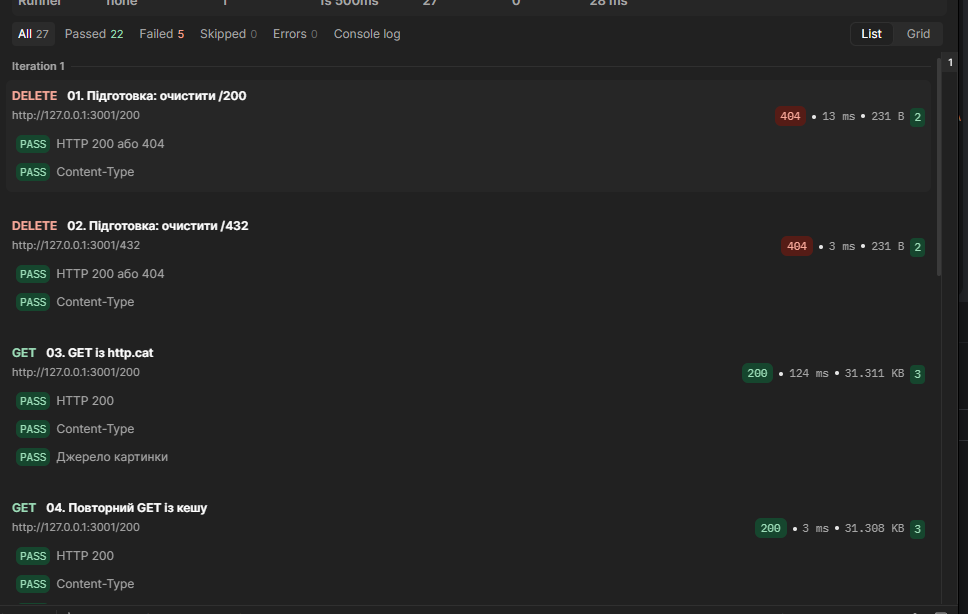
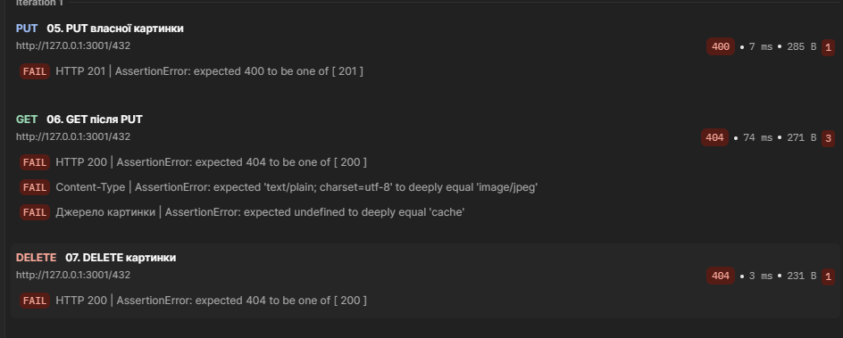
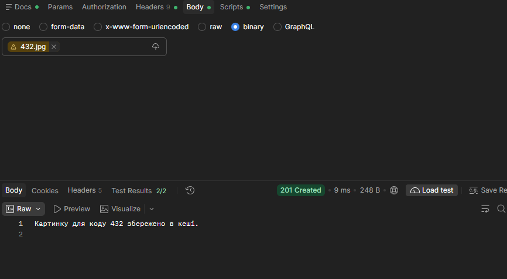
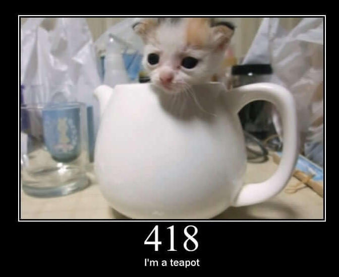

# Звіт до лабораторної роботи № 5

**Створення найпростішого кешуючого проксі-сервера на Node.js на базі модуля http**

Заклад освіти: **[вказати]**

Факультет / кафедра: **[вказати]**

Дисципліна: **Вебпрограмування на стороні сервера**

Виконав: **Олег Меленюк**

Група: **[вказати]**

Перевірив: **[ПІБ викладача]**

Рік: **2026**

> Номер роботи в наданій методичці — 5. Суфікс Git-імені `lab6` використано за окремою вимогою методички.

## Стан матеріалів

Реалізація GET, PUT і DELETE, перевірки помилок та експорт колекції готові. Успішне проходження Postman після вибору binary-файла підтверджене користувачем у розмові. Наявні знімки початкового невдалого запуску, успішного ручного PUT та картинки /418.

**Перед здачею потрібно доповнити:** реквізити титульної сторінки, версію Postman, GitHub URL, знімки підсумків двох успішних запусків Runner та їхні вимірювання часу. Ці відсутні дані не замінено вигаданими результатами.

## 1. Мета та завдання

Реалізувати HTTP-сервер-посередник, який отримує JPEG-зображення з http.cat, зберігає їх на диску й обслуговує повторні запити з кешу. Реалізувати завантаження власного зображення та видалення кешованого файла. Асинхронні операції виконувати через проміси та async/await.

Обов'язкові аргументи: `-h, --host`, `-p, --port`, `-c, --cache`. Головний файл — `main.js`; прямі сторонні залежності — лише `commander` та `superagent`. HTTP-сервер використовує `http`, файлові операції — `fs/promises`.

## 2. Середовище

{{ENVIRONMENT}}

Версія Postman: **[вказати з інтерфейсу Postman]**. Не слід підміняти її версією Node.js, колекції або розширення іншого редактора.

## 3. Репозиторій і структура

GitHub-репозиторій: **[додати URL]**. Під час підготовки звіту `git remote -v` не містив записів; публікацію не підтверджено.

Локальне ім'я Git до першого коміту встановлено командою:

```powershell
git config --local user.name "Олег Меленюк lab6"
```

Вивід `git log --oneline` перед комітом зі звітом (уже містить щонайменше 8 змістовних комітів):

```text
{{GIT_LOG}}
```

Структура основних файлів:

```text
main.js                         сервер
package.json                    налаштування npm і залежності
package-lock.json               зафіксоване дерево залежностей
.gitignore                      виключення з Git
cati.jpg                        оригінальне власне фото
output/custom/432.jpg            власне фото з рамкою для PUT
output/custom/README.md          опис підготовки фото
scripts/verify-errors.ps1        перевірки помилок та цілісності
scripts/README.md               пояснення цих перевірок
postman/lab5.postman_collection.json  експорт колекції
postman/check-sequence.ps1       перевірка порядку запитів через curl
postman/README.md                інструкція Postman
report/REPORT.md                 зібраний звіт із повними додатками
report/REPORT.template.md        редагований текст звіту
report/evidence/                 надані знімки екрана
scripts/build-report.ps1         відтворюване складання звіту
test.txt                        локальний журнал команд і результатів
cache/                          робочі картинки, виключено з Git
test-output/                    тестові кеші й артефакти, виключено з Git
```

Тека `node_modules/` та кеш не потрапляють до Git. `package-lock.json` дозволяє відтворити встановлення через `npm.cmd ci`. Для довільного шляху `--cache` всередині репозиторію треба також додати відповідне виключення; у цій роботі використовуються `cache/` і `test-output/`.

**Узгодження з вимогами:** за попереднім проханням користувача `test.txt`, `test.md` і `PLAN.md` виключені з Git. Методичка окремо вимагає `test.txt` у корені репозиторію. Повний журнал включено в додаток цього звіту, але це не замінює вимогу наявності файла в Git; перед фінальною здачею потрібно узгодити його повернення. Додаткові картинки кролів залишаються локальними та не потрібні для роботи сервера.

## 4. Обґрунтування реалізації

### 4.1. CLI та запуск

`commander.requiredOption()` перевіряє наявність трьох аргументів. `-h` означає host, тому довідка винесена на `--help`. Порт приймається лише як десяткове ціле число 1–65535; відхиляються дроби, текст і значення поза діапазоном. Порожні host та cache також відхиляються. Значення за замовчуванням не задано, оскільки опції обов'язкові.

Перед `listen(port, options.host)` виконується `await mkdir(..., { recursive: true })`. Це створює вкладені теки та допускає повторний запуск. Використання `type: module` дозволяє top-level await. На сервері немає `.then()`, `.catch()`, `.on()`, колбека listen або синхронних файлових API.

### 4.2. Шлях і відповіді

Спочатку перевіряється HTTP-метод, потім початковий `request.url`. Дозволений шлях має форму `/100`–`/599`. Запити з `../`, закодованими символами, додатковими сегментами або query-параметрами відхиляються. Альтернатива — нормалізувати URL; для одного числового ідентифікатора обрано строгий формат, щоб явно контролювати ім'я файла.

Файл кешу має ім'я `<код>.jpg`. Зображення `/404` є звичайним ресурсом: якщо його отримано, статус відповіді проксі — 200. Число в URL не є статусом поточної відповіді.

| Ситуація | Статус |
|---|---:|
| Успішний GET або DELETE | 200 |
| Створення або заміна через PUT | 201 |
| Неправильний шлях, порожній PUT | 400 |
| Помилка джерела або відсутній файл при DELETE | 404 |
| Недозволений метод | 405 та Allow: GET, PUT, DELETE |
| PUT понад 20 MiB | 413 |
| Інша помилка диска чи обробки запиту | 500 |

`sendText()` формує текстові відповіді з `text/plain; charset=utf-8`. Помилки обробки перехоплюються в async-обробнику createServer. Технічна причина записується в консоль, клієнт отримує зрозумілий текст. Якщо відповідь уже почалася або клієнт від'єднався, надіслати новий статус неможливо — з'єднання завершується.

### 4.3. GET і джерело

Спочатку виконується `readFile()` без кодування: результат — Buffer. Лише ENOENT означає промах кешу. При інших файлових помилках сервер повертає 500, а не маскує проблему зверненням до джерела.

При промаху виконується `await superagent.get(...).responseType('blob')`. У Node.js це дає Buffer. Встановлено таймаути 5 секунд до початку відповіді й 15 секунд на весь запит. Перед записом перевіряються image/jpeg та непорожнє двійкове тіло; повне декодування JPEG не виконується. Картинка зберігається перед відповіддю клієнтові.

Успішний GET має `Content-Type: image/jpeg` і `X-Image-Source: http.cat` або `cache`. Помилка superagent, включно з таймаутом чи відсутністю картинки, дає 404 без запису кешу за вимогою методички. Помилка запису кешу дає 500. Альтернатива 502 для збою зовнішнього сервера тут не застосована через умови завдання.

### 4.4. PUT і незмінність байтів

Тіло HTTP-запиту надходить потоком. `for await...of` очікує його частини, а `Buffer.concat()` об'єднує їх без перетворення на текст. Рядкове накопичення могло б пошкодити JPEG.

Порожнє тіло відхиляється до запису. Межа — 20 MiB на один PUT. Після перевищення межі частини більше не зберігаються в пам'яті; потік дочитується, після чого повертається 413. Передчасний вихід з асинхронного ітератора може зруйнувати сокет, тому обрано дочитування. При розриві з'єднання до кінця тіла запис не починається.

Створення й заміна повертають 201 відповідно до методички. Клієнт має надсилати JPEG, бо GET оголошує image/jpeg. Сервер зберігає непорожні байти без перекодування; він не доводить, що довільне тіло є коректним зображенням.

### 4.5. Запис і конкурентні запити

Прямий writeFile у кешований файл виявився недостатнім: у тесті до виправлення 6 із 10 паралельних GET отримали порожній або неповний файл.

Тепер `saveImage()` створює унікальну тимчасову теку всередині кешу через mkdtemp, записує файл повністю й замінює цільовий файл через rename. Тимчасові файли й теки прибираються у finally. Дані не обрізаються на початку запису.

На Windows конкурентна заміна одного файла іноді давала EPERM. Тому Map `activeRequests` зберігає проміс поточного запиту для кожного коду. Наступний запит цього коду очікує завершення попереднього. Різні коди можуть оброблятися паралельно. Допоміжні async-функції викликаються напряму, не передаються як колбеки.

Альтернативи: глобальна черга надмірно блокувала б різні картинки; лише тимчасовий файл не усунув усіх конфліктів Windows. Поточна черга діє лише в одному процесі; кілька незалежних серверів зі спільним кешем не координуються.

### 4.6. DELETE

`await unlink()` видаляє лише файл заданого коду. Попередня перевірка існування не потрібна, бо стан міг би змінитися між перевіркою й видаленням. ENOENT дає 404, успіх — 200, інші помилки — 500.

DELETE не звертається до джерела. Подальший GET може знову завантажити картинку. Повторний DELETE має інший статус, але однаковий кінцевий стан — файла немає; це пояснює ідемпотентність методу.

## 5. Перевірки через PowerShell і curl

Команди використовують `curl.exe`, щоб уникнути псевдоніма Invoke-WebRequest у Windows PowerShell. Тестові сервери працювали в окремих кешах; користувацький робочий кеш не очищався.

| Етап | Фактично перевірено | Результат |
|---|---|---|
| 1 | Залежності, синтаксис і запуск заглушки | Успішно |
| 2 | 20 запусків CLI | Очікувані коди завершення |
| 3 | 25 HTTP-запитів: URL, 405, тимчасові заглушки | Успішно на тому етапі |
| 4 | 10 HTTP-запитів GET; SHA-256 прямого джерела, кешу та відповіді | Збіг байтів |
| 5 | 14 запитів PUT, заміна, chunked, порожнє тіло, помилка диска | Успішно |
| 6 | 15 запитів DELETE та суміжних сценаріїв | Успішно |
| 7 | 50 HTTP-запитів і 148 перевірок після виправлень | 0 невідповідностей |
| 8 | 2 проходи по 11 запитів колекції через curl | 0 невідповідностей |
| 9 | Повторні 22 запити після отримання експорту Postman | 0 невідповідностей |

Заглушки 501 з етапу 3 належать історії розробки; у фінальному коді GET, PUT і DELETE реалізовані.

На етапі 7 перевірено неправильні шляхи, відсутність і недоступність джерела, 503, HTML або порожній JPEG замість картинки, таймаут, помилки читання/заміни/видалення, перервані та завеликі PUT, паралельні запити й незмінність байтів. Для відтворюваних збоїв URL джерела замінювався **лише в окремій тестовій копії main.js** на локальний тестовий сервер. Ці перевірки не є доказом збою реального http.cat; робочий код продовжує використовувати http.cat.

```powershell
npm.cmd run check
powershell.exe -NoProfile -ExecutionPolicy Bypass -File .\scripts\verify-errors.ps1
powershell.exe -NoProfile -ExecutionPolicy Bypass -File .\postman\check-sequence.ps1 -Port 32162
```

ExecutionPolicy Bypass діє лише для запущеного процесу PowerShell. Повні команди, відповіді, невдалі спроби й причини виправлень наведені в додатку В; успіх не приписано перерваним запускам.

## 6. Postman і браузер

Колекція містить 11 послідовних запитів: два підготовчі DELETE, перший GET, повторний GET, PUT власного фото, GET після PUT, DELETE, повторний DELETE, GET відсутньої картинки, POST та фінальний DELETE. Вісім обов'язкових сценаріїв покрито. Адресу й порт винесено в `baseUrl`.

Кожен запит перевіряє статус і Content-Type. GET додатково перевіряє X-Image-Source; помилковий GET очікує відсутність цього заголовка. POST перевіряє Allow. Post-response скрипти використовують pm.test у середовищі Postman; це окремий тестовий код, не колбек-інтерфейс Node.js-сервера.

Підготовчі DELETE та завершальне очищення роблять два запуски відтворюваними. Перший GET /200 знову має йти до джерела в кожному запуску. Жорсткої перевірки часу немає: мережеві затримки не є сталою величиною.

### Фактично надані результати

Початковий Runner-запуск мав 22 успішні й 5 невдалих перевірок. На знімку видно GET із джерела 124 мс та GET із кешу 3 мс.



Причина п'яти невдач — PUT без переданого binary-файла: 400 замість 201; після цього GET та DELETE не могли знайти картинку.



Після вибору файла ручний PUT повернув 201 і 2/2 успішні тести. На знімку його час — 9 мс.



Користувач повідомив про успішне виконання колекції та наявність повторного запуску. **Підсумкові скриншоти двох успішних Runner-запусків ще треба додати сюди.** Очікувана кількість тестів — 27, але зображень остаточних лічильників у наданих матеріалах немає.

| Успішний Runner-запуск | GET із джерела, мс | GET із кешу, мс | Знімок підсумків |
|---|---|---|---|
| 1 | [внести] | [внести] | [додати] |
| 2 | [внести] | [внести] | [додати] |

Окремі автоматичні вимірювання curl наведено нижче. Вони не підміняють вимірювання Postman:

| Серія curl | Запуск | Джерело, мс | Кеш, мс |
|---|---:|---:|---:|
| Підготовлена колекція | 1 | 153,455 | 2,384 |
| Підготовлена колекція | 2 | 70,215 | 2,007 |
| Експортована колекція | 1 | 148,180 | 3,202 |
| Експортована колекція | 2 | 104,746 | 3,487 |

Наданий користувачем знімок картинки /418 підтверджує її візуальне відображення:



Для PUT використовується `output/custom/432.jpg`: власне фото з підписом і рамкою. Рамку додано за допомогою imagegen; оригінал cati.jpg збережено. Сам сервер картинки не генерує й не редагує. Кролі для /200 і /404 також були завантажені через PUT у робочий кеш; вони не змінюють джерело http.cat і не використовувалися замість початкового GET у чистому тестовому кеші.

## 7. Висновки та обмеження

Реалізовано проксі з дисковим кешем та трьома HTTP-методами. У наведених вимірюваннях читання кешу займало приблизно 2–3,5 мс, звернення до джерела — приблизно 70–153 мс. Це спостереження для конкретних запусків, а не гарантія швидкості для будь-якого середовища.

Перевірка SHA-256 підтвердила незмінність двійкових даних при GET і PUT. Виявлення неповних відповідей при конкурентному записі обґрунтувало тимчасові файли та послідовне обслуговування одного коду. Після виправлення фінальні перевірки пройшли без невідповідностей.

Кеш може застаріти, якщо картинку змінять на http.cat: автоматичного строку придатності немає. PUT може замінити картинку довільними байтами, а повної перевірки JPEG немає. Великі або повільні одночасні завантаження все ще потребують контролю ресурсів; ліміт 20 MiB не є глобальним лімітом пам'яті. Черга працює в одному процесі. Аварійне завершення може залишити тимчасову теку; стійкість до вимкнення живлення не перевірялася.

Можливі подальші вдосконалення: строк придатності кешу, перевірка формату JPEG, обмеження кількості одночасних завантажень і тривалості повільного PUT, очищення залишених тимчасових тек. Ці можливості не заявляються реалізованими.

**Власні додаткові спостереження студента:** [доповнити після двох успішних Runner-запусків і усної підготовки].

## 8. Короткі тези для захисту

1. Сервер має роль reverse proxy до фіксованого джерела: клієнт звертається до нашої адреси, а ми визначаємо джерело.
2. Cache hit — файл знайдено на диску; cache miss — потрібне завантаження. Кеш економить зовнішні запити, але може застаріти.
3. GET читає, PUT створює/замінює ресурс за відомим URL, DELETE видаляє. PUT і DELETE ідемпотентні за кінцевим станом; статуси повторних запитів можуть різнитися.
4. Content-Type описує формат тіла. JPEG передається як Buffer, текстове повідомлення — як UTF-8. Неправильний заголовок може завадити відображенню.
5. Проміс може бути pending, fulfilled або rejected. await очікує результат; відхилення обробляється try/catch.
6. Тіло запиту є потоком: частини приходять поступово. Асинхронний ітератор дозволяє читати їх без .on('data').
7. superagent із await повертає відповідь або кидає помилку. Помилка зовнішнього запиту за методичкою перетворюється на 404.
8. Послідовний доступ одного коду запобігає конфліктам GET/PUT/DELETE. Це не блокування для всіх процесів ОС.
9. Postman-колекція зберігає запити, змінні та тести; Runner виконує їх у визначеному порядку.
10. 405 супроводжується Allow. 500 означає внутрішню помилку, а 413 — перевищення допустимого розміру тіла.

## Джерела

- Надана методичка `test.md` — вимоги до лабораторної роботи.
- [Node.js fs/promises](https://nodejs.org/api/fs.html) — файлові операції з промісами.
- [SuperAgent](https://forwardemail.github.io/superagent/) — запити та обробка відповіді.
- [Postman: тести](https://learning.postman.com/docs/tests-and-scripts/write-scripts/test-scripts/) — Post-response і Runner.
- [Postman: робоча тека](https://learning.postman.com/docs/getting-started/installation/settings/working-directory) — відносні шляхи binary-файлів.

## Додаток А. package.json і .gitignore

### package.json

```json
{{PACKAGE_JSON}}
```

### .gitignore

```gitignore
{{GITIGNORE}}
```

## Додаток Б. Повний main.js

```javascript
{{MAIN_JS}}
```

## Додаток В. Повний локальний test.txt

Журнал є історичним: він містить проміжні заглушки, невдалі спроби та перевірки попередніх версій. Це не перелік лише успішних тестів фінального коду. Вміст включено повністю на момент складання звіту.

```text
{{TEST_LOG}}
```
